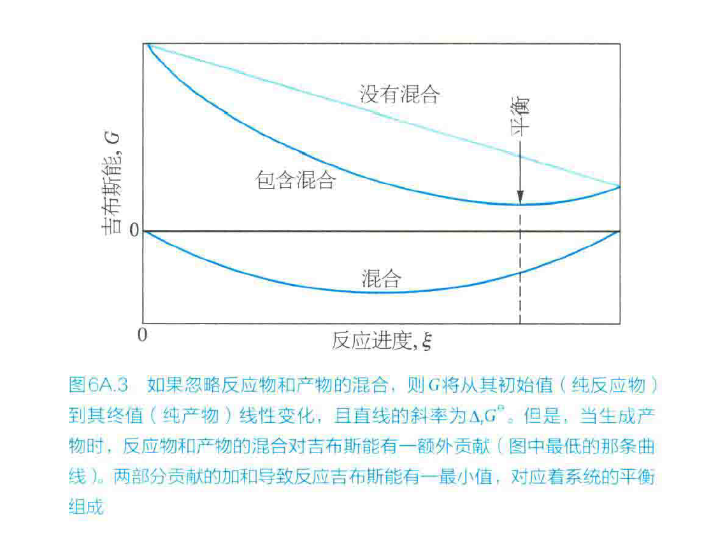

## 一、引入

我们考虑一个**等温等压**的反应体系，反应平衡的判据是什么？Atkins 上已经明确说明，平衡条件是：

$$
\Delta_r G = (\frac{\partial G}{\partial ξ})_{T,P} = 0
$$

其中$\Delta_r G=0$包括两个部分：一部分是$\Delta_rG^\theta$，另一部分是$\Delta_{mix}G$，这两部分同时作用产生了化学平衡。

因此我们通过这个公式得到了平衡常数$K$的表达式：

$$
\Delta_r G = \Delta_rG^\theta + \Delta_{mix}G = \Delta_rG^\theta + RT\ln K = 0
$$

然而，其本质判据为$\Delta_r G=0$，这在等温等压条件下是平衡条件，对于等温等容以及更加复杂的条件下，这一判据是否可以使用呢？

根据我们物理化学第一课的分析，等温等压用吉布斯自由能判断平衡，等温等容用亥姆霍兹自由能判断平衡。因此，我们可以通过判断$\Delta_r A=0$来判断等温等容反应的平衡。

下面我们将要证明，这两个判据是等价的，并提出一个更加基本的化学势判据。

## 二、化学势判据

对于任何化学反应，唯一的平衡判据是：

$$
\sum ν_i μ_i = 0
$$

其中$ν_i$是第$i$个组分的反应计量数，$μ_i$是第$i$个组分的化学势。

先回顾化学势的定义：

$$
μ_i = (\frac{\partial G}{\partial n_i})_{T,P,n_{j≠i}} = (\frac{\partial A}{\partial n_i})_{T,P,n_{j≠i}}
$$

> ### 欧拉齐次定理
>
> 若 $f$ 是 $m$ 次齐次函数：
>
> $$
> f(\lambda x_1,\dots,\lambda x_k)=\lambda^m f(x_1,\dots,x_k)
> $$
>
> 则对 $\lambda$ 求导并取 $\lambda=1$：
>
> $$
> \sum_i x_i \frac{\partial f}{\partial x_i} = m f(x)
> $$
>
> $m=1$ 时即
>
> $$
> f = \sum_i x_i \frac{\partial f}{\partial x_i}
> $$

由欧拉齐次定理，我们将$G$表示成与$T，P，n_i$的函数，其中$T，P$是固定强度量，$n_i$是被缩放的广延量：

$$
G(T,P,n_1,\dots,n_k) = \sum_i n_i (\frac{\partial G}{\partial n_i})_{T,P,n_j} = \sum_i n_i μ_i
$$

对$ξ$求偏导，得到：

$$
(\frac{\partial G}{\partial ξ})_{T,P} = \sum_i ν_i μ_i + \sum_i n_i (\frac{\partial μ_i}{\partial ξ})_{T,P}
$$

Gibbs–Duhem 定理在等温条件下给出：

$$
-V\,\mathrm dP + \sum_i n_i\,\mathrm dμ_i = 0
$$

我们考虑等温等压条件，因此 $\sum_i n_i\,\mathrm dμ_i = 0$

从而得到：

$$
\mathrm dμ_i = (\frac{\partial μ_i}{\partial ξ})_{T,P} \mathrm dξ
$$

$$
\sum_i n_i (\frac{\partial μ_i}{\partial ξ})_{T,P} \mathrm dξ = 0
$$

即：

$$
\sum_i n_i (\frac{\partial μ_i}{\partial ξ})_{T,P} = 0
$$

因此：

$$
\Delta_r G = (\frac{\partial G}{\partial ξ})_{T,P} = \sum_i ν_i μ_i = 0
$$

到此，我们证明了化学势判据的等价性。

实际上，化学势判据在所有条件下都适用。在化学平衡处，由热力学第二定律，对于孤立系统，其平衡态是所有与约束相容的宏观态中熵最大的那个。

$$
\left(\frac{\partial S}{\partial \xi}\right)_{U,V}
= \sum_i \nu_i \left(\frac{\partial S}{\partial n_i}\right)
= -\frac{1}{T}\sum_i \nu_i \mu_i = 0
$$

对孤立系，$S=S(U,V,\{n_i\})$。固定 $U,V$，允许内部变量作虚变动，平衡要求 $\delta S=0$。对三类内部自由度分别得到：

- **热平衡**（允许两子系统间传热）：$\partial S/\partial U$ 处处相等，即 $1/T$ 均匀 → $T$ 均匀；
- **力平衡**（允许体积重排）：$\partial S/\partial V$ 处处相等，即 $P/T$ 均匀 → 在热平衡下 $P$ 均匀；
- **物质平衡**（允许组分在各处重新分配）：$\partial S/\partial n_i$ 处处相等，即 $-\mu_i/T$ 均匀 → 在热平衡下 $\mu_i$ 均匀。

因此，**化学势判据是比吉布斯自由能判据更基本的判据**。

## 三、标准摩尔吉布斯自由能表与化学势的关系

由刚才推导可知，

$$
G(T,P,n_1,\dots,n_k) = \sum_i n_i (\frac{\partial G}{\partial n_i})_{T,P,n_j} = \sum_i n_i μ_i
$$

对于单一组分，其标准摩尔吉布斯自由能与化学势在数值上相等。

$$
G_m^\theta(T,P,n_1) = μ_1^\theta
$$

因此，**标准摩尔吉布斯自由能表就是标准化学势表**。

## 四、标准摩尔亥姆霍兹自由能表

考虑一个**等温等容体系**。我们知道，反应的平衡条件是：

$$
\Delta_r A = (\frac{\partial A}{\partial ξ})_{T,V} = 0
$$

类似于刚才的推导，我们知道：

$$
A(T,V,n_1,\dots,n_k) = \sum_i n_i (\frac{\partial A}{\partial n_i})_{T,V,n_j} - P V  = \sum_i n_i μ_i -P V
$$

$$
\left(\frac{\partial A}{\partial \xi}\right)_{T,V} = -V\left(\frac{\partial P}{\partial \xi}\right)_{T,V} + \sum_i \nu_i \mu_i + \sum_i n_i\left(\frac{\partial \mu_i}{\partial \xi}\right)_{T,V}
$$

Gibbs–Duhem 方程在等温条件下给出：

$$
-V\,\mathrm dP + \sum_i n_i\,\mathrm d\mu_i = 0
$$

故在固定 $T,V$ 下：

$$
\sum_i n_i\left(\frac{\partial \mu_i}{\partial \xi}\right)_{T,V} = V\left(\frac{\partial P}{\partial \xi}\right)_{T,V}
$$

第一项与第三项相消，剩下：

$$
\left(\frac{\partial A}{\partial \xi}\right)_{T,V} = \sum_i \nu_i \mu_i
$$

而同样地：

$$
\left(\frac{\partial G}{\partial \xi}\right)_{T,P} = \sum_i \nu_i \mu_i
$$

因此：

$$
\Delta_{\mathrm r}A = \Delta_{\mathrm r}G = \sum_i \nu_i \mu_i
$$

我们又证明了一遍等价性。

而对于一张标准摩尔亥姆霍兹自由能表，对于单一纯组分，$\mu = A_{\mathrm m} + PV_{\mathrm m}$。直接使用标准摩尔亥姆霍兹自由能表是难以得到正确的化学势的。换言之，$\Delta_{mix}A$形式并不简单。这就是为什么我们使用标准摩尔吉布斯自由能表的原因。

现给出一张表格：

$$
\begin{array}{c|c|c|c}
\text{势} & \text{固定强度量} & \text{被缩放的广延量} & \text{欧拉关系}\\[2pt]
\hline
U & — & S,V,n_i & U=TS-PV+\sum n_i\mu_i\\[2pt]
H & P & S,n_i & H=TS+\sum n_i\mu_i\\[2pt]
A & T & V,n_i & A=-PV+\sum n_i\mu_i\\[2pt]
G & T,P & n_i & G=\sum n_i\mu_i
\end{array}
$$

## 五、结论

1. **化学势判据$\sum_i \nu_i \mu_i = 0$是比吉布斯自由能判据更基本的判据**。
2. **标准摩尔吉布斯自由能表就是标准化学势表**
