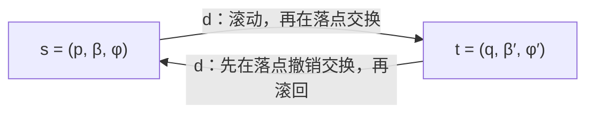

## 游戏与论文

[打开对应游戏](/cube/)

**——4×4 棋盘游戏《Cube》的数学分析**

## 摘要

本文研究浏览器小游戏《Cube》：在 $4\times 4$ 棋盘上滚动一个六面立方体，每次滚动后让立方体与落点接触的一面和落点交换颜色，目标是在规定步数内让立方体六面全蓝。我们把完整局面写成“位置、朝向、棋盘颜色、六面颜色”，再证明朝向可以由六个空间方向上的面色吸收，从而得到一个只含位置、棋盘蓝格集合与面色集合的约化状态。本文证明蓝色位置总数恒为 6，证明四个滚动生成元生成的旋转群为 24 阶并与对称群 $S_4$ 同构；把求解表述为状态图上的多源反向广度优先搜索，说明反向操作必须先撤销落点交换再滚回，给出位掩码编码、距离表复用、正确性证明与复杂度分析。按源码语义重建的穷举计算得到 $1\,193\,808$ 个守恒状态、$1\,790\,712$ 条无向边，12 个关卡的最短步数恰为 6 到 17，全部 $128\,128$ 个合法起始局面（其中 $80\,080$ 个起点为白格）可解，最大距离为 17，而全部状态的最大距离为 18。本文还讨论 $n\times n$ 棋盘、其他正多面体、双向搜索、对称性约简与若干开放问题。

## 关键词

滚动立方体；状态图；颜色守恒；立方体旋转群；对称群 $S_4$；反向广度优先搜索；位掩码；最短路径

## 1 引言

《Cube》是一个规则很小、状态却不小的益智游戏。棋盘固定为 $4\times 4$，立方体占据其中一格，初始时棋盘上恰有六个蓝格，立方体六面全白。玩家用方向键、WASD、点击相邻格或滑动来让立方体滚动一格。每次滚动后，立方体与落点接触的那一面和落点交换颜色：白面落到蓝格会“拾取”蓝色，蓝面落到白格会“放下”蓝色，两色相同则不变。起点不触发交换。六面全蓝即获胜。每一关的步数上限等于从该关初始局面出发的理论最少步数，用完仍未完成就失败；越界不计步，撤销返还一步，最后一步完成仍算获胜。

这套规则参考了 Simon Tatham 的 Cube [1]。官方说明的要点是：滚动立方体，把棋盘上的蓝色方块收集到立方体上，并在最少步数内让所有蓝色同时位于立方体上；“每次滚动后，落点方格与接触的立方体面交换颜色”[1]。本游戏把这一机制固定为 $4\times 4$、六个蓝格、六面全蓝的目标，并把“最少步数”直接变成每关的预算。

本文关心四个问题。第一，为什么蓝色不会凭空产生或消失？第二，滚动究竟生成了怎样的立方体旋转群？第三，如何把“最少步数”严格转化为图上的最短路径？第四，一个只有 $4\times 4$ 棋盘的游戏，状态空间到底有多大，是否真的都能解？本文的贡献是把这些问题放在同一个模型里回答，并用源码核对与独立穷举给出可复现的数据。

## 2 规则与基本概念

### 2.1 棋盘、立方体与一步操作

把棋盘格子编号为 $0,1,\dots,15$，按行优先排列：第 $y$ 行第 $x$ 列（$x,y\in\{0,1,2,3\}$）的编号是 $p=4y+x$。界面上列用 A 到 D，行用 1 到 4，所以左下角是 A1，右上角是 D4。立方体始终占据一个格子，但它不是棋盘颜色的一部分；棋盘颜色描述的是 16 个格子各自是蓝还是白。

立方体有六个面。本文用世界方向给它们命名：上 $T$、下 $B$、北 $N$、南 $S$、西 $W$、东 $E$。这里的“北”对应界面的上，“南”对应下，“西”对应左，“东”对应右。源码把六个方向按 $T,B,N,S,W,E$ 的顺序编码为 $1,2,4,8,16,32$ 六个二进制位。滚动方向用 $d=0,1,2,3$ 表示上、右、下、左，位置增量为
$$
e_0=(0,-1),\quad e_1=(1,0),\quad e_2=(0,1),\quad e_3=(-1,0).
$$
若 $p+e_d$ 越界，这一步不合法，游戏状态不变，也不计步。

一步的物理过程是“先滚动，后交换”。滚动把立方体翻到相邻格，同时把六个空间方向上的颜色按一个四分之一转重新排列；然后，新的底面（接触面）与落点交换颜色。注意交换发生在落点，不是在起点。起点不触发交换，所以初始局面虽然立方体坐在一个格子上，这个格子不会自动变色。

胜利条件是立方体六个面全蓝。源码用一个 6 位掩码表示六个空间方向的面色，全蓝就是掩码 $63$。步数预算由关卡字段给出；当步数用完但六面已经全蓝时，源码先判胜利、再判失败，因此最后一步完成是允许的。

### 2.2 “六份蓝色”到底是什么意思

游戏页面的数学说明写道：“棋盘 16 格与立方体 6 面上的蓝色总数始终为 6。”这句话容易被误读成“棋盘有 6 份、立方体另有 6 份，共 12 份”，或者“16+6=22 份”。准确的读法是：棋盘 16 格和立方体 6 面一共是 22 个可以承载蓝色的位置，其中恰有 6 个位置是蓝色。初始时是“棋盘 6 个蓝格 + 立方体 0 个蓝面”，目标是“棋盘 0 个蓝格 + 立方体 6 个蓝面”。中间可以是 $5+1$、$3+3$、$0+6$ 等任意分配，但总数始终是 6。

这个读法直接来自源码。棋盘颜色用 16 位掩码 `board` 表示，六面颜色用 6 位掩码 `faces` 表示（`popcount` 指二进制表示中 1 的个数）；一次交换要么两边都不变，要么同时翻转一个棋盘位和一个面位。因此 `popcount(board) + popcount(faces)` 不变。初始关卡数据中每个 `board` 的 popcount 都是 6，`faces` 都是 0；目标 `faces=63` 时，`board` 必须是 0。本文第 3 节把这一点写成定理。

### 2.3 为什么只记“空间方向上的颜色”

一个自然的疑问是：立方体滚动时朝向变了，为什么求解器只存 `pos`、`board`、`faces` 三个字段，不存朝向？答案不是“朝向不重要”，而是“朝向已经被六个空间方向上的颜色吸收了”。只要知道当前每个世界方向上是蓝是白，再加上位置和棋盘颜色，下一步的结果就完全确定；至于哪个物理面叫什么名字，规则并不关心。

第 3.1 节会把这一点写成完整状态到约化状态的映射，并说明它为什么不丢失未来信息。这里先给出直观版本：滚动是对六个空间方向的置换，交换只改写新的底面。两者都只作用于“世界方向上的颜色”，不作用于物理面的标签。因此，把物理面的标签视为不可区分，是精确的商，不是近似。

## 3 数学建模

### 3.1 状态与状态空间

设棋盘格集合为 $\mathcal B=\{0,\dots,15\}$，方向集合为 $\mathcal D=\{T,B,N,S,W,E\}$。一个约化状态写成三元组
$$
s=(p,\beta,\varphi),
$$
其中 $p\in\mathcal B$ 是立方体位置，$\beta\subseteq\mathcal B$ 是蓝格集合，$\varphi\subseteq\mathcal D$ 是蓝色面所在的世界方向集合。由于蓝色总数守恒，物理上可达的状态满足
$$
|\beta|+|\varphi|=6.
$$
把所有满足这个等式的三元组记为 $\mathcal U$。其大小为
$$
|\mathcal U|=16\binom{22}{6}=16\times 74\,613=1\,193\,808.
$$
理由是：22 个位置中选 6 个放蓝色，再选立方体的位置，共 16 种。

如果坚持题目最初的说法“局面 = 位置 + 立方体朝向 + 棋盘颜色 + 六面颜色”，可以写得更完整。给六个物理面贴上标签，令 $g\in R$ 是立方体的朝向（$R$ 是第 3.5 节的 24 阶旋转群），$c\in\{0,1\}^6$ 是标签面上的颜色。空间颜色 $\varphi$ 由
$$
\varphi(w)=c(g^{-1}w),\qquad w\in\mathcal D
$$
给出。完整状态是 $(p,g,\beta,c)$。对每个约化状态 $(p,\beta,\varphi)$ 和每个朝向 $g$，颜色 $c=g^{-1}\varphi$ 被唯一确定，所以完整状态总数是
$$
24\times 16\binom{22}{6}=28\,651\,392.
$$
也就是说，约化状态恰好是完整状态在“同时重标朝向与物理面”下的商，每个纤维有 24 个元素。代码只存约化状态，表就小了 24 倍；这不是丢信息，而是丢掉了不影响未来的标签信息。

还需要说明：为什么约化后的转移是良定义的？滚动把空间颜色按 $\rho_d$ 重排，交换只改写新的底面 $B$。用完整状态写，
$$
g'=\rho_d g,\qquad
\varphi'=g'c'=\rho_d(\varphi)\triangle\{B\}\ \text{或}\ \rho_d(\varphi),
$$
右端只含 $\varphi$，不含 $g$ 或 $c$ 的标签。因此，给定 $(p,\beta,\varphi)$，下一步的 $(p',\beta',\varphi')$ 完全确定。不同历史到达同一约化状态后，未来完全一样；这就是求解器可以合并状态的依据。

### 3.2 转移函数

设滚动方向为 $d$，落点 $q=p+e_d$。若 $q\notin\mathcal B$，记 $\operatorname{Move}(s,d)=\bot$。否则先滚动：
$$
\psi=\rho_d(\varphi),
$$
其中 $\rho_d$ 是六个世界方向的置换。然后在新位置 $q$ 交换：
$$
(\beta',\psi')=
\begin{cases}
\bigl(\beta\triangle\{q\},\ \psi\triangle\{B\}\bigr),&
\mathbf 1_{\beta(q)}\ne \mathbf 1_{B\in\psi},\\[2mm]
(\beta,\psi),& \text{否则}.
\end{cases}
$$
这里 $\triangle$ 是对称差，$\mathbf 1_{\beta(q)}$ 表示落点是否为蓝，$\mathbf 1_{B\in\psi}$ 表示滚动后的底面是否为蓝。最后
$$
\operatorname{Move}(s,d)=(q,\beta',\psi').
$$
如果两色相同，交换不产生任何变化；如果两色不同，就同时翻转落点和底面。无论哪种情况，蓝色总数都不变。

四个滚动的方向置换可以直接从源码的 `permutations` 表读出。按“旧方向到新方向”的轮换记号，它们是
$$
\rho_0=(T\,N\,B\,S),\quad
\rho_1=(T\,E\,B\,W),\quad
\rho_2=(T\,S\,B\,N),\quad
\rho_3=(T\,W\,B\,E).
$$
其中 $\rho_2=\rho_0^{-1}$，$\rho_3=\rho_1^{-1}$。例如向上滚时，旧的上面转到北面，旧的北面转到下面，旧的下面转到南面，旧的南面转到上面；左右两面不动。这个轮换与“先滚动、再交换”的顺序一起，构成完整的转移。

### 3.3 反向操作：先撤销交换，再滚回

正向操作是“滚动，然后在落点交换”。因此反向操作不能简单地“先滚回，再交换”。如果先滚回，交换会发生在旧位置而不是落点，颜色就错了。正确的顺序是：

1. 在当前落点 $q$ 做一次交换，把刚才的交换撤销；
2. 再沿相反方向滚回 $p=q-e_d$。

形式化地，给定当前状态 $s'=(q,\beta',\psi')$，要找沿方向 $d$ 到达它的前驱：
$$
(\beta,\psi)=\operatorname{Exchange}_q(\beta',\psi'),\qquad
\varphi=\rho_d^{-1}(\psi)=\rho_{d+2}(\psi),\qquad
p=q-e_d.
$$
这里 $\operatorname{Exchange}_q$ 就是对格子 $q$ 和底面 $B$ 做交换。交换是对合，所以做两次等于不做；旋转的逆是 $\rho_{d+2}$。于是得到前驱 $(p,\beta,\varphi)$。

**引理 1（反向操作的正确性）.** 对任意合法状态 $s$ 和方向 $d$，若 $t=\operatorname{Move}(s,d)\ne\bot$，则按上述步骤从 $t$ 得到的 $s'$ 满足 $s'=s$；反之，$\operatorname{Move}(s',d)=t$。

**证明.** 设 $s=(p,\beta,\varphi)$，$q=p+e_d$，$\psi=\rho_d(\varphi)$，$t=(q,\beta',\psi')$，其中 $(\beta',\psi')$ 是交换后的结果。反向第一步对 $q$ 做交换。由于交换只比较 $q$ 与 $B$，且交换是对合，$(\beta',\psi')$ 经过同一次交换回到 $(\beta,\psi)$。第二步用 $\rho_{d+2}=\rho_d^{-1}$ 作用，得到 $\rho_d^{-1}(\psi)=\varphi$；位置回到 $q-e_d=p$。因此 $s'=s$。反向论证相同：从 $s'$ 出发按方向 $d$ 滚动，落点又是 $q$，旋转得到 $\psi$，交换得到 $(\beta',\psi')$，即 $t$。证毕。

这个引理是反向 BFS 能够工作的关键。它同时说明：源码中的 `previous` 先调用 `exchange(s)`，再用 `rotations[(d+2)%4]` 滚回，顺序不是实现细节，而是数学上唯一正确的顺序。

下面的交换图概括了正向与反向的关系：



### 3.4 颜色守恒定理

**定理 1（蓝色总数守恒）.** 对任意合法状态 $s=(p,\beta,\varphi)$ 和任意一步合法移动，量
$$
Q(\beta,\varphi)=|\beta|+|\varphi|
$$
不变。特别地，从初始的“六蓝格、六白面”出发，任何可达状态都满足 $Q=6$。

**证明.** 滚动只把 $\varphi$ 按 $\rho_d$ 置换，基数不变。交换分两种情况：若落点颜色与底面颜色相同，$\beta$ 和 $\varphi$ 都不变；若不同，则 $\beta$ 翻转一个格子（增加或减少一个蓝格），同时 $\varphi$ 翻转一个面（减少或增加一个蓝面），两个基数一个加一、一个减一，总和不变。越界移动不改变状态，也不改变 $Q$。初始时 $|\beta|=6$，$|\varphi|=0$，故 $Q=6$。证毕。

**推论 1.** 目标状态必须满足 $\beta=\varnothing$、$\varphi=\mathcal D$。也就是说，六面全蓝时棋盘必然全白，六份蓝色全部在立方体上。

这个推论说明，页面说的“把棋盘上的六块蓝色收进立方体”不是比喻，而是守恒律的直接结果：目标要求立方体有 6 个蓝面，总数只有 6，所以棋盘不能再有蓝格。

### 3.5 滚动生成的旋转群

四个滚动方向对应四个四分之一转。它们生成整个立方体旋转群，而这个群有 24 个元素，同构于 $S_4$（四个对象的全部置换组成的对称群，共有 $4!=24$ 个元素）。这不是本游戏特有的巧合，而是立方体对称性的标准事实 [2,4]。下面给出一个不依赖“查表”的证明。

**定理 2（滚动生成 $S_4$）.** 令 $R$ 为立方体的 24 个保向旋转组成的群，令
$$
G=\langle \rho_0,\rho_1,\rho_2,\rho_3\rangle
$$
为四个滚动置换生成的群。则 $G=R$，且 $G\cong S_4$。

**证明.** 把立方体的四条体对角线编号为 $1,2,3,4$。每个保向旋转都置换这四条对角线，于是得到一个同态 $\theta:R\to S_4$。非恒等的旋转至少移动一条体对角线：绕面心轴的 $90^\circ$ 旋转四循环四条对角线，绕体对角线的 $120^\circ$ 旋转固定一条、三循环其余三条，绕棱中点的 $180^\circ$ 旋转固定两条并交换另外两条，绕面心轴的 $180^\circ$ 旋转成对交换四条。因此 $\theta$ 是单射，$R$ 同构于 $S_4$ 的一个 24 阶子群，即 $S_4$ 本身。

现在看 $\rho_0$ 和 $\rho_1$。它们分别是绕水平轴的四分之一转，作用在四条体对角线上都是 4-循环。两个绕互相垂直轴的四分之一转的复合是一个绕体对角线的三分之一转，因而在四条对角线上是一个 3-循环。用矩阵验证：在适当坐标下
$$
R_y(90^\circ)R_x(90^\circ)=
\begin{pmatrix}
0&1&0\\
0&0&-1\\
-1&0&0
\end{pmatrix},
$$
其迹为 0、行列式为 1，特征值为 $1,e^{\pm 2\pi i/3}$，所以阶为 3，旋转轴是一条体对角线。于是 $G$ 作用在四条对角线上，既含 4-循环又含 3-循环。由拉格朗日定理，$4\mid |G|$ 且 $3\mid |G|$，故 $12\mid |G|$；又 $G$ 通过该作用嵌入 $S_4$，故 $|G|\in\{12,24\}$。若 $|G|=12$，则其像为 $S_4$ 的指数 2 子群，只能是 $A_4$；但 $A_4$ 不含 4-循环，矛盾。因此 $|G|=24$，$G\cong S_4$。而 $R$ 本身也是 24 阶且包含 $G$，故 $G=R$。证毕。

这个证明用到了两个标准事实：指数 2 的子群是 $A_4$，以及 $A_4$ 不含 4-循环。前者是因为指数 2 子群正规，且 $S_4/A_4$ 的商群阶为 2；后者是因为 4-循环是奇置换。证明没有依赖具体配色，因此对任意初始朝向都成立。

把 24 个朝向作为顶点，把四个基本滚动作为生成元，得到 Cayley 图
$$
\operatorname{Cay}\bigl(R,\{\rho_0,\rho_1,\rho_2,\rho_3\}\bigr).
$$
Cayley 图以群元素为顶点、以生成元为边，是研究群作用的标准工具 [3]。
因为 $\rho_2=\rho_0^{-1}$、$\rho_3=\rho_1^{-1}$，每条边都可以双向走，所以这是一个 24 个顶点的 4-正则无向图。从单位元出发做 BFS，各层大小是
$$
1,\ 4,\ 10,\ 8,\ 1,
$$
直径为 4。也就是说，如果不考虑棋盘边界和颜色交换，任何朝向最多四步滚动就能转到。这个事实有助于理解滚动生成元，但不能直接当作本游戏的步数下界：本游戏的目标是颜色条件，而颜色交换会改变面色的分布，目标并不是某个固定朝向。

从位置看，每次滚动把 $p$ 沿 $4\times 4$ 网格的一条边移动一格。因此状态图到网格图有自然的投影：每条状态边都映到一条网格边。投影的纤维是颜色配置。由于交换是否发生取决于落点颜色，状态图不是“网格图 × 颜色”的简单直积，而是一个带颜色反馈的扩展结构。这个结构正是下一节要分析的配置图。

## 4 核心理论

### 4.1 状态图与目标集

定义状态图 $\mathcal G=(\mathcal U,E)$：顶点是全部 $1\,193\,808$ 个守恒状态，若存在方向 $d$ 使 $\operatorname{Move}(s,d)=t$，则连一条有向边 $s\to t$。由引理 1，每条边都有反向边，所以 $\mathcal G$ 可以看作无向图；我们将在命题 3 中确认它连通。

目标集是
$$
Z=\{(p,\varnothing,\mathcal D):p\in\mathcal B\}.
$$
它有 16 个元素：立方体可以在任意格子，棋盘全白，六面全蓝。对状态 $s$，定义
$$
d(s)=\min\{k\ge 0:\text{存在 }k\text{ 步从 }s\text{ 到达某个 }z\in Z\}.
$$
若不存在这样的路径，则 $d(s)=\infty$。最少步数就是 $d(s)$。

**引理 2（状态合并）.** 若两条不同的操作历史到达同一个约化状态 $s=(p,\beta,\varphi)$，则从 $s$ 出发的任意方向序列产生的后续状态和最终结果完全相同。

**证明.** 转移函数 $\operatorname{Move}$ 只依赖 $(p,\beta,\varphi)$ 和方向 $d$，不依赖历史。对序列长度归纳即可。证毕。

这个引理是 BFS 只访问每个状态一次的依据，也是“不需要区分物理面标签”的形式化表达。两个只有物理标签不同、空间颜色相同的完整状态，在约化模型中是同一个顶点；它们的未来完全一致。

### 4.2 连通性与可解性

**命题 3（$4\times 4$ 的穷举定理）.** 在 $4\times 4$ 棋盘上，全部 $1\,193\,808$ 个守恒状态属于同一个连通分量，且该分量包含 16 个目标状态。因此每个合法起始局面都可解。全部状态到目标的最大距离是 18；限制到合法起始局面（棋盘 6 个蓝格、六面全白），最大距离是 17。

**证明（计算机辅助穷举）.** 按第 5 节的算法，从 16 个目标状态同时出发，沿 `previous` 定义的反向边做 BFS。访问表的大小是 $2^{22}\cdot 16$，实际非零项为 $1\,193\,808$，恰好等于 $16\binom{22}{6}$。由于 `previous` 是 `move` 的逆（引理 1），每条被遍历的反向边都对应一条正向边；BFS 结束时所有守恒状态都被访问，说明每个状态都能沿正向边到达某个目标。反向路径反转就是一条合法解。又因为每条边可逆，任取两个状态 $u,v$，可以先从 $u$ 到目标、再从目标反向到 $v$，所以整个状态图连通。层数统计给出最大距离 18；对 $16\binom{16}{6}=128\,128$ 个合法起始局面单独统计，最大距离为 17。证毕。

这个证明是穷举式的，依赖“源码语义被正确重建”这一前提。本文做了三项交叉校验：第一，所有被访问状态都满足 $|\beta|+|\varphi|=6$；第二，12 个关卡的最短步数与页面标注逐一相符；第三，状态总数与组合公式 $16\binom{22}{6}$ 完全一致。因此可以把命题 3 看作对这份源码的严格计算验证，而不是对任意 $n$ 的一般定理。一般 $n$ 的纯组合证明仍是开放问题（第 7 节）。

一个直接的步数下界来自面数。

**命题 4（六步下界）.** 对任意状态 $s=(p,\beta,\varphi)$，
$$
d(s)\ge 6-|\varphi|.
$$
特别地，合法起始局面 $|\varphi|=0$，所以至少需要 6 步。

**证明.** 一步最多让蓝色面数增加 1：滚动只置换面，不改变 $|\varphi|$；交换最多翻转一个面位。要从 $|\varphi|$ 增加到 6，至少需要 $6-|\varphi|$ 步。证毕。

这个下界也是 A* 可以使用的启发函数 $h(s)=6-|\varphi|$。它是一致的：沿一条边，$|\varphi|$ 最多变化 1，所以 $h$ 最多变化 1，不会高估。它很弱，但足以解释为什么第 1 关的最优值是 6，且这个下界在该关是紧的。

### 4.3 最短路径、双向搜索与对称性

在无权图上，BFS 首次访问一个顶点时的层数就是最短距离；BFS 与 A* 的标准表述见 [7]。由于目标有 16 个，反向 BFS 实际上是多源 BFS：把 16 个目标同时入队，距离为 0，然后逐层向外扩展。这样一次建表就能回答“任意状态到最近目标的最短距离”，而不需要为每个关卡单独搜索。

如果只查询一个起始状态，双向 BFS 是另一种选择：正向从起始状态、反向从目标集同时搜索，两个前沿相遇时停止。设分支因子为 $b$、距离为 $d$，双向搜索的时间与空间约为 $O(b^{d/2})$，优于单向的 $O(b^d)$ [6]。但本游戏有 12 个固定关卡，还有每日和随机模式，查询次数多、状态空间只有百万级，所以“一次反向建全表、之后 $O(1)$ 查询”更合适。双向 BFS 更适合状态空间大、查询少的场景。

对称性也可以约简。棋盘有 8 个二面体对称（旋转与翻转），目标集在这些对称下不变，因此距离在棋盘对称下不变。理论上可以把状态规范化到 $D_4$ 轨道，把表缩小最多 8 倍；源码没有这样做，而是直接用稠密表换取实现简单和查询常数时间。另一个“对称性”是时间反演：每条边可逆，所以从目标反向搜与从起始正向搜在数学上是对称的。颜色互补不是对称性，因为蓝色数 6 与白色数 16 不相等，交换蓝白会改变守恒量。

## 5 算法与复杂度

### 5.1 位掩码与键编码

源码用三个整数表示约化状态：`pos`（0 到 15）、`board`（16 位）、`faces`（6 位）。键的定义是
$$
\kappa(s)=(\text{board}\cdot 64+\text{faces})\cdot n+\text{pos},\qquad n=16.
$$
因为 `board` 最多 $2^{16}-1$，`faces` 最多 63，所以 $\text{board}\cdot 64+\text{faces}<2^{22}$，再乘 16 后小于 $2^{26}$，可以放进 32 位整数。解码时
$$
\text{pos}=\kappa\bmod n,\qquad
\text{faces}=\lfloor \kappa/n\rfloor\bmod 64,\qquad
\text{board}=\lfloor \kappa/(64n)\rfloor.
$$
距离表是一个 `Uint8Array`，长度为 $2^{n+6}\cdot n=2^{22}\cdot 16=67\,108\,864$ 字节，即 64 MiB。0 表示未访问；目标状态的初值写成 1，所以真实距离是表值减 1。最大距离 18 远小于 255，用一字节足够。队列用 `Uint32Array`，长度按
$$
n\binom{n+6}{6}=16\times 74\,613=1\,193\,808
$$
分配，约 4.55 MiB。这些数字是“稠密表 + 显式队列”的代价；如果改用哈希表，内存组成会不同，但查询会更慢。

### 5.2 伪代码

下面的伪代码与源码语义一致。`Encode`、`Decode` 是上面的键编码与解码；`ExchangeAt(q, β, φ)` 在格子 $q$ 与底面 $B$ 之间做交换。

```text
算法 ExchangeAt(q, β, φ)
1  if β(q) ≠ [B ∈ φ] then
2      β ← β △ {q}
3      φ ← φ △ {B}
4  return (β, φ)

算法 Move(p, β, φ, d)
1  q ← p + e_d
2  if q 越界 then return ⊥
3  ψ ← ρ_d(φ)
4  (β, ψ) ← ExchangeAt(q, β, ψ)
5  return (q, β, ψ)

算法 Previous(p, β, φ, d)
1  q ← p - e_d
2  if q 越界 then return ⊥
3  (β, φ) ← ExchangeAt(p, β, φ)   // 先撤销落点交换
4  φ ← ρ_{d+2}(φ)                 // 再反向滚回
5  return (q, β, φ)

算法 BuildTable(n)
1  D ← 长度 2^(n+6)·n 的字节数组，初值 0
2  Q ← 空队列
3  for p ← 0 to n-1 do
4      k ← 63·n + p              // board=0, faces=63
5      D[k] ← 1
6      Q.push_back(k)
7  while Q 非空 do
8      k ← Q.pop_front()
9      (p, β, φ) ← Decode(k)
10     for d ← 0 to 3 do
11         t ← Previous(p, β, φ, d)
12         if t = ⊥ then continue
13         k′ ← Encode(t)
14         if D[k′] = 0 then
15             D[k′] ← D[k] + 1
16             Q.push_back(k′)
17 return D

算法 Analyse(s)
1  k ← Encode(s)
2  if D[k] = 0 then return “不可达”
3  δ ← D[k] - 1
4  if δ = 0 then return (0, 无方向)
5  for d ← 0 to 3 do
6      t ← Move(s, d)
7      if t ≠ ⊥ and D[Encode(t)] = δ then
8          return (δ, d)
```

`Analyse` 中判断 `D[Encode(t)] = δ` 而不是 `δ-1`，是因为表值存的是“距离加 1”。当前状态的真实距离是 $\delta=D[k]-1$；如果一步到达最优，后继的真实距离是 $\delta-1$，表值就是 $(\delta-1)+1=\delta$。这个细节很容易写错，源码在此处是对的。

### 5.3 正确性

**定理 4（BFS 建表的正确性）.** 若 `BuildTable` 正常结束，则对每个被访问的状态 $s$，表值满足
$$
D[\kappa(s)]=d(s)+1,
$$
其中 $d(s)$ 是到目标集的最短距离；未被访问的状态满足 $d(s)=\infty$。

**证明.** 目标状态入队时 $D=1$，而 $d(z)=0$，结论成立。假设 BFS 处理到状态 $s$ 时，所有先前入队的状态都满足结论。对任意前驱 $t$（即 $\operatorname{Move}(t,d)=s$），有 $d(t)\le d(s)+1$。如果 $t$ 尚未访问，那么 $d(t)\ge d(s)+1$：否则 $t$ 的最短路径层数不大于 $d(s)$，BFS 的层序会使它在处理 $s$ 之前就已入队，矛盾。于是 $d(t)=d(s)+1$，算法赋的 $D[\kappa(t)]=D[\kappa(s)]+1=d(s)+2=d(t)+1$ 正确。由引理 1，枚举前驱是完备的，不会漏掉任何一条正向边。队列按非降层扩展，故每个状态首次被访问时取得最小层数。证毕。

**推论 2.** 对任意合法起始状态，`Analyse` 返回的 $\delta$ 就是该关的最少步数；若 $\delta>0$，返回的方向 $d$ 是一条最优路径的第一步。

这个推论解释了页面为什么能用同一张表设置所有关卡的预算：固定关卡的 `optimal` 值虽然写在关卡数据里，但与表中的精确距离逐一吻合；随机和每日题则直接从表中筛选。

### 5.4 复杂度

设棋盘有 $n$ 个格子，蓝色总数固定为 6。状态数上界是
$$
S_n=n\binom{n+6}{6}.
$$
每个状态最多有 4 条出边，所以建表时间
$$
T(n)=O(S_n),
$$
常数因子约为 4 次前驱计算。稠密距离表的空间是
$$
M(n)=O(2^{n+6}n)\ \text{字节}.
$$
队列空间是 $O(S_n)$。对 $n=16$，$S_{16}=1\,193\,808$，时间约 $4.8\times 10^6$ 次前驱计算，稠密表 64 MiB，队列约 4.55 MiB。实际可达状态恰好等于上界，因此这些估计是紧的（在稠密表的意义上）。

建表按棋盘尺寸缓存：源码用 `Map` 以 `"wxh"` 为键，12 个关卡全是 $4\times 4$，所以只建一次；每日和随机模式也复用同一张表。建表在 Web Worker 中进行，每处理 8192 个状态让出一次主线程；如果 Worker 不可用，则退回主线程异步执行。这个工程细节不改变复杂度，但决定了页面在百万级状态上仍能保持可操作。

单次查询 `Analyse` 是 $O(1)$ 的表查找，外加最多 4 次 `Move` 来选方向。随机出题时，生成器洗牌后取前 6 个格子为蓝格、第 7 个为起点，查表得到最优值；若不在指定区间就重试，最多 20 000 次。每次候选是 $O(1)$，所以期望时间取决于区间命中率，而不是状态空间大小。

与通用搜索相比：单向 BFS 是 $O(S_n)$；双向 BFS 在理论上可把指数降到一半 [6]；A* 用 $h=6-|\varphi|$ 可以剪枝，但这个启发式最多提供 6 的下界，作用有限；IDA* 省内存但会重复扩展；模式数据库可以为更大棋盘提供更强下界。对本游戏而言，状态空间只有百万级，精确全表是最简单也最可靠的选择。

## 6 本游戏实例与数据

### 6.1 十二个关卡

源码的 `LEVELS` 数组有 12 项，全部是 $w=h=4$。每项的 `board` 是一个 16 位掩码，`pos` 是起点，`optimal` 是页面标注的最优步数。表 1 列出全部数据。所有 `board` 的 popcount 都是 6，所有初始 `faces` 都是 0。

| 关 | 名称 | board 掩码 | 起点 | 最优步数 |
|---:|---|---:|---|---:|
| 1 | 初识 | 504 | C1 | 6 |
| 2 | 转个弯 | 25740 | B3 | 7 |
| 3 | 换一面 | 59395 | A2 | 8 |
| 4 | 绕行 | 25140 | A1 | 9 |
| 5 | 留住蓝色 | 29826 | D3 | 10 |
| 6 | 六面协作 | 33490 | C4 | 11 |
| 7 | 小棋盘 | 58380 | C2 | 12 |
| 8 | 迂回 | 25733 | A4 | 13 |
| 9 | 空间记忆 | 20225 | A4 | 14 |
| 10 | 一步不多 | 473 | D4 | 15 |
| 11 | 收官之前 | 37901 | D3 | 16 |
| 12 | 恰到好处 | 45187 | C1 | 17 |

第 7 关的名字叫“小棋盘”，但源码中它的 `w` 和 `h` 仍然是 4；名字只是关卡主题，不是尺寸变化。12 个最优值恰好覆盖 6 到 17，构成一条完整难度阶梯。

以第 1 关为例，$504=2^3+2^4+2^5+2^6+2^7+2^8$，对应格子 D1、A2、B2、C2、D2、A3；起点 2 是 C1。棋盘如下（`B` 为蓝格，`*` 为立方体起点，`.` 为白格）：

```text
4  . . . .
3  B . . .
2  B B B B
1  . . * .
   A B C D
```

这个局面只需要 6 步，正好达到命题 4 的下界：每一步都必须把一个蓝格收进立方体，不能有任何浪费。

### 6.2 状态图统计

按源码语义重建 BFS，得到以下数据。

| 项目 | 数值 |
|---|---:|
| 守恒状态数 $16\binom{22}{6}$ | 1,193,808 |
| 有向边数 | 3,581,424 |
| 无向边数 | 1,790,712 |
| 平均度数 | 3.0 |
| 合法起始局面数 $16\binom{16}{6}$ | 128,128 |
| 白格起点局面数 $16\binom{15}{6}$ | 80,080 |
| 全部状态最大距离 | 18 |
| 合法起始最大距离 | 17 |
| 距离 18 的状态数 | 64 |
| 距离 17 的合法起始数 | 244 |
| 距离 17 的白格起点数 | 84 |

状态图的度数只取决于立方体位置，不取决于颜色：在角格有 2 个合法方向，在边格有 3 个，在内部格有 4 个。因此
$$
4\times 74\,613=298\,452
$$
个角状态度数为 2，
$$
8\times 74\,613=596\,904
$$
个边状态度数为 3，
$$
4\times 74\,613=298\,452
$$
个内部状态度数为 4。总度数是
$$
2\cdot298\,452+3\cdot596\,904+4\cdot298\,452=3\,581\,424,
$$
与表 2 的有向边数一致；无向边数是它的一半。平均度数恰好是 3.0，这也是 $4\times 4$ 网格的平均度数。

表 3 给出全部状态的逐层距离分布，以及其中合法起始局面的分布。合法起始局面要求 `faces=0` 且 `board` 的 popcount 为 6，不要求起点格为白。

| 距离 | 全部状态 | 合法起始 |
|---:|---:|---:|
| 0 | 16 | 0 |
| 1 | 48 | 0 |
| 2 | 152 | 0 |
| 3 | 368 | 0 |
| 4 | 1,076 | 0 |
| 5 | 2,844 | 0 |
| 6 | 7,656 | 160 |
| 7 | 18,608 | 536 |
| 8 | 44,172 | 1,600 |
| 9 | 92,680 | 4,184 |
| 10 | 168,092 | 11,340 |
| 11 | 235,664 | 20,884 |
| 12 | 254,032 | 32,352 |
| 13 | 197,632 | 29,168 |
| 14 | 111,860 | 18,012 |
| 15 | 45,340 | 7,656 |
| 16 | 11,852 | 1,992 |
| 17 | 1,652 | 244 |
| 18 | 64 | 0 |
| 合计 | 1,193,808 | 128,128 |

这张表有几个值得注意的地方。第一，合法起始局面没有距离小于 6 的，这与命题 4 一致。第二，距离 6 的合法起始有 160 个，说明六步下界对一部分局面是紧的。第三，距离 17 的合法起始有 244 个，而第 12 关只是其中一个代表；页面“最短解最多 17 步”的说法，在“任意六蓝格布局 + 白格起点”的限制下是准确的。第四，全部状态中有 64 个距离 18 的状态，它们都不是合法起始：这些状态的面色已经有 1 或 2 个蓝面（24 个有 1 个蓝面，40 个有 2 个蓝面），棋盘上的蓝格相应少于 6 个。因此“最大 18”与页面的“最多 17”并不矛盾；页面说的是白格起点的最大距离（而任意起点的最大距离也恰好是 17）。

页面明确限定“白格起点”。若要求起点格不是蓝色，合法起始数是 $16\binom{15}{6}=80\,080$，最大距离仍是 17，距离 17 的有 84 个；12 个关卡的起点全部是白格。起点在蓝格上的 $48\,048$ 个局面也都有解，最大距离同样 17；把起点限制为白格后，距离 6 的局面从 160 个降到 96 个，说明起点在蓝格有时能省一步。这个细分不改变“最多 17 步”的结论，但让“白格起点”这一限定有了准确的数据对应。

分布的形状也很有意思：距离 12 的状态最多（254,032 个），随后逐层下降；距离 18 只有 64 个，像是状态图边缘的“深口袋”。这说明大多数状态离目标中等距离，真正难的状态很少。

### 6.3 源码核对

表 4 把页面的关键说法与源码实现逐项对照。

| 页面/说明中的说法 | 源码核对结果 |
|---|---|
| 棋盘始终 $4\times 4$，共 12 关 | `LEVELS` 有 12 项，每项 `w=h=4` |
| 初始棋盘 6 个蓝格，立方体六面白 | 所有 `board` 的 popcount 为 6，`initial` 令 `faces=0` |
| 蓝色总数始终为 6 | `exchange` 要么同时翻转棋盘位与面位，要么不变；BFS 访问状态全部满足守恒 |
| 每关上限等于理论最少步数 | `play` 用 `level.optimal` 作预算；12 个 `optimal` 与 BFS 距离逐一吻合 |
| 从所有六面全蓝目标反向 BFS | `build` 对每个 `pos` 以 `faces=63, board=0` 入队，沿 `previous` 扩展 |
| 反向必须先撤销交换再滚回 | `previous` 先 `exchange(s)`，再 `rotations[(d+2)%4]` |
| 位掩码编码，距离表复用 | `board` 16 位、`faces` 6 位；`key` 打包；`tables` 按尺寸缓存 |
| 最短解最多 17 步 | 白格起点最大距离 17；任意起点最大距离也为 17；全部状态最大 18，但后者不是合法起始 |
| 越界不计步 | `move` 返回 `null`，`play` 原样返回状态 |
| 最后一步完成算赢 | `play` 先判 `faces===63`，再判 `used>=budget` |
| 撤销返还一步，失败后可撤销 | UI 从 `history` 恢复快照，预算按 `used` 重算；`undo` 不检查胜负 |
| 每日/随机题的步数范围 | 每日 `min=10,max=17`；随机 `min=8,max=17`；日期按北京时间生成 |

还有两个容易混淆的实现细节。第一，UI 的 `state` 里有 `pose`（用于绘制立方体），但求解器的 `analyse` 只发送 `board`、`faces`、`pos`，不发送 `pose`；这与第 3.1 节的约化模型一致。第二，UI 的撤销恢复的是历史快照，而不是调用引擎的 `previous`；`previous` 只用于反向 BFS。两者作用不同，不能混为一谈。

## 7 变体、推广与开放问题

### 7.1 从 $4\times 4$ 到 $n\times n$

把棋盘换成 $n$ 个格子，蓝色总数仍为 6，状态数变为
$$
S_n=n\binom{n+6}{6}.
$$
当 $n$ 较大时，
$$
S_n=\frac{n^7}{720}+O(n^6),
$$
增长是七次方的。对 $5\times 5$，$S_{25}=25\binom{31}{6}=18\,407\,025$；对 $6\times 6$，$S_{36}=36\binom{42}{6}=188\,848\,296$。稠密表需要 $2^{n+6}n$ 字节，$n=25$ 时已经不可行；这时应改用稀疏哈希表、双向 BFS 或带模式数据库的 A*。对浏览器游戏来说，$4\times 4$ 的百万级状态正好落在“可以精确全表”的甜点区。

### 7.2 其他正多面体

Simon Tatham 的 Cube 允许在 Type 菜单中换用其他正多面体 [1]。若多面体有 $f$ 个面，蓝色总数取 $f$，状态数变为
$$
n\binom{n+f}{f}.
$$
正四面体、立方体、正八面体、正十二面体、正二十面体的旋转群阶数分别是 12、24、24、60、60；前三个对应 $A_4$、$S_4$、$S_4$，后两个对应 $A_5$。面数越多，状态空间增长越快：正八面体已经有 $\binom{n+8}{8}$ 量级的配色，正十二面体更是如此。滚动生成元的群论结构会随多面体改变，但“颜色守恒 + 反向 BFS”的框架不变。

### 7.3 规则变体

可以想象几类变体。第一，棋盘上加入障碍或不可停留的格子，状态空间变成网格图的子集，BFS 仍然适用，但可解性不再有“全部状态连通”的保证。第二，给格子加权，一步的代价不同，最短路要用 Dijkstra 或 0-1 BFS。第三，放置多个立方体，状态是各立方体位置与颜色的乘积，守恒量可能按立方体分别保持，也可能只保持总数。第四，使用 $k$ 种颜色而不是蓝白两色，守恒量变成颜色计数的向量，状态数变成多项系数。第五，取消交换，只保留滚动，此时游戏退化为 Cayley 图上的朝向问题，直径只有 4（对立方体），难度大幅下降。第六，只让玩家看到部分棋盘，求解变成部分可观察规划，BFS 要搜索信念状态。

### 7.4 开放问题

第一，能否给出“所有守恒状态连通”的纯组合证明，而不依赖 $4\times 4$ 的穷举？本文的命题 3 只是计算验证；对一般 $n$，连通性、可解性与最大距离都还没有统一公式。

第二，精确直径 $D(n)$ 是多少？对 $4\times 4$，全部状态是 18，合法起始是 17；对更大的 $n$，这两个数如何增长？这与魔方类的“上帝之数”问题形似，但模型不同。作为数量级对比，三阶魔方的合法状态群约有 $4.3252\times 10^{19}$ 个元素 [8]，而本游戏的约化状态只有 $1.19\times 10^6$ 个。Demaine 等对 $n\times n\times n$ 魔方证明了直径 $\Theta(n^2/\log n)$ [5]，并证明了某些 $n\times n\times 1$ 变体的最优求解是 NP 难的；这些结果不能直接搬到本游戏，但提示了参数化复杂度的研究方向。

第三，最大距离的状态有多少个、结构如何？本文只给出 $4\times 4$ 的计数（距离 18 有 64 个，合法距离 17 有 244 个）。能否刻画这些“最难局面”的颜色分布与位置？

第四，能否用群论给出最优步数的代数公式？目前距离是由 BFS 逐层定义的，缺少闭式表达。滚动生成元是 $S_4$ 的 4-循环，交换是颜色与位置的耦合；把两者统一成一个代数结构，可能会得到更好的下界与构造。

第五，带障碍或加权时，判定可解性与求最优解的复杂度如何？本文不宣称它是 NP 难的；这需要独立的归约证明。对固定 $4\times 4$、固定 6 个蓝格的特例，穷举已经足够；对一般 $n$，问题可能变难。

第六，对称性约简与模式数据库能把可精确求解的 $n$ 推到多大？$D_4$ 约简最多省 8 倍；更强的方法是抽象掉部分颜色或位置，构造可加的模式数据库。这与十五数码、魔方的最优求解技术相通，但需要针对“滚动 + 交换”的耦合设计新的抽象。

## 8 结语

《Cube》的规则可以用一句话说完，但它的数学结构并不单薄。一次滚动同时做了两件事：置换六个空间方向上的颜色，以及在落点交换棋盘与底面的颜色。前者属于立方体旋转群 $S_4$，后者属于一个守恒的搬运过程。把两者放在同一个状态图里，最少步数就变成多源反向 BFS 的层数；位掩码和距离表让百万级状态可以在浏览器中精确求解。

本文的核心结论是：蓝色总数 6 是全局不变量；四个滚动生成整个 24 阶旋转群；$4\times 4$ 的全部 $1\,193\,808$ 个守恒状态连通，合法起始最多 17 步；反向搜索必须先撤销交换再滚回。数据与源码逐项吻合，12 关的 6 到 17 步不是估算，而是精确距离。这个小小的滚动立方体，恰好展示了不变量、群作用、状态图与搜索算法如何在一个具体游戏里汇合。

同系列文章：[01-clocks.md](/#blog/math-games-01-clocks)、[02-cube.md](/#blog/math-games-02-cube)、[03-sixteen.md](/#blog/math-games-03-sixteen)、[04-knight.md](/#blog/math-games-04-knight)、[05-tronix.md](/#blog/math-games-05-tronix)、[06-coloring.md](/#blog/math-games-06-coloring)、[07-swap.md](/#blog/math-games-07-swap)、[08-flip.md](/#blog/math-games-08-flip)、[09-pegs.md](/#blog/math-games-09-pegs)、[10-robots.md](/#blog/math-games-10-robots)、[11-hex.md](/#blog/math-games-11-hex)。

## 参考文献

[1] Simon Tatham, Cube, 2026（访问）, https://www.chiark.greenend.org.uk/~sgtatham/puzzles/js/cube.html

[2] Wikipedia contributors, Octahedral symmetry, 2026（访问）, https://en.wikipedia.org/wiki/Octahedral_symmetry

[3] Wikipedia contributors, Cayley graph, 2026（访问）, https://en.wikipedia.org/wiki/Cayley_graph

[4] Eric W. Weisstein, Octahedral Group, MathWorld, 2026（访问）, https://mathworld.wolfram.com/OctahedralGroup.html

[5] Erik D. Demaine, Martin L. Demaine, Sarah Eisenstat, Anna Lubiw, Andrew Winslow, Algorithms for Solving Rubik's Cubes, 2011, https://arxiv.org/abs/1106.5736

[6] Wikipedia contributors, Bidirectional search, 2026（访问）, https://en.wikipedia.org/wiki/Bidirectional_search

[7] Thomas H. Cormen, Charles E. Leiserson, Ronald L. Rivest, Clifford Stein, Introduction to Algorithms (4th ed.), 2022, https://mitpress.mit.edu/9780262046305/introduction-to-algorithms/

[8] Wikipedia contributors, Rubik's Cube group, 2026（访问）, https://en.wikipedia.org/wiki/Rubik%27s_Cube_group
