## 3.1 重结晶

经过任一反应所合成的有机化合物，一般总是与许多其他物质(其中包括进行反应的原料、副产物、溶剂等)共存于反应体系中。因此在有机制备中，常需从复杂的混合物中分离出所要的物质。随着有机合成的发展，分离提纯的技术将愈显示它的重要性。

### 重结晶

重结晶是提纯固体有机化合物的常用方法之一。 固体有机化合物在任一溶剂中的溶解度，均随温度的升高而增加。所以，将一个有机化合物在某溶剂中、在较高温度时制成饱和溶液，然后使其冷到室温或降至室温以下，即会有一部分成结晶析出。利用溶剂中被提纯物质和杂质溶解度的不同，让杂质全部或大部分留在溶液中(或被过滤除去)，从而达到提纯的目的。

#### (一) 溶剂的选择

选择合适的溶剂对于重结晶是很重要的一步。 被提纯的化合物，在不同溶剂中的溶解度与化合物本身的性质以及溶剂的性质有关，通常是极性化合物易溶于极性溶剂，非极性化合物则易溶于非极性溶剂。借助文献可以了解某些已知化合物在某种溶剂中的溶解度，但最主要是通过实验方法进行选择。

所选溶剂必须具备的条件： (1) **不与被提纯化合物起化学反应**。 (2) **温度高时，化合物在溶剂中溶解度大，室温或低温下溶解度很小；而杂质的溶解度应该非常大或非常小。** (3) 溶剂沸点适中，较易挥发，易与被提纯物分离除去。 (4) 价格便宜、毒性小，回收容易，操作安全。

常用的溶剂包括水、甲醇、乙醇、丙酮、乙醚、石油醚、乙酸乙酯、二氯甲烷、三氯甲烷、二氧六环、环己烷等。早期文献中常见使用四氯化碳、苯等溶剂进行重结晶，但因其毒性较大，现已很少使用。

选择溶剂的具体方法是：取约0.10g(或更少)的待重结晶的样品，放入一支小试管中，滴入约1mL(或更少)某种溶剂，振荡下，观察是否溶解。若很快全溶，表明此溶剂不宜作重结晶的溶剂；若不溶，加热后观察是否全溶，如仍不溶，可小心加热并分批加入溶剂至3~ 4mL，若沸腾下仍不溶解，说明此溶剂也不适用。如能使样品溶在1~ 4mL沸腾溶剂中，室温下或冷却能自行析出较多结晶，此溶剂适用。以上仅仅是一般方法，实际实验中要同时选择几个溶剂，用同样方法比较收率，选择其中最优者。

某些化合物，在许多溶剂中的溶解度太大或太小，很难选择到一种合适的单一溶剂。这时，可考虑用**混合溶剂**(表3.1)。方法是：选用一对能互相溶解的溶剂，样品易溶于其中之一(即良溶剂)，而难溶或几乎不溶于另一个(即不良溶剂)。

**表3.1 常用的混合溶剂**

| 混合溶剂 |
| --- |
| 水-乙醇 |
| 吡啶-水 |
| 甲醇-二氯乙烷 |
| 乙醚-丙酮 |
| 石油醚-乙醚 |
| 水-乙酸 |
| 甲醇-乙醚 |
| 甲醇-水 |
| 乙醇-石油醚 |
| 氯仿-醇 |
| 氯仿-乙醚 |
| 石油醚-丙酮 |
| 乙醇-乙醚-乙酸乙酯 |
| 水-丙酮 |

\*当使用乙醇-石油醚混合溶剂时，是指无水乙醇，因为石油醚与含水乙醇不能任意混溶，在冷却时会引起溶剂分层。

#### (二) 热溶液的制备

用水作为溶剂时，可在烧杯或锥形瓶中进行；而用有机溶剂时，则必须用**锥形瓶或圆底烧瓶**作为容器，安装**回流冷凝管**，防止溶剂挥发。

将固体样品通过纸漏斗或固体加样器放入烧瓶中，加入适量溶剂，加热使溶剂沸腾，再逐渐加入溶剂，使溶剂量刚好将样品全部溶解或几乎全部溶解，然后再使其**过量约20%~ 30%**，以免热过滤时因温度的降低和溶剂的挥发，结晶在滤纸上析出而造成损失。如果这样加入的溶剂过量太多，使结晶析出量太少或根本不能析出，可蒸出适量溶剂后再行结晶。

一般1g样品的溶解需要加入10~ 20 mL左右的溶剂。有些样品的溶解速度较慢，需要一定的回流时间以完成溶解。如已加入前述足量溶剂，回流后仍有较多产品不溶时，应先将热溶液倾出或过滤，于剩余物中再加溶剂加热溶解；如仍不溶，过滤，滤液单独放置或冷却，观察是否有结晶析出。应避免因有固体未完全溶解而加入过多溶剂。

溶解过程中，由于条件掌握不好，体系中有时会有**油状物**析出，其中包含有溶质和少量溶剂。遇到这种情况，应注意两点：首先，**所选溶剂的沸点应低于溶质的熔点**；其次，若不能选择出沸点较低的溶剂，则应在比熔点低的温度下进行热溶解。出油在混合溶剂重结晶时最为常见，多因溶剂总量不足或难溶溶剂比例偏大，高温时成溶液状态，温度降低后有“油”析出。实际上是一种**分相**，即部分溶质与易溶溶剂为主的溶剂成浓溶液以“油”的形态析出，其他部分成另一相。这种情况需要通过调整混合溶剂比例或增大溶剂总量来解决。

#### (三) 脱色与热过滤

当样品本身无色，但热溶液颜色明显，或热溶液因含有树脂状物质而呈混浊状，因其往往不能通过简单过滤有效除去，可加入**适量的活性炭或其他吸附剂**进行**吸附脱除**。活性炭脱色效果与溶液的极性、杂质的多少有关，活性炭在水溶液及极性有机溶剂中脱色效果较好，而在非极性溶剂中效果则不甚显著。活性炭用量一般为固体量的1%~ 5%左右，不可过多。若用非极性溶剂时，也可在溶液中加入适量氧化铝，摇荡脱色。加活性炭时，应待产品全部溶解后，**溶液稍冷再加，切不可趁热加入**！否则**易引起暴沸**，严重时甚至会有溶液冲出的危险。

热过滤的方法有两种，即常压热过滤和减压热过滤。重结晶溶液是一种热的饱和溶液，遇冷即会析出结晶，因此需要**趁热过滤**。常压热过滤就是用重力过滤的方法除去不溶性杂质(包括活性炭)。热过滤时所用的漏斗和滤纸须事先**用热溶剂润湿温热**，或者把仪器**放入烘箱预热**后使用，有时还需要将漏斗放入铜质热保温套中，在**保温**情况下过滤。

##### 1\. 常压热过滤 (图 3.1)

常用短颈或无颈的玻璃漏斗，以免溶液在漏斗下部管颈遇冷而析出结晶，影响过滤。为了过滤得快，经常采用菊花形(扇形)折叠滤纸。

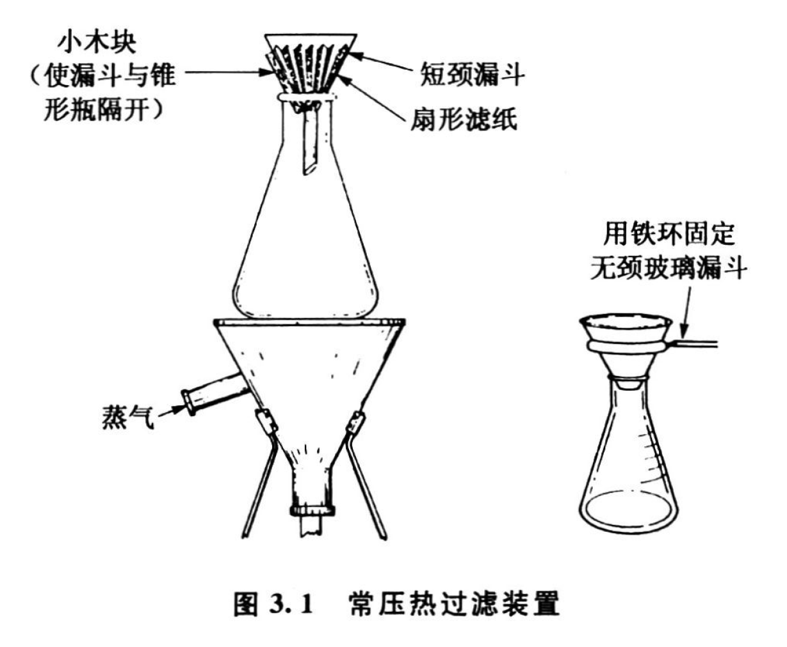

热过滤用折叠滤纸由于有效表面积大、过滤速度快，在化学实验中会经常用到。 常压热过滤中菊花形滤纸的折叠有两种方法：这里不做过多赘述。

##### 2\. 减压热过滤 (图 3.2)

也叫抽滤，其优点是过滤快，但缺点是**遇有沸点较低的溶液时，会因减压而使热溶剂沸腾、蒸发导致溶液浓度改变，使结晶有过早析出的可能。**

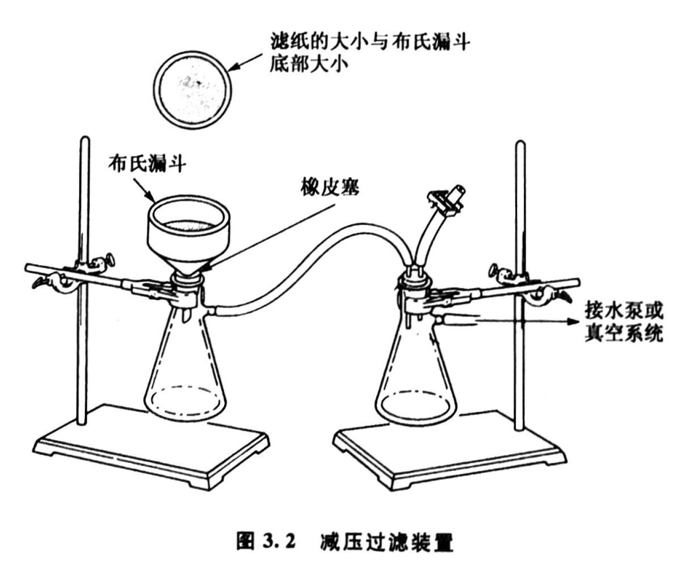

减压抽滤使用**布氏漏斗(Büchner)**。所用滤纸大小应和布氏漏斗底部恰好合适，然后用水湿润滤纸，使滤纸与漏斗底部贴紧。如抽滤样品需要在无水条件下过滤时，需**先用水贴紧滤纸，然后用无水溶剂洗去纸上水分**(例如用乙醇或丙酮洗)，确信已将水分除净后再行过滤。减压抽紧滤纸后，迅速将热溶液倒入布氏漏斗中，在过滤过程中漏斗里应一直保持有较多的溶液。在未过滤完以前不要抽干，同时使压力不宜降得过低，为防止由于压力低，溶液沸腾而沿抽气管跑掉，可**用手稍稍捏住抽气管，或使安全活塞保持不完全关闭状态**，使吸滤瓶中仍保持一定的真空度，而能继续迅速过滤。

有时某些物质易于析出结晶，在过滤过程中结晶在滤纸上析出，阻碍继续过滤，处理不妥，产品损失很多，在少量实验中，影响严重。**此时须小心将析出物与滤纸一同返回，重新制备热溶液**，这种情况下，可将热溶液配制得稍稀一些。

#### (四) 结晶的析出

将滤液保温下或室温放置冷却，使其慢慢析出结晶。**不要将滤液置于冷水中迅速冷却或冷却过程中加以摇振**，因为这样形成的结晶较细，表面积大，吸附母液多，且容易夹有杂质。但也**不要结晶过大(超过2mm以上)**，这样往往又会在结晶中包藏有溶液，给干燥带来一定困难，同时也会有杂质夹在其中，而使产品纯度降低。过滤、洗涤晶体过程中可将较大结晶尽量压碎，将其中包含的母液压挤、洗涤、经抽滤除净。

有时杂质的存在影响化合物晶核的形成和结晶的生长，常见在化合物溶液虽已达到过饱和状态，但仍不易析出结晶，而成油状物存在。为了促进化合物较快地结晶出来，往往采取以下措施，以帮助形成晶核，利于结晶生长： (1) **用玻璃棒摩擦瓶壁**，由于摩擦使液面粗糙，促使分子在液面定向排列形成结晶，析出或固化。 (2) 加入少量晶种，使结晶析出，这一操作称为**种晶**。实验室没有这种结晶，可以自己制备，其方法为：取数滴过饱和溶液于一试管中旋转，使该溶液在试管表面成一薄膜，然后将此试管放入冷冻剂中，形成的少量结晶作为“晶种”。较为方便的是以**玻璃棒一端沾取少许溶液，使溶剂挥发得到晶种**。 (3) 一般地说，将过饱和溶液置于冷冻剂中，用玻棒摩擦瓶壁，温度越低，越易结晶。但是过度冷却，往往也使液体粘度增大，给分子间定向排列造成困难。此时，**适当加入少量溶剂再冷冻，可得到晶体**。 (4) 在过饱和溶液中，加入难溶解该物质的少量溶剂后，用玻棒摩擦器壁或放入乳钵中长时间研磨，令其固化。 (5) 如以上各种方法均难以结晶，可**长时间在冰箱中放置，使结晶析出**。否则，需改换溶剂及其用量，再行结晶。

小量及微量物质重结晶，应采用**与该物质量相适应的小型仪器**。例如，在小试管内制备热溶液，使用玻璃钉或带滤孔板的小漏斗，过滤热溶液使用小型抽滤管滤集母液(图3.3)。微量物质重结晶，可在**小离心管**中进行，热溶液制备后，即行**离心**，使不溶杂质沉淀于管底，用滴管将上层清液移至另一小离心管中，令其结晶。采用**在滴管的细颈部位放入少许脱脂棉作为热溶液的过滤器**(图3.4)，使用前，先用少量所使用的溶剂洗涤脱脂棉，以除去小纤维。用另一滴管将待过滤热溶液移入这一滴管，接上橡皮头，用力挤压，使热溶液经脱脂棉过滤，呈澄清溶液。若一次挤压不能把液体全部挤出，可在橡皮头上扎一小孔，让空气进入后再次挤压，即可完成。

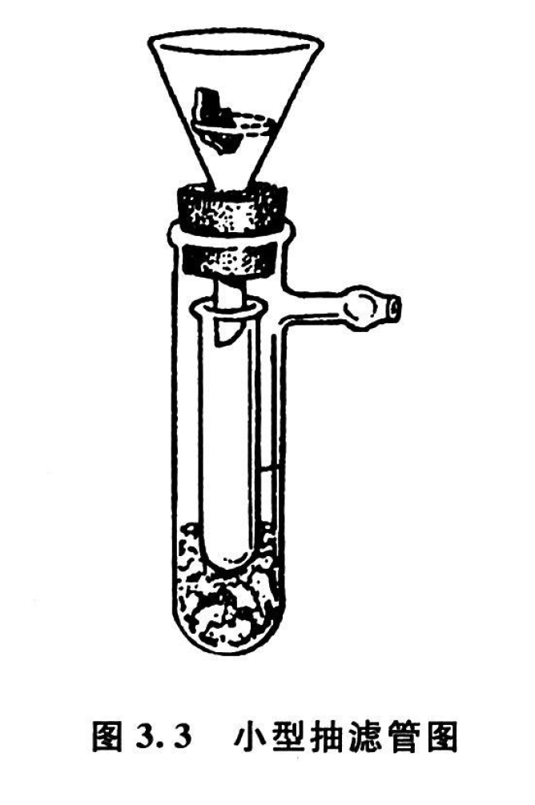

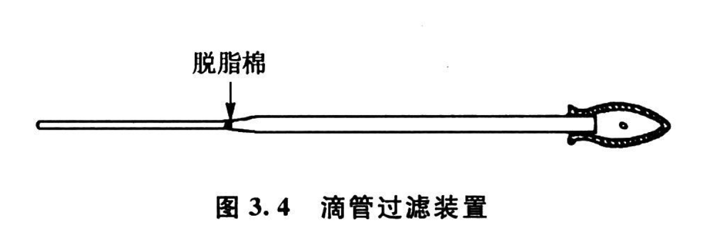

#### (五) 结晶的过滤、洗涤

将析出结晶的冷溶液和结晶的混合物，用抽滤法分出结晶，瓶中残留的结晶可用少量滤液冲洗数次，一并移至布氏漏斗中，把母液尽量抽尽。对于细碎的、易吸附液体的固体，过滤时应使用平底瓶塞等仪器**均匀地轻压滤饼表面并逐渐压实，抽滤至没有母液流出**。应注意避免滤饼出现裂缝或滤饼周围与漏斗壁不能贴实，这样都会使母液不易被彻底抽出。然后打开安全瓶活塞停止减压，滴入少量的洗涤液，如果结晶较多而且又经用玻璃塞压紧，在加入洗涤液后，可用镍勺将结晶轻轻掀起并加以搅动，使全部结晶润湿，然后再抽干以增加洗涤效果。如果所用溶剂沸点较高，为便于后续干燥，在完成洗去母液的步骤后，**可以用溶解度更小的低沸点溶剂洗涤几次，以除去挥发较慢的高沸点溶剂**，如用乙醚洗去乙醇，用低沸点石油醚洗去甲苯等。

### 附：固液分离常用方法

分离固液混合物的常用方法包括倾析法、离心法和过滤法。

**倾析法**是最为简便的方法，即，将液体慢慢倾倒出去，固体则留在容器中。一般适合固体颗粒较大、较为密实而易于沉在容器底部，从而液体可以倾倒彻底，实现固液的有效分离。如使用无水硫酸钠干燥有机液体时，多数情况下可以选择倾析法将有机液体移出。如果固液混合物中固体颗粒较细、较轻而易于悬浮时，倾析则是不适用的。特殊的情形是当混合物中的**固体不宜与空气接触**时，倾析法常被选用，当然每次的液固分离也是不彻底的。

当混合物中的固体颗粒很细以至于严重影响过滤速度，或其在空气中易于吸湿或潮解，或样品量很少，过滤法易造成损失时，**离心法**可能是一个更佳的选择(图3.5)。可以将混合物转移入离心管，**调节并使各离心管重量达到平衡**，快速离心使混合物中的固体密实地附于管底，倾出上层清液，加入适量新的溶剂，将管中固体搅拌成浆状后再次离心。根据需要重复这一步骤，即可以实现有效分离。最后一次离心后，晶体表面附着的溶剂，可**用滤纸条吸除**，然后将固体移出以使残余溶剂挥发或采用真空将其抽离。

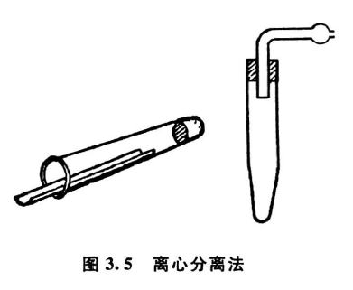

**过滤法**是最通用的固液分离方法。过滤媒介可以是滤纸、烧结玻璃板(玻璃砂芯)或是棉花(过滤颗粒较大的固体)。过滤可以分为常压过滤和减压过滤(即抽滤)。

滤纸的孔径有不同的规格，粗孔滤纸过滤速度快，但过滤悬浊液、颗粒很细的体系时则不适用。一般会选择中孔滤纸，既能有效分离又能保证合适的过滤速度。

对于酸性体系、含活性炭等极细颗粒体系，通常会使用**两层滤纸叠用**，以防止穿滤的发生。

常压过滤一般用于含固体较少的体系或目的在于收集液体的过滤，收集结晶或需快速过滤时更多地会选择抽滤。

抽滤一般是布氏漏斗配打孔橡胶塞或橡胶过滤垫与吸滤瓶联用。收集液体时宜用较大的布氏漏斗以求快速，收集固体时宜用较小的布氏漏斗以使固体较为集中便于洗涤，但固体层也不应太厚，否则不易抽干和洗涤。

布氏漏斗表面光滑不沾结晶，适于各种加热方式，耐用且不易损坏，是实验室常用仪器。但其最大的缺点是，**不透明**，内部如附着亲水性差的化合物，往往**难以洗净且不易判断**，可能会污染下一过滤操作中的样品。

如需过滤的体系中含有酸、酸酐及氧化剂等腐蚀滤纸的物质，抽滤可以在**砂芯漏斗**中进行。利用砂芯漏斗进行抽滤，不需使用滤纸从而避免穿滤，这是其方便之处。但砂芯漏斗的缺点也很明显：一是砂芯表面易附着部分细碎结晶，当样品量较少时损失相对较大；二是砂芯部分的洗涤要求较高，常不能彻底洗净；三是其价格较贵，且较布氏漏斗易碎。此外，强碱等试剂会腐蚀砂芯部分。

某些体系中含有如焦油类的组分，常规过滤时往往会糊住滤纸或滤芯，使过滤无法完成，或焦油类组分中含有需要提取的物质，这时可以使用助滤剂，如硅藻土、活性炭等。将助滤剂均匀地铺在滤纸或滤芯上，倾入待滤液，过滤过程中，焦油类组分分散在助滤剂上，使过滤顺利进行。如再加入适宜的溶剂洗涤，还可以将原来溶于焦油中的需要组分提取出来。

#### 国产烧结玻璃漏斗的规格

| 型号  | 滤板平均孔径 | 一般用途 |
| --- | --- | --- |
| 1号  | 80~ 120 μm | 滤除大粒沉淀，收集或分布大分子气体 |
| 2号  | 40~ 80 μm | 滤除较大颗粒的沉淀，收集或分布较大分子的气体 |
| 3号  | 15~ 40 μm | 滤除化学处理中的一般结晶和杂质，过滤水银，收集或分布一般气体 |
| 4号  | 5~ 15 μm | 滤除细粒沉淀，收集或分布小分子气体 |
| 5号  | 2~ 5 μm | 滤除极细的颗粒，滤除较大的细菌 |
| 6号  | <2 μm | 滤除细菌 |

### (六) 结晶的干燥

为了保证产品的纯度，需要把溶剂除去。若产品不吸水，可以在空气中放置，使溶剂自然挥发；不易挥发的溶剂，可根据产品性质(熔点高低、吸水性、对光热敏感性等)采用红外灯烘干或用真空恒温干燥器干燥(图3.6)，特别是，在制备标准样品和分析样品以及产品易吸水时，需将产品放入真空恒温干燥器中干燥。

真空恒温干燥器适用于干燥少量样品。将样品装在试管中，置试管于干燥器2中；在3中一般放置P2O5；烧瓶1中采用适当沸点的有机液体，其沸点需与欲干燥温度接近。操作时，通过活塞4将仪器抽真空，加热回流烧瓶1中液体使之沸腾，保持回流温度使样品在恒温下得以干燥。其间当真空度到达所要求时可关闭活塞4，适时可再打开以维持一定真空度。

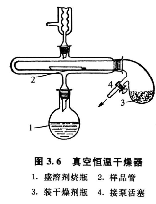

### (七) 混合溶剂重结晶的操作

使用混合溶剂进行重结晶，其操作与单一溶剂有所不同；

(1) 按照选择溶剂的方法，确定良溶剂(易溶解溶剂)和不良溶剂(难溶解溶剂)； (2) 将被重结晶物质加热溶解于适量的良溶剂中； (3) 趁热过滤，以除去不溶性杂质； (4) 向热的滤液(适当加热保温)中用滴管逐滴加入热的不良溶剂，直至出现混浊，且不再消失为止； (5) 再加热使其澄清，或再加极少量的良溶剂，使其刚好澄清； (6) 将此热溶液在室温下放置，冷却析出结晶。 如冷后析出油状物，则需调整两溶剂的比例或总量，再进行实验，或另换一对溶剂。有时也可以将两种溶剂按比例预先混合好，再进行重结晶，此时相当于进行单一溶剂的重结晶。

### (八) 重结晶效果评价

重结晶是否达到满意效果，可以从回收率、产品纯度两方面评价。一般情况下可以通过薄层层析比较重结晶样品、经重结晶得到的晶体以及重结晶母液的组成，检测分析提纯效果及回收效率，以确定是否需要二次操作或调整、改换重结晶方案。需要注意的是，若结晶析出不完全，将母液经适当浓缩后可能再得到一部分结晶，但因母液中杂质比例明显升高，所得的二次结晶纯度往往较差。因此，控制好溶剂量从而使结晶能够较为彻底地一次性析出是极为重要的。

## 3.2 升华

### (一) 原理

升华是提纯某些固体化合物的方法之一。升华往往可以得到很纯的化合物。其基本原理是，利用固体的不同蒸气压，将不纯的物质在其熔点温度以下加热，**不经过液态而直接把蒸气变成固态**，也就是说，只有在其熔点温度以下具有相当高(高于2.67 kPa)蒸气压的固态物质，才可用升华来提纯。

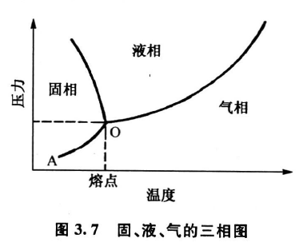

图3.7中，O点为固、液、气三相同时并存的三相点，在三相点点以下不存在液态；OA 曲线表示固相和气相之间平衡时的温度和压力。因此，进行升华都是在三相点温度以下进行操作。表3.2是几种固体物质在其熔点时的蒸气压。

一个物质的正常熔点是其固、液两相在大气压下平衡时的温度。在三相点时的压力是其固、液、气三相的平衡蒸气压，所以三相点时的温度和正常的熔点有些差别，通常差别只有几分之一度。

**表3.2 固体化合物在其熔点时的蒸气压**

| 化合物 | 固体在熔点时的蒸气压/mmHg | 熔点/℃ |
| --- | --- | --- |
| 樟脑  | 370(49.3 kPa) | 179 |
| 碘   | 90(12.0 kPa) | 114 |
| 萘   | 7(0.93 kPa) | 80  |
| 苯甲酸 | 6(0.80 kPa) | 122 |
| p-硝基苯甲醛 | 0.009(0.001 kPa) | 106 |
| 六氯乙烷 | 781(104 kPa) | 186 |

\*此栏()前的单位为mmHg，()内为kPa。

在三相点以下，物质只有固、气两相。若降低温度，蒸气就不经过液态而直接变成固态；若升高温度，固态也不经过液态而直接变成蒸气。若某物质在三相点温度以下的蒸气压很高，因而气化速率很大，就可以比较容易地从固态直接变为蒸气。物质蒸气压随温度降低而下降非常显著，稍降低温度即能由蒸气直接转变成固态，此物质可容易地在常压下用升华方法提纯。例如，六氯乙烷(三相点温度186 ℃，压力104 kPa)在185℃时蒸气压已达0.1MPa，在低于186℃时就可完全由固相直接挥发成蒸气，中间不经过液态阶段。樟脑(三相点温度179 ℃，压力49.3 kPa)在160 ℃时蒸气压为29.1 kPa，即未达熔点前，已有相当高的蒸气压，只要缓缓加热，使温度维持在179℃以下，它就可不经熔化而直接蒸发，蒸气遇到冷的表面就凝结成为固体，这样蒸气压可始终维持在49.3 kPa 以下，直至挥发完毕。

严格说来，升华是指物质自固态不经过液态直接转变成蒸气的现象。而对有机化合物的提纯来说，是使物质蒸气不经过液态而直接转变成固态，因为这样能得到高纯度的物质。因此，在有机化学实验操作中，只要是物质从蒸气不经过液态而直接转变成固态的过程也都称为升华(按其实际物理过程应该称之为凝华，一般升华法提纯都包括升华和凝华两个过程)。一般来说，对称性较高的固态物质，具有较高的熔点；且在熔点温度以下具有较高的蒸气压，易于用升华来提纯。

### (二) 分类

#### 1\. 常压升华

最简单的常压升华装置[图3.8(a)]是用一蒸发皿在其中放入要升华的物质，蒸发皿口上盖一张**穿有密集小孔的滤纸**，滤纸上再倒扣一个与蒸发皿口径合适的玻璃漏斗，漏斗的**颈部塞一点棉花或玻璃毛**以防蒸气逸出。在沙浴上缓缓加热，使温度控制在被提纯物的熔点以下，使其慢慢升华，此时被升华的物质就会粘附在滤纸上，或是粘附在小孔四周甚至于凝结在漏斗壁上。然后将产品用刮刀从滤纸上轻轻刮下，放在干净的表面皿上，即是纯净产品。

在常压下除上述装置外，也可以使用图3.8(b)的装置。二者均可以得到满意的结果。

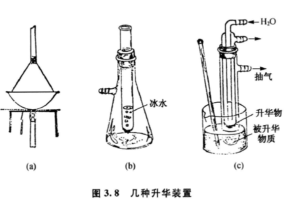

#### 2\. 减压升华

装置如图3.8(c)所示，将欲升华物质放入吸滤管底部，然后在吸滤管中装一“指形冷凝管”用橡皮塞塞紧，接通水源，再把吸滤管放入油浴或水浴中加热，利用水泵或油泵进行抽气，使其升华。升华物质蒸气因受冷凝水冷却，就会凝结在指形冷凝管的底部。

## 3.3 简单蒸馏

对于液体有机化合物的分离和提纯来说，应用最广泛的方法是蒸馏，其中包括简单蒸馏、减压蒸馏、水蒸气蒸馏和分馏。

简单蒸馏可以把挥发的液体与不挥发的物质分离开，也可以分离两种或两种以上沸点相差较大(至少30℃以上)的液体混合物。

### (一) 原理

蒸馏广泛地应用于分离和纯化液体有机化合物。它是根据**混合物中各组分的蒸气压不同**而达到分离的目的。一个液体的蒸气压 $p$是该液体表面的分子进入气相的倾向大小的客观量度。在一定的温度下，该液体的蒸气压是一定的，并不受液体表面总的压力——大气压($p_0$)的影响。当液体的温度不断升高时，蒸气压也随之增加，直至该液体的蒸气压等于液体表面的大气压力，即 $p=p_0$，这时就有大量气泡从液体内部逸出，即液体沸腾。我们定义在 $p=p_0$时的温度为该液体的沸点。一个纯净的液体的沸点，在一定的外界压力下是一个常数。例如，纯水在一个大气压下的沸点为100℃。在室温下具有较高蒸气压的液体的沸点比在室温下具有较低蒸气压的液体的沸点要低。

当一个液体混合物沸腾时，液体上面的蒸气组成与液体混合物的组成不同，**蒸气组成是易挥发的组分，即低沸点的组分**。假如把在沸腾时液体上面的蒸气进行收集并冷却成液体，这时冷却收集到的液体的组成与蒸气的组成相同。随着易挥发组分的蒸出，混合物的易挥发组分将变小，因而混合物的沸点稍有升高，这是由于组成发生了变化。当温度相对稳定时，收集到的蒸出液将是原来混合物的一个纯组分。如果两个组分的沸点相差较近($△bp<30 ℃$)，用蒸馏的方法分离混合物的两个组分将是不适用的。上述可以总结为以下三个过程：

(1) 加热蒸馏瓶，使液体混合物沸腾。易挥发组分富集于液体上面的蒸气中，不易挥发的组分大多留在原来的液相中。

(2) 继续加热，将蒸气冷却并收集到收集瓶里，易挥发组分富集于冷却的蒸气中；蒸馏瓶里液体混合物的总体积变小，不易挥发组分的浓度相对增大。

(3) 继续加热，使富集于冷却蒸气中的易挥发组分更多地收集于收集瓶中；在蒸馏瓶里留存下来的液体主要是不易挥发的组分，从而达到分离的目的。

在常压下进行蒸馏时，大气压往往不是760 mmHg(0.1 MPa)，严格说来，应对观察到的沸点加以校正，但因偏差较小[一般大气压相差20 mmHg(2.7 kPa)，校正值为±1℃]，所以，对一般实验来说，可忽略不计。我们在蒸馏时，实际测量的不是溶液的沸点，而是**蒸出液的沸点**，即蒸出液气液平衡时的温度。

在压力一定时，凡纯净化合物，必有一固定沸点。因此，一般利用测定化合物的沸点鉴定其是否纯净。但必须指出，凡具有固定沸点的液体不一定均为纯净的化合物。这是由于含有两个或两个以上组分的某些化合物，可以形成**共沸混合物**(表3.3)。共沸混合物不能利用简单蒸馏的方法将其各个组分分开，因为在共沸混合物中，和液体平衡的蒸气组分与液体本身的组成相同。

**表3.3 常见的共沸混合物**

|     | 组分(甲) |     | 组分(乙) |     | 共沸点混合物 |     |     |     |
| --- | --- | --- | --- | --- | --- | --- | --- | --- |
|     | 名称  | bp/°C | 名称  | bp/°C | $w_H$ | $w_Z$ | bp/°C |     |
| **二元最低共沸混合物** | 乙醇  | 78.3 | 甲苯  | 110.5 | 68.0 | 32.0 | 76.7 |     |
|     | 乙酸乙酯 | 77.1 | 乙醇  | 78.3 | 69.4 | 30.6 | 71.8 |     |
|     | 第三丁醇 | 82.5 | 水   | 100.0 | 88.2 | 11.8 | 79.9 |     |
|     | 苯   | 80.1 | 异丙醇 | 82.5 | 66.7 | 33.3 | 71.9 |     |
|     | 苯   | 80.1 | 水   | 100.0 | 91.1 | 8.9 | 69.4 |     |
|     | 乙酸乙酯 | 77.1 | 水   | 100.0 | 91.9 | 8.8 | 70.4 |     |
|     | 水   | 100.0 | 乙醇  | 78.5 | 4.4 | 95.6 | 78.2 |     |
| **二元最高共沸混合物** | 丙酮  | 56.4 | 氯仿  | 61.2 | 20.0 | 80.0 | 64.7 |     |
|     | 甲酸  | 100.7 | 水   | 100.0 | 77.5 | 22.5 | 107.3 |     |
|     | 氯仿  | 61.2 | 乙酸乙酯 | 77.1 | 22.0 | 78.0 | 64.5 |     |
|     | 组分(甲) |     | 组分(乙) |     | 组分(丙) |     | 共沸混合物 |     |
|     | 名称  | bp/°C | 名称  | bp/°C | 名称  | bp/°C | $w_H$ | $w_Z$ |
| **三元最低共沸混合物** | 乙醇  | 78.3 | 水   | 100.0 | 苯   | 80.1 | 18.5 | 7.4 |
|     | 乙酸乙酯 | 77.1 | 乙醇  | 78.3 | 水   | 100.0 | 83.2 | 9.0 |

### (二) 装置

简单蒸馏最常用的装置是由**蒸馏瓶、温度计、直形冷凝管、接引管和接收瓶**组成的(图3.9)。蒸馏瓶与蒸馏头之间常常借助于大小口接头连接。普通温度计是借助于温度计套管固定在蒸馏头上口处。**温度计液球上端应与蒸馏头侧管的下限在同一水平线上**。冷凝水应从**下口进入，上口流出**，上端的出水口应朝上，以保证冷凝管套管中充满水。所用仪器都必须清洁干燥。仪器安装顺序是：先在架设仪器的铁台上放好加热浴，再根据加热浴的高低安装蒸馏瓶，瓶底不要触及加热浴底部。用水浴锅时，瓶底应距水浴锅底1cm左右。安装冷凝管的高度应和已装好的蒸馏瓶高度相适应，在冷凝管尾部通过接引管连接接收瓶(可用**锥形瓶或梨形瓶**，注意不要用烧杯等广口的器皿接收蒸出液)。接收瓶需事先称量并作记录。

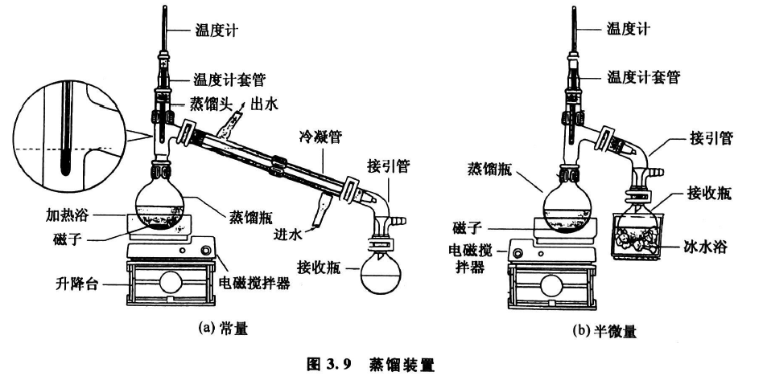

安装仪器顺序一般总是**自下而上，从左到右**；要准确、端正、竖直；无论从正面或侧面观察，**全套仪器的轴线都要在同一平面内**；铁架都应整齐地放在仪器的背部。

在小量、半微量合成中，由于产品量少，蒸馏仪器的选择显得尤其重要。蒸馏瓶与冷凝管是蒸馏体系的主要组成部分，一般说来，**沸点(bp)在130~ 150℃以下用直形冷凝管**，其长短粗细，首先决定于被蒸馏物的沸点，**沸点愈低，蒸气愈不易冷凝，则需选择长一些的冷凝管，内径相应粗**；反之，沸点愈高，蒸气愈易冷凝，可用较短的冷凝管，内径也相应细。当实验中需要回收溶剂，蒸馏物量多，所用蒸馏瓶的容量较大，由于受热面增加，单位时间内从蒸馏瓶内排出的蒸气量也大，因此，所需冷凝管应长些和粗些。值得注意的是，**蛇形冷凝管切不可斜装，以免使冷凝液停留在其中，阻塞了通道而发生事故**。冷凝水的速率也很重要，蒸馏物**沸点在70℃以下时，水速要快，100~ 120℃时水流应缓；沸点在120~ 150℃时，水的流速要极缓慢；130~ 150℃时，则可考虑改用空气冷凝管；超过150℃时，则必须用空气冷凝管**，也可选用适当粗细的玻璃管，其长、短、粗、细要以蒸馏物的沸点和体积大小而定。在小量产品的蒸馏中，为减少产品损失，可选用直形冷凝管。

#### 补：冷凝管间的区别：

| 特性  | **直形冷凝管 (Liebig Condenser)** | **蛇形冷凝管 (Graham Condenser)** | **球形冷凝管 (Allihn Condenser)** |
| --- | --- | --- | --- |
| **结构特点** | 内外管均为直管 | 内管为螺旋盘绕的蛇形管 | 内管由一连串球形泡串联而成 |
| **冷却面积** | 相对最小 | 相对最大 | 居中，大于直形，小于蛇形 |
| **冷却效率** | 较低  | 最高  | 较高  |
| **液体残留** | 极少，液体流出顺畅 | 严重，液体会滞留在螺旋管内 | 较少，比蛇形管好很多 |
| **主要用途** | **蒸馏** (Distillation) | **回流** (Reflux) | **回流** (Reflux) |
| **使用方向** | 倾斜或垂直均可 | **只能垂直使用** | **只能垂直使用** |
| **清洗难度** | 最容易 | 最困难 | 较容易 |

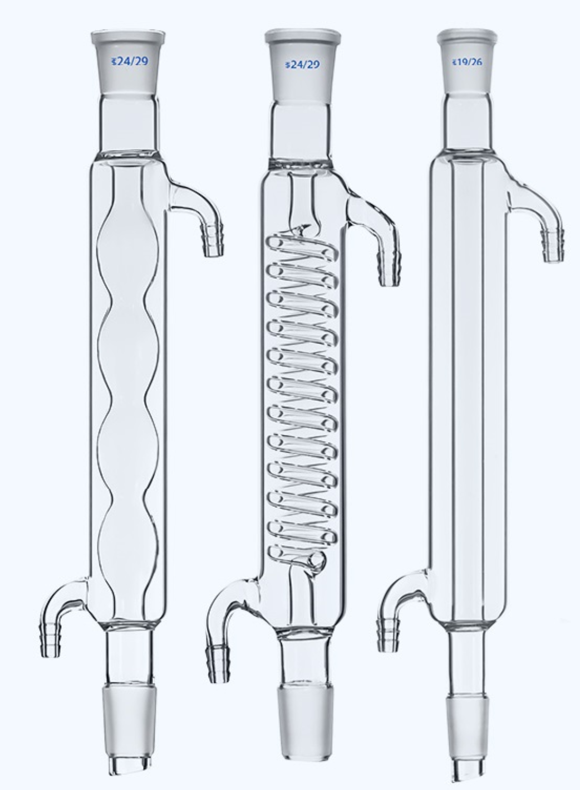

加热浴的温度一般须比蒸馏物沸点高出**20~ 30℃**为宜，即使蒸馏物沸点很高，也绝不要将浴温超出40℃。浴温过高会由于蒸馏速率过快，蒸馏瓶和冷凝器上部蒸气压过大，使大量蒸气来不及冷凝而逸出，导致产品损失，或突发着火或蒸馏物过热发生分解。

蒸馏物沸点高时，选用仪器的容积大小，更要注意与蒸馏物的体积相适。尽管如此，往往还是会发生蒸馏物易被冷凝，蒸气未达到蒸馏头支管处已经回流冷凝，液滴回到烧瓶中。此时，应立即迅速**将简单蒸馏改为减压蒸馏**，或在**蒸馏瓶颈上保温**。否则，持续时间过长，高沸点蒸馏物易受热分解变质。

蒸馏过程中的“过热”现象和“暴沸”现象的发生和避免，关系到蒸馏操作的成败，应该给予足够重视。

液体在沸腾时，液体释放大量蒸气至小气泡中。待气泡中的总压力增加到超过大气压，并足够克服由于液柱所产生的压力时，蒸气的气泡就上升逸出液面。此时，如在液体中有许多小气泡或其他的气化中心时，液体就可平稳地沸腾。否则，液体的温度可能上升到超过沸点而不沸腾，这种现象称为**过热**。这时，一旦有一个气泡形成，由于液体在此温度时的蒸气压已远远超过大气压和液柱压力之和，这样就会使得上升的气泡增大得非常快，甚至将液体冲溢出瓶外，这种不正常的沸腾称为**暴沸**。因而在加热前应加入**助沸物引入气化中心**，以保证沸腾平稳。助沸物一般是表面疏松多孔、吸附有空气的物体，如**素瓷片、沸石或玻璃沸石**等。另外，也可用**几根一端封闭的毛细管**以引入气化中心(注意毛细管有足够的长度，使其上端可搁在蒸馏瓶的颈部；开口的一端朝下)。现较为常用的方式是通过**磁子搅拌**避免体系暴沸。在任何情况下，**切忌将助沸物加至已受热接近沸腾的液体中**，否则常因突然放出大量空气而将大量液体从蒸馏瓶口喷出造成危险。如果加热前忘了加入助沸物，补加时必须先移去热源，待加热液体冷至沸点以下后方可加入。如果沸腾中途停止，则在重新加热前应**补加新的助沸物**。因为起初加入的助沸物在加热时已逐出了部分空气，在冷却时吸附了液体，可能已经失效。另外，如果采用浴液间接加热，保持浴温不要超过蒸馏液沸点20℃，这种加热方式不但可大大减少瓶内蒸馏液中各部分之间的温差，而且可使蒸气的气泡，不单从烧瓶的底部上升，也可沿着液体的边沿上升，因而也可大大减小过热的可能。

### (三) 操作方法

将待蒸馏液通过玻璃漏斗小心倒入蒸馏瓶中。加入磁子，塞好带温度计的塞子。先由冷凝管下口缓缓通入冷水，自上口流出引至水槽中，开动电磁搅拌，然后开始加热。加热时可以看见蒸馏瓶中液体逐渐沸腾，蒸气逐渐上升，温度计的读数也略有上升。当蒸气的顶端达到温度计液球部位时，温度计读数就急剧上升。这时应适当调小加热速率，使瓶颈上部和温度计受热，让液球上液滴和蒸气温度达到平衡。控制加热温度，调节蒸馏速率，**通常以每秒1~ 2滴为宜**。在整个蒸馏过程中，**应使温度计液球上常有被冷凝的液滴滴下**。此时的温度即为液体与蒸气平衡时的温度。温度计的读数就是液体(馏出液)的沸点。进行蒸馏前，至少要准备两个接收瓶。因为在达到预期物质的沸点之前，沸点较低的液体先蒸出，这部分馏液称为**前馏分**；前馏分蒸完，蒸出的就是较纯的物质，应更换一个洁净干燥的接收瓶接收，当温度稳定后记下这部分液体开始馏出时和最后一滴时温度计的读数，即是该馏分的**沸程**；在所需要的馏分蒸出后，若再继续升高加热温度，温度计的读数会显著升高，继续蒸馏所得馏分为高沸点杂质，若维持原来的加热温度，就不会再有馏分蒸出，**温度会突然下降**。

蒸馏完毕，应先停止加热，然后停止通水，拆下仪器。拆除仪器的顺序和装配的顺序相反，先取下接收器，然后拆下接引管、冷凝管、蒸馏头和蒸馏瓶等。

液体的沸程常可代表它的纯度，纯粹的液体沸程一般不超过1~ 2℃。

【注意事项】 (1) 蒸馏前根据待蒸液体量的多少，选择合适规格的蒸馏瓶是至关重要的，瓶子越大，相对地产品损失越多。从表面上看，液体是蒸完了，但瓶子中充满了蒸气，当其冷却后，即成为液体。尤其是待蒸液体积少时，更要选择大小合适的蒸馏瓶。 (2) 绝大多数液体加热时，如无磁子搅拌或未加入沸石等，经常发生过热现象。当继续加热时，液体会突然暴沸，冲入冷凝管中，或冲出瓶外造成损失，甚至造成着火事故！ (3) 热源：对于沸点较低、可燃的液体，宜在热水或沸水浴中加热，沸点在80℃以下的液体可用水浴加热。通常热源温度和沸点温度相差20~ 30℃时即可以顺利进行蒸馏，若温差再小时，往往蒸馏太慢。液体沸点高于80℃以上者，可用油浴、沙浴、金属浴、电热套等加热。 (4) 在蒸馏沸点高于130℃的液体时，一般需用空气冷凝管。若用水冷凝管，由于气体温度较高，**冷凝管外套接口处因局部骤然遇冷容易破裂**。 (5) 应当注意蒸馏装置不能成封闭系统。因为一旦在封闭系统中进行加热蒸馏，随着压力升高，会引起仪器破裂或爆炸。 (6) 铁夹不应夹得太紧或太松，以夹住仪器后，稍用力仪器能转动为宜。铁夹与玻璃物之间要垫有橡皮等软质物，以防加热膨胀致使仪器破损。 (7) 蒸馏乙醚等低沸点有机溶剂时，特别要注意蒸馏速度不能太快，否则冷凝管不能将乙醚全部冷凝下来。应在**冷凝管下端的接引管侧口连接一根橡皮管，使其导入流动的水中**，以便把挥发的乙醚蒸气带走。因乙醚易燃，乙醚蒸气又比空气重，总是积聚在桌面附近，不易散去，如遇明火很易发生着火事故。

## 3.4 分馏

利用简单蒸馏可以分离两种或两种以上沸点相差较大的液体混合物。而对于沸点相差较小的、或沸点接近的液体混合物的分离和提纯则是采取分馏的办法。根据经验，两种待分离物质的沸点差小于80℃时，简单蒸馏往往无法实现完全分离，只有采用分馏才能得到满意的分离结果。分馏在化学工业和实验室中被广泛应用，现在最精密的分馏设备已能将沸点相差仅1~ 2℃的混合物分开。

### (一) 原理

如果将几种沸点不同而又完全互溶的液体混合物加热，当其总蒸气压等于外界压力时开始沸腾气化。蒸气中易挥发组分所占的比例比原液相中所占的比例要大。若将该气体凝结成液体，其中有较多的低沸点成分，根据这一现象可以把液体混合物中的各组分分离开。

为了简化，仅讨论混合物是二组分理想溶液的情况。所谓理想溶液，即是指在这种溶液中，相同分子间的相互作用与不同分子间的相互作用是一样的。也就是各组分在混合时无热效应产生，体积没有改变。只有理想溶液才遵守拉乌尔(Raoult)定律。

由组分R和S组成的理想溶液，当 $p_R^{(c)} + p_S^{(c)} = p_{\text{外}}$时，即R和S的分压和等于外界压力($p_{\text{外}}$)时，溶液就开始沸腾，蒸气中易挥发液体的成分较在原混合液中要多。而理想溶液，就是指遵从拉乌尔定律的溶液。这时溶液中每一组分的蒸气压等于此纯物质的蒸气压和它在溶液中的摩尔分数的乘积，即

$$p_R = p_R^* x_R， \quad p_S = p_S^* x_S \quad(1)$$

式中 $p_R^*， p_S^*$分别为溶液中R、S分压， $p_R^*， p_S^*$分别为纯物质的蒸气压， $x_R， x_S$分别为R、S在溶液中的摩尔分数。

根据道尔顿分压定律，气相中每一组分的蒸气压和它的摩尔分数成正比。因此，在气相中各组分蒸气的成分为

$$x_{R(\text{气})} = \frac{p_R}{p_R + p_S}， \quad x_{S(\text{气})} = \frac{p_S}{p_R + p_S} \quad(2)$$

由(1)和(2)可以得到

$$\frac{x_{R(\text{气})}}{x_{S(\text{气})}} = \frac{p_R}{p_S} = \frac{p_R^* x_R}{p_S^* x_S} \quad(3)$$

如果在R和S的混合液上面一定体积的蒸气中，组分R、S的摩尔分数与其本身的分压成正比，且(3)式中 R比S更易挥发，即 $p_R^* > p_S^*$， 那么 $p_R^*/p_S^* > 1$。此时从(3)式可知

$$x_{R(\text{气})}/x_{S(\text{气})} > x_R/x_S$$

即蒸气中易挥发组分的摩尔分数 $x_{R(\text{气})}$与 $x_{S(\text{气})}$比值大于与之平衡的液相中的相应比。由此可知，在任何温度下蒸气相中总比与之平衡的沸腾液相中有更多的易挥发组分，利用这一原理，沸点相近的液体化合物借助分馏柱就可以被分离。

图3.10 是二元理想溶液的气液相组成与温度的关系图(大气压下的苯-甲苯体系的沸点-组成图)。通常是通过实验测定在各温度时气液平衡状况下的气相和液相的组成，以横坐标表示组成x(摩尔分数)，纵坐标表示温度t(如果是理想溶液，则可直接由计算作出)作图。从图中可以看出，由苯20%和甲苯80%组成的液体(L₁)在102℃时沸腾，和此液相平衡的蒸气(V₁)组成约为苯40%和甲苯60%。若将此组成的蒸气冷凝成同组成的液体(L₂)，则与此溶液成平衡的蒸气(V₂)组成约为苯60%和甲苯40%。显然，如此继续重复，即可获得接近纯苯的气相。

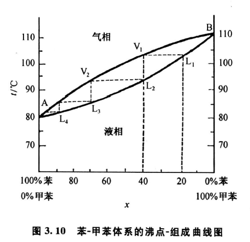

通过分别收集大量的最初蒸出液和残留液，并反复多次进行简单蒸馏，能够分离出一定量的纯物质。显然这样太烦琐了，而分馏柱就可以把这种重复蒸馏的操作在柱内完成。所以分馏是多次重复的简单蒸馏。

连续的蒸馏过程是如何在分馏柱中实现的呢？如图3.11所示，在分馏过程中的液体蒸气进入分馏柱中，其中较难挥发的成分在柱内遇冷即凝为液体，流回原容器中，而易挥发成分仍为气体进入冷凝管中，冷凝为液体蒸出液(馏分)。在此过程中，柱内流回的液体和上升的蒸气进行热交换，使流回液体中较易挥发的成分，因遇热蒸气而再次气化，同时，高沸点液体蒸气在柱内冷凝时放热，使气体中的易挥发成分继续保持气体上升至冷凝管中。因此，**这种热交换作用是提高分馏效果的必要条件之一，即要求流回的液体和上升的蒸气在柱内有充分的接触机会**。为此，通常是在分馏柱内放入**填充物**，或设计成各种高效的塔板，使流回的液体于其上形成一层薄膜，从而保证其与上升的蒸气有最大的接触面进行热交换。同时，也有利于气液平衡。

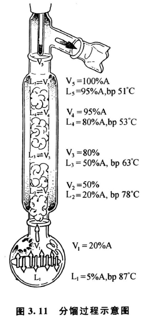

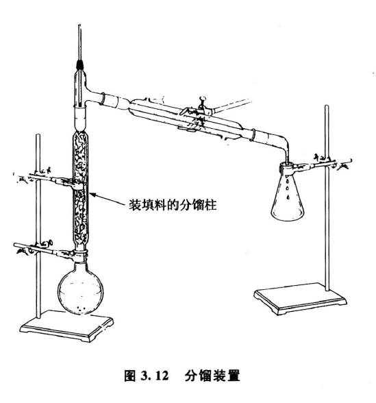

### (二) 分馏柱及分馏柱的效率

分馏柱的种类很多，但其作用都是有一个从蒸馏瓶通向冷凝管的垂直通道，这一垂直通道要比简单蒸馏长得多。如图3.12所示，当蒸气从蒸馏瓶沿分馏柱上升时，有些就冷凝下来。一般柱的下端比柱的上端温度高，沿柱流下的冷凝液有一些将重新蒸发，未冷凝的气体与重新蒸发的气体在柱内一起上升，经过一连串凝聚蒸发过程，这些过程就相当于反复的简单蒸馏。在这个过程中，每一步产生的气相都使易挥发的组分增多，沿柱流下的冷凝液体在每一层上要比与之接触的蒸气相含有更多的难挥发组分。这样整个柱内气液相之间建立了众多的气液平衡，在柱顶的蒸气几乎全是易挥发的组分，而在蒸馏瓶底部的液体则多为难挥发组分。

要达到这一状态，最重要的先决条件是： (1) **在分馏柱内气液相要广泛紧密地进行接触，以利于热量的交换和传递。** (2) **分馏柱自下而上保持一定的温度梯度。** (3) 分馏柱应有足够的高度。 (4) 混合液各组分的沸点有一定差距。

若具备了前两个条件，则沸点差距较小的化合物也可以用长的分馏柱或高效率分馏柱进行满意的分离。因为**组分间沸点差距与所需的柱长之间具有反比例的关系**，即组分间沸点差距越小，所需分馏柱的柱长越长；反之，组分间沸点差距越大，所需分馏柱的柱长就可以短一些。

为使气液相充分接触，最常用的方法是在柱内填上惰性材料，以增加表面积。**填料包括玻璃、陶瓷，或螺旋形、马鞍形、网状形等各种形状的金属小片。**

当分馏少量液体时，经常使用一种不加填充物，但柱内有许多“锯齿”的分馏柱，叫**韦氏分馏柱**，如图3.13(a)所示。

韦氏分馏柱的优点是**较简单，而且较填充柱粘附的液体少**；缺点是**分馏效率低**。在分馏过程中，不论使用哪一种柱，都应**防止回流液体在柱内聚集**，否则会减少液体和蒸气接触面，或者上升蒸气会把液体冲入冷凝管中，达不到分馏目的。为了避免这种情况，需在**柱外包扎绝热物以保持柱内温度**，防止蒸气在柱内很快冷凝。在分馏较低沸点的液体时，柱外包上铝箔等保温即可；若液体沸点较高，则需安装真空外套或电热外套管，如图3.13(b)所示。当使用填充柱时，也往往由于填料装得太紧或部分过分紧密，造成柱内液体聚集，这时需要重新填装。

在柱内保持一定的温度梯度，对分馏来说是极为重要的。在理想情况下，**柱底部的温度与蒸馏瓶内液体的沸腾温度接近，在柱内自下而上温度不断降低直至柱顶达到易挥发组分的沸点**。在大多数分馏中，柱内温度梯度的保持是通过适当**调节蒸馏速率**建立起来的。若加热太猛，蒸出速率太快，整个柱体自上而下几乎没有温差，这样就达不到分馏的目的。另一方面，如果蒸馏瓶加热太迅猛而柱顶移去蒸气太慢，柱体将被流下来的冷凝液所液阻，发生**液泛**。如果要避免上述情况的出现，可以控制加热与回流比来实现。所谓回流比，是指在一定时间内冷凝的蒸气以及重新流回柱内的冷凝液的数量与从柱顶移去的蒸馏液数量之间的比值。**回流比越大，分馏效果越好**。

在分馏柱上安装**全回流可调蒸馏头**(图3.14)，就可以测量和控制回流比。在一定的时间内从冷凝管尖端P滴下的液滴数量是全回流的数值，而通过活塞S流入接收瓶R的液滴数是出料量的数值。若全回流中每十滴中有一滴流入接收瓶，则回流比为9：1。我们知道，回流比越大，分馏效率越好。对于某些精馏，可采用100：1回流比的高效分馏柱。

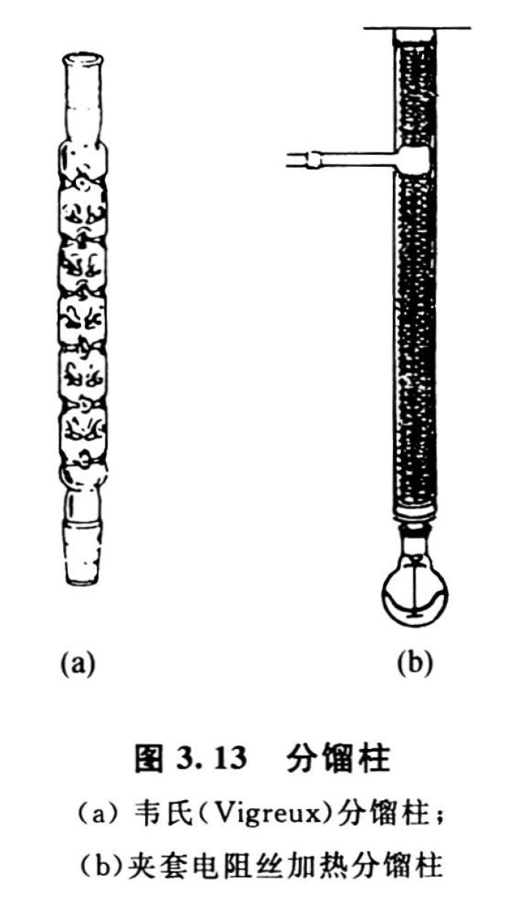

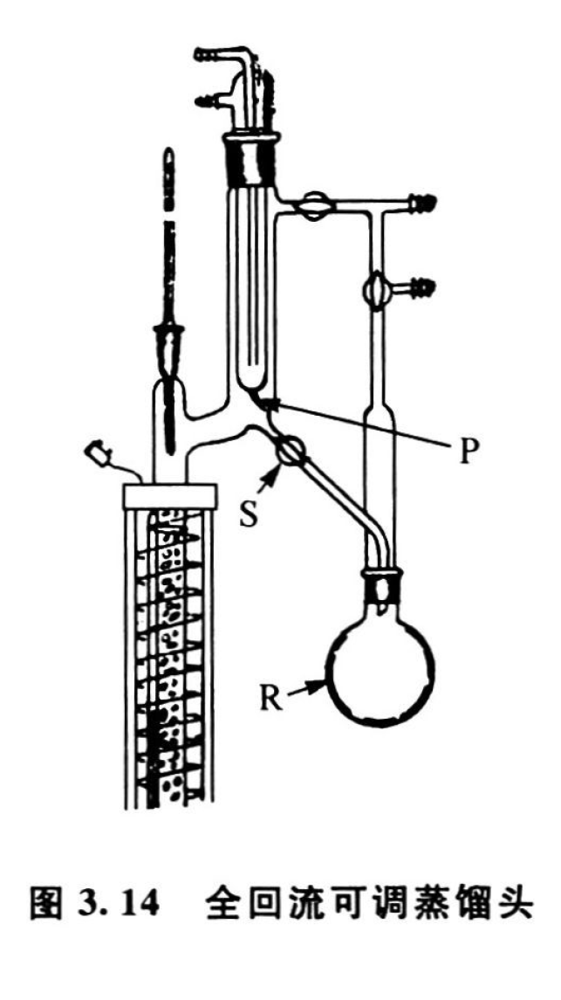

### (三)非理想溶液的分馏

虽然大多数均相液体的性质近似理想溶液，但还有许多已知的例子是非理想的。在这些溶液中不同分子相互之间的作用是不同的，以致发生对拉乌尔定律的偏离。有些溶液蒸气压较预期的大，即所谓正向偏离；另有一些则较预期的要小，即所谓负向偏离。

在正向偏离情况下，两种或两种以上的分子之间的引力要比同种分子间的引力弱，故其合并起来的蒸气压要比单一的易挥发的组分的蒸气压大。于是在此组成范围内的混合物(指图3.15 X 与Y 之间)，其沸点要比任何一个纯组分低(Z点)，Z点的组成可成为第三组分，组成了**最低沸点共沸物**(图3.15)。这个最低沸点共沸物有一定的组成(Z点)。

例如，水与乙醇(bp 78.5℃)形成最低沸点共沸物，沸点为78.2℃，其组成为**水(4.4%)-乙醇(95.6%)**。

在负向偏离的情况下，两种或两种以上的分子间的引力，要比同种分子间的引力大，故其合并起来的蒸气压要比单一的难挥发的组分的蒸气压低，故组成了最高沸点共沸物。于是在此组成范围内的混合物(图3.16X与Y之间)，沸腾温度比纯的高沸点组分还高(图3.16)，这个最高沸点共沸物也有一定的组成(Z点)。因此在分馏过程中，有时可能得到与单纯化合物相似的混合物，有固定沸点和固定组成，其气相和液相的组成也完全相同，故不能用分馏法进一步分离。

例如，甲酸(bp 100.7℃)与水形成最高沸点共沸物，其沸腾温度为107.3℃，该沸点组成为甲酸(77.5%)-水(22.5%)，除该点外，蒸馏该体系，在分馏时都会获得共沸组成的残液。

共沸混合物虽不能用分馏来进行分离，但它不是化合物，它的组成和沸点要随压力而改变。用其他方法**破坏共沸组分后再蒸馏，即可以得到纯粹的组分**。

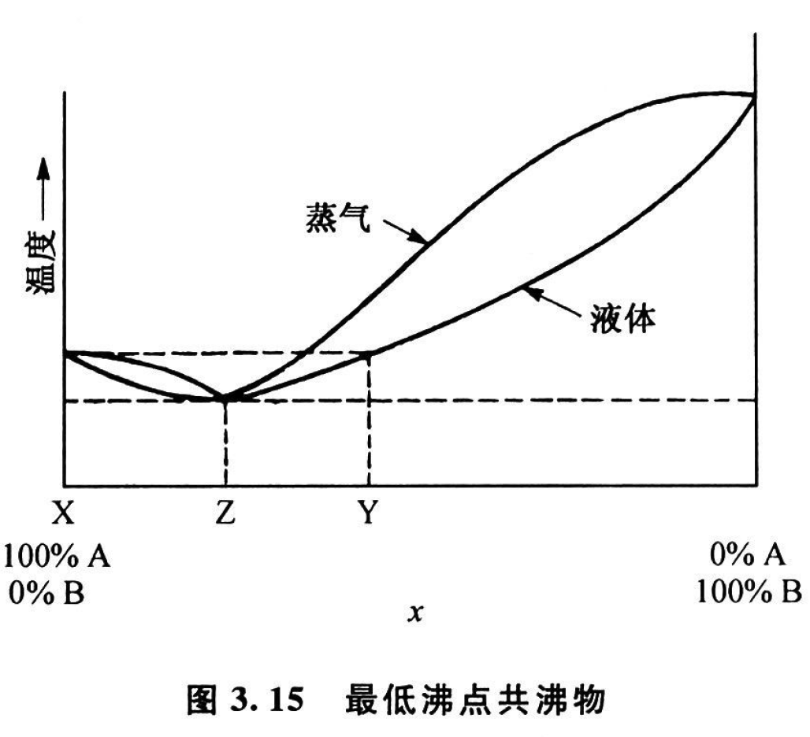

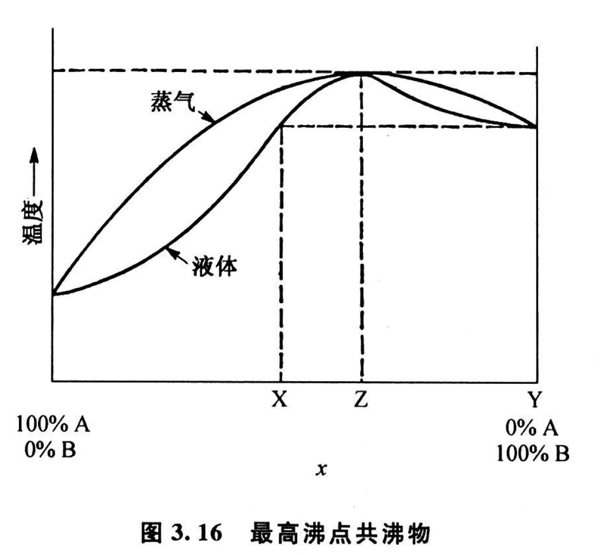

### (四)装置

按图3.12自下而上地进行安装。先夹住蒸馏瓶，再装上 Hemple 分馏柱和蒸馏头。调节夹子使分馏柱垂直，装上冷凝管并在指定的位置夹好夹子，夹子一般不要夹得太紧。连接接引管并用磨口夹固定，再将接收瓶与接引管用磨口夹固定。但切记**不可用磨口夹支持太重的物品**。比如大的接收瓶，或要在蒸馏过程中接收较多蒸出液的小接收瓶，最好在接收瓶底垫上石棉网，可根据实际情况采取不同的办法。分馏操作和蒸馏基本相同，但要特别注意控制温度，并随时注意收集不同温度区间的不同馏分。具体操作是，将待分馏的混合物放入圆底烧瓶中，加入沸石或磁子。柱的外围可用保温材料包住，以减少柱内热量的散发(对流、传导及辐射等导致的热量损失均会减低分馏柱的效率)，加热，液体沸腾后要注意调节浴温，使蒸气慢慢升入分馏柱，约10~ 15 min 后蒸气到达柱顶。当有馏出液滴出后，调节浴温使得蒸出液体的速率控制在**每2~ 3s馏出1滴**，待低沸点组分蒸完后，再渐渐升高温度。当第二个组分蒸出时会产生沸点的迅速上升。

## 3.5 减压蒸馏

减压蒸馏是分离和提纯有机化合物的一种重要方法。它特别适用于那些**在简单蒸馏时未达沸点即已受热分解、氧化或聚合**的物质。

### (一)原理

液体的沸点是指它的蒸气压等于外界大气压时的温度。所以，液体沸腾的温度是随外界压力的变化而变化的。因而如用真空泵连接盛有液体的容器，使液体表面上的压力降低，即可降低液体的沸点。这种在较低压力下进行蒸馏的操作称为**减压蒸馏**。

给定压力下的沸点可以近似地由下列公式求出：

$$\lg p = A + B/T$$

式中p为蒸气压，T为沸点(热力学温度)，A、B为常数。如以 $\lg p$为纵坐标，$1/T$ 为横坐标作图，可以近似地得到一直线。因此，可从两组已知的压力和温度算出A和B的数值。再将所选择的压力代入上式算出液体的沸点。但实际上许多物质沸点的变化不能完全如此，这是由物质的物理性质(主要是**分子在液体中缔合程度**)所决定的。因此在实际减压蒸馏中，我们可以参考图 3.17 和3.18 的经验关系图来估计一个化合物的沸点和压力的关系，即从某一已知常压下的沸点推算出某一压力下的沸点。

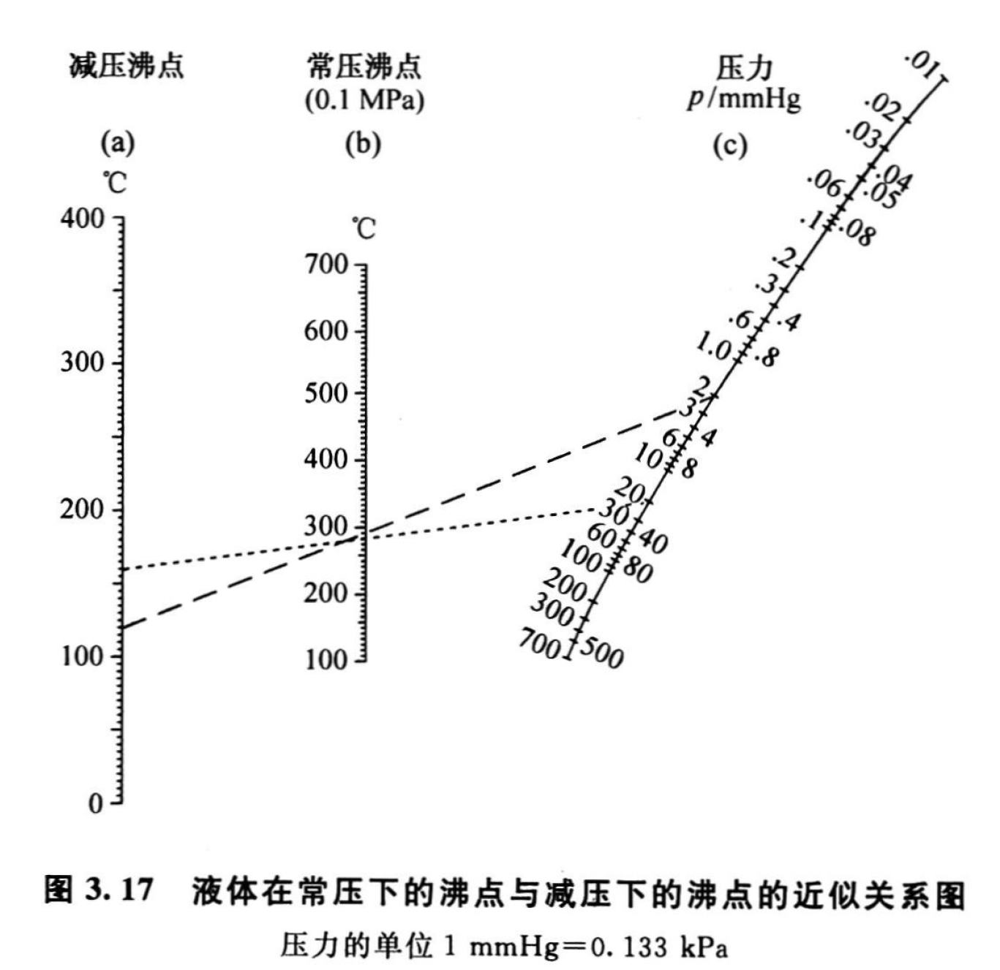

1.图3.17的应用

已知某一个液体化合物在常压下沸点为290℃，实验中循环水泵减压下蒸馏体系压力为 20 mmHg(2.67 kPa)。该压力下，这一液体化合物的沸点是多少呢？用尺子连接(c)上的 20 mmHg(2.67 kPa)与(b)上的 290 ℃两点，延伸至(a)上的 160 ℃，便是该液体化合物在 20 mmHg下的沸点(约为160℃)，表示为160℃/2.67 kPa。同理，当已知某一液体化合物文献沸点为120℃/2 mmHg(0.266 kPa)，也可以用图3.17估计出其常压下的沸点约为295℃。

在一些有机化学手册中可以查到某些有机化合物的A、B常数值，这样即可直接计算出任一压力下的近似沸点，有些手册则直接给出化合物的蒸气压与沸点关系图(图3.18)。

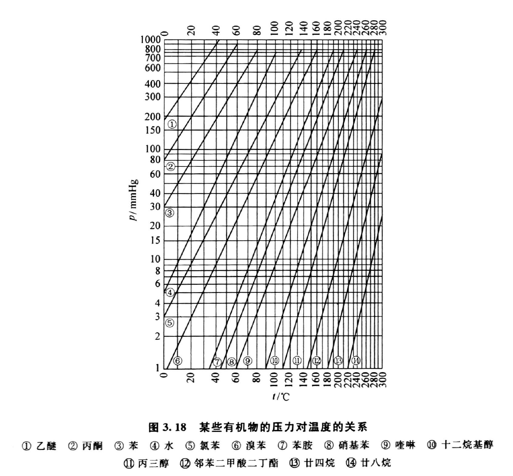

表3.4列出了水和一些有机化合物在常压与不同压力下的沸点。

**表3.4 水和某些有机化合物在常压和不同压力下的沸点(℃)**

| 化合物 p/mmHg | 水   | 氯苯  | 苯甲醛 | 水杨酸乙酯 | 甘油  | 蔥   |
| --- | --- | --- | --- | --- | --- | --- |
| 760 | 100 | 132 | 179 | 234 | 290 | 354 |
| 50  | 38  | 54  | 95  | 139 | 204 | 225 |
| 30  | 30  | 43  | 84  | 127 | 192 | 207 |
| 25  | 26  | 39  | 79  | 124 | 188 | 201 |
| 20  | 22  | 34.5 | 75  | 119 | 182 | 194 |
| 15  | 17.5 | 29  | 69  | 113 | 175 | 186 |
| 10  | 11  | 22  | 62  | 105 | 167 | 175 |
| 5   | 1   | 10  | 50  | 95  | 156 | 159 |

\*1 mmHg=0.133 kPa。

从表3.4中可以总结出以下经验规律：(i)当压力降低到2.67 kPa (20 mmHg)时，大多数有机物的沸点比常压0.1 MPa(760 mmHg)的沸点低100~ 120℃；(ii)当减压蒸馏在1.33~ 3.33 kPa (10~ 25mmHg)之间进行时，大体上压力每相差0.133 kPa (1 mmHg)，沸点约相差1℃。对于具体某个化合物减压到一定压力后其沸点是多少，可以查阅有关资料，但更重要的是通过实验确定。

2.真空度的划分

所谓真空只是相对真空，我们把任何压力较常压为低的气态空间均称为真空。因此真空在程度上有很大的差别。为了应用方便，常常把不同程度的真空划分成几个等级。

(1)**低真空**(气压760~ 10 mmHg，101~ 1.33 kPa)

一般在实验室中可用**水泵**获得。水泵的抽空效力与水压、泵中水流速率及水温有关。好的水泵所能达到的最大真空度受**水的蒸气压**所限制，因此水源温度在3~ 4℃时，水泵减压下的体系压力不会低于6mmHg(0.8kPa)；而水源温度在20~ 25℃时，体系压力最低只能达到17~ 25 mmHg(2.26~ 3.33 kPa)。在不同温度下，水的蒸气压见表3.5。

(2)**中度真空**(气压10~ 10^-3 mmHg，1.33~ 0.133 × 10^-3 kPa)

一般可用**油泵**获得，最好可达到0.001 mmHg(0.133 × 10^3 kPa)左右。

(3)**高真空**(10~ 3~ 10^-8 mmHg，0.133 × 10^3~ 0.133 × 10^-8 kPa)

在实验室获得高真空主要用**扩散泵**。它是利用一种液体的蒸发和冷凝，使空气附着在凝聚时所形成的液滴的表面上，达到富集气体分子的目的而被另一泵抽出。该泵在这里的作用，一方面是抽走集结的气体分子，另一方面它可以降低所用液体的气化点，使其易沸腾。扩散泵所用的工作液可以是汞或其他特殊油类，其极限真空主要决定于工作液体的性质。

### (二)装置

常用的减压蒸馏系统可分为**蒸馏**、**抽气(减压)**、**安全系统**和**测压**四部分，如图3.19所示。整套仪器必须装配紧密，所有接头需润滑并密封，防止漏气，这是保证减压蒸馏顺利进行的先决条件。

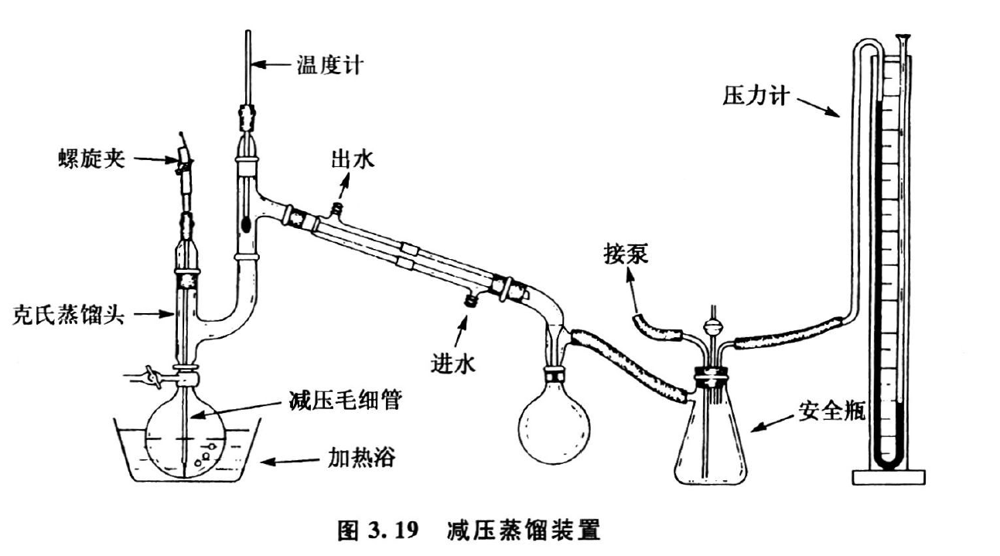

#### 1.蒸馏

减压蒸馏瓶又称**克氏(Claisen)蒸馏瓶**，为了避免减压蒸馏时瓶内液体由于沸腾而冲入冷凝管，在磨口仪器中用**克氏蒸馏头配圆底烧瓶**，瓶的一颈中插入温度计；另一颈中插入一根**毛细管**，其长度恰好使其下端距瓶底1~ 2mm。毛细管上端连有一段**带螺旋夹的橡皮管**。螺旋夹用以调节进入空气的量，使有极少量的空气进入液体，呈**微小气泡**冒出，作为液体沸腾的气化中心，使蒸馏平稳进行。现多采用**电磁搅拌**，磁子的搅拌带动液体的旋转，可起到同样作用。接收器可用圆底烧瓶，切不可用平底烧瓶或锥形瓶。蒸馏时若要收集不同的馏分而又不中断蒸馏，则可用**两尾或多尾接收管**(图3.20)，多尾接收管与圆底烧瓶连接起来。转动多尾接收管，就可使不同的馏分进入指定的接收器中。

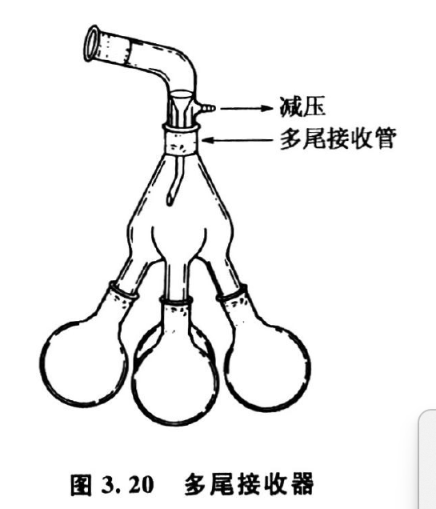

如果蒸馏的液体量不多而且沸点甚高，或是低熔点的固体，可**不用冷凝管**，而将克氏瓶的支管通过接收管直接使用(图3.20)。蒸馏沸点较高的物质时，最好用保温材料包裹蒸馏瓶的两颈，以减少散热。

#### 2.减压

实验室通常用水泵或油泵进行减压。

(1)水泵

水泵所能达到的最低压力为当时**室温下的水蒸气压**(表3.5)。例如在水温为6~ 8℃时，水蒸气压为7.0~ 8.0mmHg(0.93~ 1.07 kPa)；在夏天，若水温为30℃，则水蒸气压为31.6 mmHg(4.2 kPa)左右。用水循环泵代替简单的水泵，方便、实用和节水。

表3.5 温度在1~ 30℃时水的蒸气压

| t/°C | p/mmHg | t/°C | p/mmHg | t/°C | p/mmHg |
| --- | --- | --- | --- | --- | --- |
| 1   | 4.9 | 11  | 9.8 | 21  | 18.5 |
| 2   | 5.3 | 12  | 10.5 | 22  | 19.7 |
| 3   | 5.7 | 13  | 11.2 | 23  | 20.9 |
| 4   | 6.1 | 14  | 11.9 | 24  | 22.2 |
| 5   | 6.5 | 15  | 12.7 | 25  | 23.5 |
| 6   | 7.0 | 16  | 13.6 | 26  | 25.0 |
| 7   | 7.5 | 17  | 14.5 | 27  | 26.5 |
| 8   | 8.0 | 18  | 15.4 | 28  | 28.1 |
| 9   | 8.6 | 19  | 16.4 | 29  | 29.8 |
| 10  | 9.2 | 20  | 17.4 | 30  | 31.6 |

(2)油泵

好的油泵能抽至真空度为10^-1~ 10^-3mmHg(0.133×10^1~ 0.133×10^-3 kPa)。一般使用油泵时，系统的压力常控制在1~ 5mmHg(0.133~ 0.665 kPa)之间，因为在沸腾液体表面上要获得1mmHg以下的压力比较困难。这是由于蒸气从瓶内的蒸发面逸出而经过瓶颈和支管(内径为4~ 5mm)时，需要有一定的压力差，如果要获得较低的压力，可选用短颈和支管粗的克氏蒸馏瓶。

#### 3.测压装置

当用油泵进行减压时，为了防止易挥发的有机溶剂、酸性物质和水汽进入油泵，必须在馏液接收器与油泵之间顺次安装**冷却阱和几种吸收塔**，以免污染油泵用油、腐蚀机件致使真空度降低。冷却阱的构造如图3.21所示，将它置于盛有冷却剂的广口保温瓶中，冷却剂的选择随需要而定，例如可用冰-水、冰-盐、干冰与丙酮等。后者能使温度降至-78℃。吸收塔(又称干燥塔)(图3.21)，通常设两个，前一个装无水氯化钙(或硅胶)，后一个装粒状氢氧化钠。有时为了吸除烃类气体，可再加一个装**石蜡片**的吸收塔。

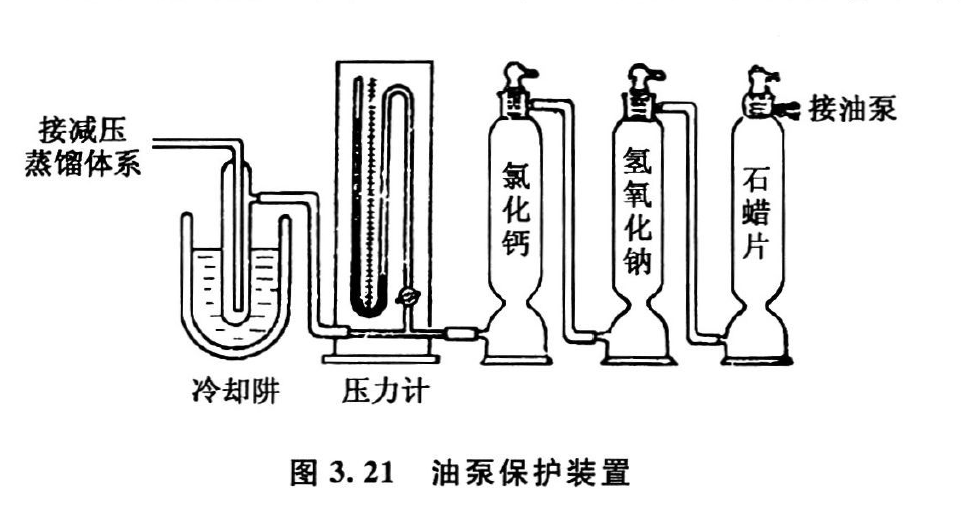

图3.21 油泵保护装置

实验室通常采用水银压力计或真空表来测量减压系统的压力。图3.22(a)(1)为开口式水银压力计，两臂汞柱高度之差即为大气压力与系统中压力之差。因此，蒸馏系统内的实际压力(真空度)应是大气压力减去这一压力差。封闭式水银压力计[图3.22(a)(2)]，两臂液面高度之差即为蒸馏系统中的真空度。测定压力时，可将管后木座上的滑动标尺的零点调整到右臂的汞柱顶端线上，这时左臂的汞柱顶端线所指示的刻度即为系统的真空度。开口式压力计较笨重，读数方式也较麻烦，但读数比较准确。封闭式的比较轻巧，读数方便，但常常因为有残留空气以致不够准确，需用开口式来校正。(3)为转动式真空规，又称麦氏真空规(Mcleod vacuum gauge)，当体系内压力降至1mmHg以下时使用。所有的压力计使用时都应避免水或其他污物进入压力计内，否则将严重影响其准确度。图3.22(b)为真空表，是循环水泵中常用的测压仪表。水泵未工作状态下，表的初始值为0；水泵工作状态下，其测量值介于0~ -0.1 MPa 之间。真空表上的指示值不是真空度的绝对值，而是真空度的相对值。如真空表的读数为0.095，则系统内的压力为$1.01 \times 10^5 \times(1-0.095)Pa$，即约为5kPa(38 mmHg)。

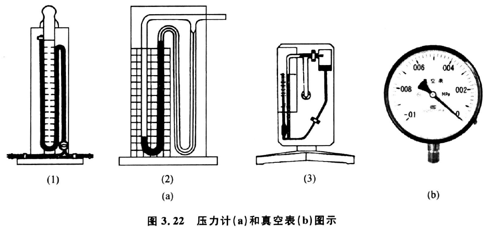

### (三)操作方法

仪器安装好后，需**先试系统是否漏气**，方法是：关闭毛细管，减压至压力稳定以后，捏住连接系统的橡皮管，观察压力计有无变化，无变化说明不漏气，有变化即表示漏气。漏气，可能是接头部分连接不紧密，或没有用油脂润滑好。检查仪器不漏气后，加入待蒸的液体，量不要超过蒸馏瓶容积的一半。开始减压，调节螺旋夹，**使液体中有连续平稳的小气泡通过**(如无气泡，可能毛细管已阻塞，应予更换)。开启冷凝水，选用合适的热浴加热蒸馏。加热时，克氏瓶的圆球部位至少应有2/3浸入浴液中。在浴液中放一温度计，控制浴温比待蒸馏液体的沸点约高20~ 30℃，使每秒钟馏出1~ 2滴，在整个蒸馏过程中，都要密切注意瓶颈上的温度计和压力的读数。经常注意蒸馏情况和记录压力、沸点等数据变化。

往往开始时有低沸点馏分，待观察到沸点稳定不变时，转动燕尾管收接馏分。蒸完后，应先移去加热浴，待蒸馏瓶冷后再慢慢开启安全瓶活塞放气。因有些化合物较易氧化，热时突然放入大量空气会发生爆炸事故！放气后再关水泵或停止油泵转动。

**【注意事项】** (1)在减压蒸馏系统中切勿使用有裂缝的或薄壁的玻璃仪器，尤其不能用不耐压的平底瓶(如锥形瓶)。因为使用水泵抽真空，装置外部面积受到的压力较高，不耐压的部分可引起内向爆炸。 (2)减压蒸馏最重要的是**系统不漏气，压力稳定，平稳沸腾**。为了防止暴沸，保持稳定沸腾，可采用磁子搅拌或拉制一根细而柔软的毛细管尽量伸到蒸馏瓶底部。**在减压蒸馏中加入沸石，一般对防止暴沸是无效的**。蒸馏时，为了控制毛细管的进气量，可在露于瓶外的毛细玻璃管上套一段乳胶管，并夹一螺旋夹，最好在橡皮管中插入一段细铁丝，以免因螺旋夹夹紧后不通气，或夹不紧进气量过大。 (3)在减压蒸馏中，有些化合物遇空气很易氧化，在减压时，可由毛细管通入氮气或二氧化碳气保护。 (4)蒸出液接收部分，通常使用**燕尾管**，连接两个梨形瓶或圆底烧瓶。在安装接收瓶前需先称每个瓶的质量，并作记录以便计算产量。 (5)在使用水泵时应特别注意因水压突然降低，使水泵不能维持已经达到的真空度，蒸馏系统中的真空度比该时水泵所产生的真空度高，因此，**水会流入蒸馏系统玷污产品**。为了防止这种情况，需在水泵和蒸馏系统间安装**安全瓶**。

## 3.6 水蒸气蒸馏

水蒸气蒸馏是分离和纯化有机化合物的常用方法之一。进行水蒸气蒸馏时，对要分离的有机化合物有以下要求： (1)不溶或微溶于水，这是满足水蒸气蒸馏的先决条件。 (2)长时间与水共沸时不与水发生反应。 (3)近于100℃时有一定的蒸气压，一般不少于10 mmHg(1.33 kPa)。

许多不溶于水或微溶于水的有机化合物，无论是固体还是液体，只要在100℃左右具有一定的蒸气压，即有一定的挥发性时，若与水在一起加热就能与水同时蒸馏出来，这就称为水蒸气蒸馏。利用水蒸气蒸馏可把这些化合物同其他挥发性更低的物质分开而达到分离提纯的目的。水蒸气蒸馏也是从动植物中提取芳香油等天然产物最常用的方法之一。

### (一)原理

互不混溶的挥发性物质的混合物，其中每一组分i在一定温度时的分压$p_i$等于在同一温度下的纯化合物的蒸气压，即$p_i=p_i^0$，而不取决于混合物中各化合物的摩尔分数，这就是说，混合物的每一组分是独立地蒸发的。这一性质与互溶液体的溶液完全相反，而两种互溶的液体的蒸气压服从拉乌尔定律，各自的蒸气压与它们的摩尔分数成正比。因此根据道尔顿(Dalton)分压定律，不互溶的挥发性有机物质在某一温度下的总蒸气压力为

$(p_i)_{总} = p_1^0 + p_2^0 + … + p_n^0$

式中$p_1^0$、$p_2^0$、$p_n^0$表示各分组分的分压等同于同一温度下纯化合物蒸气压。任何温度下的总蒸气压力，总是大于任一组分的蒸气压，等于各组分的分蒸气压力之和，$(p_i)_{总}$随着温度升高而增加，直到其等于外部大气压力时，液体即开始沸腾。显然，不互溶的混合物的沸点要比沸点最低的某个组分单独存在时的沸点低。

而对于水蒸气蒸馏情况来说，$(p_i)_{总}=p_{水}^0 + p_{苯}^0$，也就是说，水蒸气蒸馏时，沸腾的温度要低于水的正常沸点$[(p_i)_{总}> p_{水}^0]$。如水的沸点为100℃，甲苯为111 ℃，当两者混合在一起进行水蒸气蒸馏时，沸腾温度为84.6℃，在此温度下水的蒸气压为424 mmHg (56.39kPa)，甲苯为336 mmHg(44.69 kPa)，两者之和等于760mmHg(0.1 MPa)，即当时之大气压。

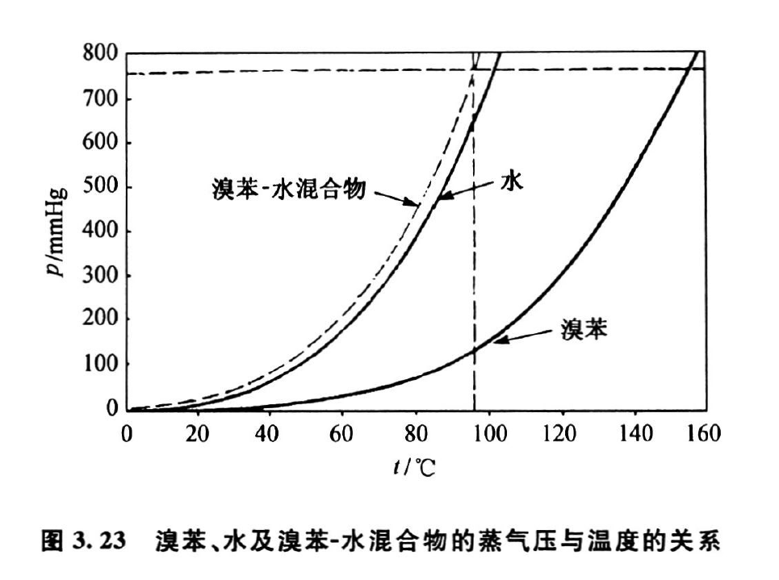

水蒸气蒸馏中冷凝液的组成由所蒸馏的化合物的相对分子质量以及在此蒸馏温度时它们相应的蒸气压来决定。如把它们当做理想体系，就可利用理想气体定律，得到下面两式：

$p_{水}^0 V_{水} = \frac{m_{水}}{M_{水}}RT$(1)

$p_{s}^0 V_{s} = \frac{m_{s}}{M_{s}}RT$(2)

式中$p^0$代表纯液体的蒸气压，V是气体的体积，m是气相下该组分的质量(以克为单位)，M为相对分子质量，R为摩尔气体常数，T为热力学温度，s代表具有一定挥发性的有机物质。

将(1)式比(2)式，得

$\frac{p_{水}^0 V_{水}}{p_{s}^0 V_{s}} = \frac{m_{水} M_{s}}{m_{s} M_{水}}$

在水蒸气蒸馏条件下，$V_{水}=V_{s}$。并且蒸馏温度相等，故可以把上式变为

$\frac{m_{s}}{m_{水}} = \frac{p_{s}^0 M_{s}}{p_{水}^0 M_{水}}$

上式表明，这两种物质在馏液中的相对质量(就是它们在蒸气中的相对质量)与它们的蒸气压和相对分子质量成正比。

在95℃时溴苯和水的混合物的蒸气压分别为120 mmHg(16.0 kPa)和 640 mmHg (85.1 kPa，见图3.23)，其蒸出液的组分可以从上述方程式计算获得：

$\frac{m_{溴苯}}{m_{水}} = \frac{120 \times 157}{640 \times 18} = \frac{1.64}{1}$

尽管溴苯在蒸馏温度时的蒸气压很小，但由于溴苯的相对分子质量远远大于水的相对分子质量，所以按质量计算在水蒸气馏液中溴苯要比水多。1g的水能带出1.64g溴苯，溴苯在溶液中的组分占62%。

鉴于通常有机化合物的相对分子质量要比水大得多，所以即使有机化合物在100℃时蒸气压只有10mmHg(1.33 kPa)，用水蒸气蒸馏亦可获得良好效果。甚至固体(例如粗萘)也常用水蒸气蒸馏提纯。

再如，苯胺和水在98.4℃时蒸气压分别为42.5 mmHg (5.73 kPa)和 717.5 mmHg (94.8 kPa)。从计算得到，馏液中苯胺的含量应占24%，但实际上所得到的比例比较低。这主要是苯胺微溶于水，导致水的蒸气压降低所引起。上述关系式**只适用于与水不相互溶的物质**。而实际上很多化合物在水中或多或少有些溶解。因此这样的计算只是近似的。如果蒸气压在1~ 5mmHg(0.13~ 0.67 kPa)，则其在馏液中的含量仅占1%，甚至更低。为使馏液中的含量增高，就要想办法提高此物质的蒸气压，也就是说，要提高温度，使蒸气的温度超过100℃，即要用**过热水蒸气蒸馏**。

### (二)装置

水蒸气蒸馏的装置一般由**蒸气发生器**和**蒸馏装置**两部分组成(图3.24和3.26)。这两部分在连接部分要尽可能**紧凑**，以防蒸气在通过较长的管道后部分冷凝成水，而影响水蒸气蒸馏的效率。如果从实验室的蒸气管道取得蒸气，在管道与蒸馏瓶之间接上**气液分离器**(图3.25)或装上一个T形管以除去其中的冷凝水，即在T形管下端连一个弹簧夹，以便及时除去冷凝下来的水滴。

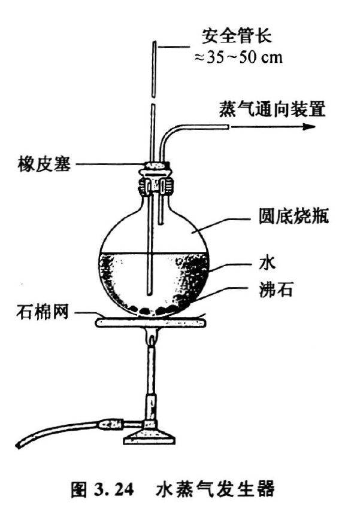

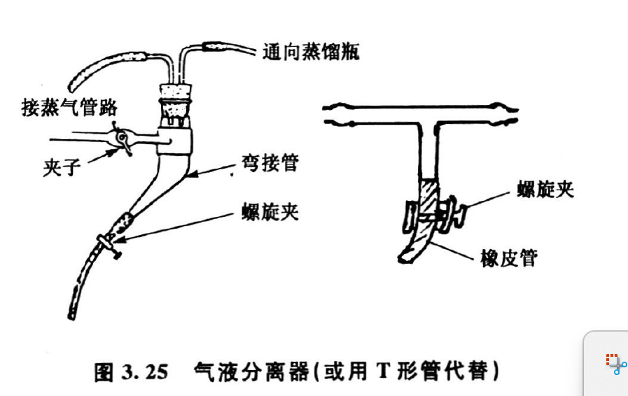

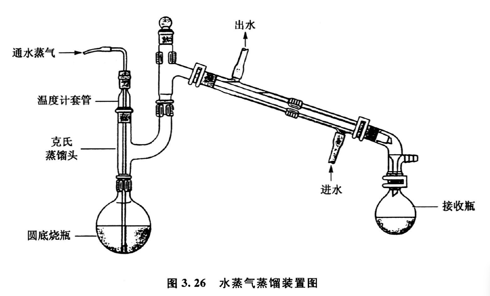

### (三)操作步骤

水蒸气蒸馏通常采用以下两种方法：

**方法1** 将需蒸馏的有机化合物放在装有**克氏蒸馏头**的圆底烧瓶中，克氏蒸馏头与冷凝管相接(克氏蒸馏头用来防止蒸馏时蒸馏瓶中的混合物溅入冷凝管)。然后将水蒸气经玻璃管导入蒸馏瓶的底部。在较长时间进行水蒸气蒸馏时，外部通入的水蒸气可能有部分在蒸馏瓶内冷凝下来，为此可**温和地加热蒸馏瓶**以防止水蒸气冷凝。

**方法2** 如果只要少量水蒸气就可以把所有的有机物蒸出的话，就可以省去水蒸气发生器，而直接将有机化合物与水一起放在蒸馏瓶内，加热蒸馏瓶，使之产生水蒸气进行蒸馏。

值得注意的是，第一种方法先将被蒸物放入蒸馏瓶中，加热水蒸气发生器，**直至水开始沸腾后，才可以将T形管上的螺旋夹旋紧，使蒸气直接进入蒸馏瓶**。

水蒸气蒸馏过程中，可以看见一滴滴**混浊液**随热蒸气冷凝聚集在接收瓶中。当被蒸物质全部蒸出后，蒸出液由混浊变澄清，此时不要结束蒸馏，要再**多蒸出10~ 20 mL的透明馏出液**方可停止蒸馏(目的：为了将附着在蒸馏装置内壁和残留在蒸汽空间中的产物“冲洗”和“推送”出来，从而确保产物被完全收集，以提高产率)。

中断或结束蒸馏时，一定要**先打开连接于水蒸气发生器与蒸馏装置之间的T形管上的螺旋夹，使体系通大气**，然后再停止加热，拆下接收瓶后，再按顺序拆除各部分装置。如果随水蒸气挥发的物质具有较高的熔点，在冷凝后易于析出固体，则应**调小冷凝水的流速**，使它冷凝后仍然保持液态。如已有固体析出并且接近阻塞时，要暂时停止冷凝水的流通，甚至需要将冷凝水暂时放去，以使物质熔融后随水流入接收器中。

## 3.7 干燥和干燥剂

有机化合物在进行定性或定量分析、波谱分析之前均应经干燥，才会有准确结果。为防止少量水与液体有机化合物生成共沸混合物，或由于少量水与有机物在加热下发生反应而影响产品纯度，在蒸馏前都必须干燥以除去水分。还有许多有机反应需要在绝对无水条件下进行，所用原料和溶剂也均应干燥处理，反应过程也要通过干燥管以防止潮气侵入容器。可见，干燥在有机实验中是极普遍而又重要的操作。

干燥方法可分为**物理方法**和**化学方法**。属于物理方法的有：加热、真空干燥、冷冻、分馏、共沸蒸馏及吸附等。化学方法是利用干燥剂去水。干燥剂按其去水作用可分为两类：(i)能与水可逆地生成水合物，如硫酸、氯化钙、硫酸钠、硫酸镁、硫酸钙等；(ii)与水反应后生成新的化合物，如金属钠、五氧化二磷等。

表3.6列出常用干燥剂性质及适用范围。

**表3.6 常用干燥剂简介**

| 干燥剂 | 性质  | 与水作用产物 | 适用范围 | 非适用范围 | 备注  |
| --- | --- | --- | --- | --- | --- |
| CaCl2 | 中性  | CaCl2 • H2O， CaCl2 • 2H2O， CaCl2 • 6H2O (30℃以上失水) | 烃、卤代烃、烯、酮、醚、硝基化合物、中性气体、氯化氢(保干器) | 醇、胺、氨、酚、酯、酸、酰胺及某些醛酮 | 吸水量大，作用快，效力不高，是良好的**初步干燥剂**，廉价，含有碱性杂质氢氧化钙 |
| Na2SO4 | 中性  | Na2SO4 • 7H2O， Na2SO4 • 10H2O (33℃以上失水) | 酯、醇、醛、酮、腈、酚、酰胺、卤代烃、硝基化合物，及不能用氯化钙干燥的化合物 |     | 吸水量大，作用慢，效力低，是良好的**初步干燥剂** |
| MgSO4 | 中性  | MgSO4 • H2O， MgSO4 • 7H2O (48℃以上失水) | 同上  |     | 较硫酸钠作用快，效力高 |
| CaSO4 | 中性  | CaSO4 • 1/2H2O， 加热2~ 3h失水 | 烷、芳香烃、醚、醇、醛、酮 |     | 吸水量小，作用快，效力高，可先用吸水量大的干燥剂作初步干燥后再用 |
| K2CO3 | 碱性  | K2CO3 • 3/2H2O， K2CO3 • 2H2O | 醇、酮、酯、胺、杂环等碱性化合物 | 酸、酚及其他酸性化合物 |     |
| H2SO4 | (强)酸性 | H3O+HSO4- | 脂肪烃、烷基卤化物 | 烯、醚、醇及弱碱性化合物 | 脱水效力高 |
| KOH NaOH | (强)碱性 |     | 胺、杂环等碱性化合物 | 醇、酯、醛、酮、酸、酚、酸性化合物 | 快速有效 |
| 金属钠 | (强)碱性 | H2 + NaOH | 醚、三级胺、烃中痕量水分 | 碱土金属或对碱敏感物、氯化烃(有爆炸危险)、醇 | 效力高，作用慢，需经初步干燥后才可用，干燥后需**蒸馏** |
| P2O5 | 酸性  | HPO3， HP2O7， H3PO4 | 醚、烃、卤代烃、腈中痕量水分，酸溶液、二硫化碳(干燥枪、保干器) | 醇、酸、胺、酮、碱性化合物、氯化氢、氟化氢 | 吸水效力高，干燥后需**蒸馏** |
| CaH2 | 碱性  | H2 + Ca(OH)2 | 碱性、中性、弱酸性化合物 | 对碱敏感的化合物 | 效力高，作用慢，先经初步干燥后再用，干燥后需**蒸馏** |
| CaO BaO | 碱性  | Ca(OH)2， Ba(OH)2 | 低级醇类、胺 |     | 效力高，作用慢，干燥后需**蒸馏** |
| 分子筛\* (3Å、4Å) | 中性  | 物理吸附 | 各类有机物、不饱和烃气体(保干器) |     | 快速高效，经初步干燥后再用 |
| 硅胶  |     |     | (保干器) | 氟化氢 |     |

\*分子筛为硅铝酸盐的商品名称，是具有一定直径小孔的结晶形结构。3Å、4Å为分子筛的孔径大小，它仅允许水或其他小分子(如氨分子)进入。由于水化，水被牢牢吸附，水化后分子筛可在常压或减压下300~ 320℃加热脱水活化。

### (一)干燥剂的选择

选择干燥剂应考虑下列条件：首先，干燥剂必须不与被干燥的有机物发生化学反应，并且易与干燥后的有机物完全分离；其次，使用干燥剂要考虑干燥剂的**吸水容量**和**干燥效能**。吸水容量是指单位质量干燥剂所吸收的水量，吸水容量愈大，即干燥剂吸收水分愈多。干燥效能指达到平衡时液体被干燥的程度，对于形成水合物的无机盐干燥剂，常用吸水后结晶水的蒸气压表示(参见表 3.7)。

**表3.7 常用干燥剂的水蒸气压(20℃)**

| 干燥剂 | p(水) /mmHg | p(水) /kPa |
| --- | --- | --- |
| P2O5 | 0.00002 | 0.2 × 10-5 |
| KOH(熔融过) | 0.002 | 0.2 × 10-3 |
| CaSO4(无水) | 0.004 | 0.5 × 10-3 |
| H2SO4(浓) | 0.005 | 0.7 × 10-3 |
| 硅胶  | 0.006 | 0.8 × 10-3 |
| NaOH(熔融过) | 0.15 | 0.02 |
| CaO | 0.2 | 0.027 |
| CaCl2 | 0.2 | 0.027 |
| CuSO4 | 1.3 | 0.173 |
| Na2SO4 | 1.92(25℃) | 0.255 |

例如，硫酸钠能形成10个结晶水的水合物，其吸水容量为1.25，25℃时水蒸气压为1.92 mmHg(256 Pa)。氯化钙最多能形成6个结晶水的水合物，吸水容量为0.97，25 ℃时的水蒸气压为0.20mmHg(27 Pa)。二者相比较，硫酸钠吸水量较大，干燥效能弱；氯化钙吸水量较小，但干燥效能强。所以，应将干燥剂的吸水容量和干燥效能进行综合考虑。有时对含水较多的体系，常先用吸水容量大的干燥剂干燥，然后再使用干燥效能强的干燥剂。

影响干燥剂干燥效能的因素很多，如温度、干燥剂用量、干燥剂颗粒大小、干燥剂与液体或气体接触时间等。以无水硫酸镁干燥含水液体有机化合物为例，由于体系不同，硫酸镁可生成不同水合物且具有不同的水蒸气压，见表3.8a。由表看出，25℃时无水硫酸镁能达到的最低水蒸气压为1mmHg(0.133 kPa)，它是硫酸镁一水合物与无水硫酸镁的平衡压力，与两者的相对量没有关系，无论加入多少无水硫酸镁，想除去全部水分是不可能的。**加入干燥剂过多，会使液体产品吸附受损失**；加入量不足，则不能达到一水合物，反而会形成多水合物，其蒸气压力大于1mmHg(0.133 kPa)。这就是为什么**干燥剂要加适量**，且在使用干燥剂前必须尽可能将水分离除净的缘故。另外，干燥剂成为水合物需要有一个平衡过程，因此，液体有机物进行干燥时**需放置一定时间**。

**表3.8a 硫酸镁的不同结晶水合物的水蒸气压(25℃)**

| 平衡式 | p(水) /mmHg | p(水) /kPa |
| --- | --- | --- |
| $\rightleftharpoons$ | 1   | 0.13 |
| $\rightleftharpoons$ | 2   | 0.27 |
| $\rightleftharpoons$ | 5   | 0.67 |
| $\rightleftharpoons$ | 9   | 1.20 |
| $\rightleftharpoons$ | 10  | 1.33 |
| $\rightleftharpoons$ | 11.5 | 1.50 |

从氯化钙水合物的蒸气压与温度的关系(见表3.8b)看出，温度低，水蒸气压小，干燥效能高。温度升高，尽管可加速干燥剂水合，但另一方面由于水蒸气压也随之增加，干燥剂效能减弱，因此，在液体有机物进行蒸馏之前必须滤除干燥剂。

一般地说，第二类干燥剂干燥效能较第一类高，但吸水容量较小。所以，通常**先用第一类干燥剂除去大部分水分后，再用第二类干燥剂除去残留的微量水**。只有在需要绝对无水的反应条件时，才使用第二类干燥剂。

**表3.8b 氯化钙水合物的水蒸气压和温度的关系**

| t/°C | p(水) /mmHg | p(水) /kPa |
| --- | --- | --- |
| 29.2 | 5.67 | 0.75 |
| 38.4 | 7.88 | 1.05 |
| 45.3 | 11.77 | 1.57 |

此外，选择干燥剂还要考虑干燥速率和价格，可参考表 3.6。

### (二)干燥剂的使用方法

以无水氯化钙干燥乙醚为例。室温下水在乙醚中溶解度为1%~ 1.5%，现有100 mL乙醚，估计其中含水量约1.00g。假定无水氯化钙在干燥过程中全部转变为六水合物，其吸水容量为0.97(即1.00g无水氯化钙可以吸收0.97g水)，这就是说，按理论推算用1g氯化钙可将100 mL乙醚中的水除净。**但实际用量却远大于1g**。其原因是在用乙醚从水溶液中萃取分离某有机物时，乙醚层中水相不能完全分离干净；无水氯化钙在干燥过程中转变为六水合物需要较长时间，短时间往往不能达到无水氯化钙应有的干燥容量。鉴于以上主要因素，要干燥 100 mL含水乙醚，往往要用7~ 10g无水氯化钙。

确定干燥剂的使用量可查阅溶解度手册。根据溶解度进行估算，**一般有机物结构中含有亲水基时，干燥剂应过量**。这种办法仅仅提供理论参考，由于实际反应因素复杂，最重要的还是在实验中不断积累经验。

在实际操作中，一般干燥剂的用量为每10mL液体约需0.5~ 1g。但由于液体产品中水分含量不同，干燥剂质量不同，颗粒大小不同，干燥温度不同，因此不能一概而论。一般应分批加入干燥剂，每次加入后要振荡，并仔细观察，如果干燥剂全部粘在一起，说明用量不够，需再加入一些干燥剂，**直到出现无吸水的、松动的干燥剂颗粒**。放置一段时间后，观察被干燥的溶液是否透明。干燥时间应根据液体量、含水情况而定，**一般约需30~ 40 min**，甚至更长。干燥过程中应多**摇动几次**，以便提高干燥效率。多数干燥剂的水合物在高温时会失水，降低干燥效能，故在蒸馏前必须把干燥剂过滤除去。块状干燥剂(如氯化钙)用时要**破碎成粒状**，颗粒大小似黄豆粒。若研成粉末，干燥效果虽好，但过滤困难，难以与产品分离，影响纯度和产量。

经干燥，液体透明，并不能说明该液体已不含水分，透明与否和水在该化合物中的溶解度有关。例如20℃乙醚中，可溶解1.19%的水；乙酸乙酯中可溶解 2.98%的水，只要含水量不超过溶解度，含水的液体总是透明的。在这样的液体中，加干燥剂的量必然要大于常规量。某些干燥剂如金属钠、石灰、五氧化二磷等，由于它们和水生成比较稳定的产物，有时可不必过滤而直接蒸馏。

有些溶剂的干燥不必加干燥剂，借其和水可形成共沸混合物的特点，直接进行**蒸馏**把水除去。如苯、甲苯、四氯化碳等。例如工业上制备无水乙醇就是利用乙醇、水、苯三者形成共沸混合物的特点，与95%乙醇中加入适量苯进行共沸蒸馏。前馏分为三元共沸混合物；把水蒸完后，即为乙醇与苯的二元共沸物；无苯后，沸点升高即为无水乙醇。但该乙醇中带有微量苯，不宜作为光谱溶剂。

## 3.8 萃取

从固体或液体混合物中分离所需的有机化合物，最常用的操作是萃取。萃取广泛用于有机产品的纯化，应用萃取可从固体或液体混合物中萃取出所需要的物质，如天然产物中各种生物碱、脂肪、蛋白质、芳香油和中草药的有效成分等都可用萃取的方法从动植物中获得；也可以用于除去产物中的少量杂质。通常称前者为“萃取”或“提取”、“抽取”，后者为“洗涤”。洗涤也是一种萃取。根据被萃取物质形态的不同，萃取又可分为从溶液中萃取(液-液萃取)和从固体中萃取(固-液萃取)两种萃取方法。

### (一)原理

萃取是利用有机化合物在两种不互溶(或微溶)的溶剂中的**溶解度或分配比不同**而得到分离。可用与水不互溶的有机溶剂从水溶液中萃取有机化合物来说明。在一定温度下，有机物在有机相中和在水相中的浓度比为一常数。若$c_o$表示有机物在有机相中的浓度(g/mL)，$c_1$表示有机物在水中的浓度(g/mL)，温度一定时，$c_o/c_1=k$，k是一常数，称为“分配系数”。它可以被近似地认为是有机物在两溶剂中的溶解度之比。由于有机物在有机溶剂中的溶解度比在水中大，因而可以用有机溶剂将有机物从水中萃取出来。

用一定量的溶剂一次或分几次从水中萃取有机物，其萃取效率是否相同呢？设$s_0$为水溶液的毫升数；$s$为每次所用萃取剂的毫升数；$x_0$为溶解于水中的有机物的克数；$x_1$，…， $x_n$分别为萃取一次至n次后留在水中的有机物克数；k为分配系数。根据k的定义，进行以下推导：

• 一次萃取

$$
k = \frac{c_o}{c_1} = \frac{(x_0-x_1)/s}{x_1/s_0}
$$

$$
x_1 = x_0 \frac{s_0}{ks+s_0}
$$

• 二次萃取

$$
x_2 = x_1 \frac{s_0}{ks+s_0} = x_0 \left(\frac{s_0}{ks+s_0}\right)^2
$$

• n 次萃取

$$
x_n = x_0 \left(\frac{s_0}{ks+s_0}\right)^n
$$

式$s_0/(ks+s_0)<1$，且当n值愈大时，$x_n$则愈小，说明当用**同样多的溶剂分多次萃取比一次萃取的效果要好**。这一点十分重要，它是提高分离效率的有效途径。根据分配定律，既可求出每次提取出的物质的数量，也可算出经萃取后的剩余量。

但是，连续萃取的次数不是无限度的，当溶剂总量保持不变时，萃取次数(n)增加，s就要减小，n>5时，n和s这两个因素的影响就几乎相互抵消了，再增加n，$x_n/x_{n+1}$的变化不大。因此，一般以**萃取三次**为宜。

另一类萃取剂的萃取原理是利用它能与被萃取物质起**化学反应**。这种萃取常用于从化合物中移去少量杂质或分离混合物，这类萃取剂，一般用5%氢氧化钠、5%或10%的碳酸钠、碳酸氢钠溶液、稀盐酸、稀硫酸等。**碱性萃取剂可以从有机相中移出有机酸**，或从有机溶剂(其中溶有有机物)中除去酸性杂质(成钠盐溶于水中)；反之，**酸性萃取剂可从混合物中萃取碱性物质(杂质)**等。

固体物质的萃取通常借助于**索氏(Soxhlet)提取器**，是利用溶剂回流及虹吸原理，使固体有机物连续多次被纯溶剂萃取，它具有萃取效率较高、节省溶剂等特点。对受热易分解或变色的物质不宜采用，同时所用溶剂沸点也不宜过高。

#### 补：索氏提取器简介

**一、 索氏提取器的核心用途**

索氏提取器的根本用途是进行**固-液萃取**，特别是当目标化合物在溶剂中的溶解度不高，或者需要**长时间、高效萃取**时。它的核心优势在于通过一个巧妙的**虹吸原理**，实现了连续、自动化的萃取过程，并始终使用**新鲜、纯净、热的溶剂**来萃取样品，从而大大提高了萃取效率和产率。

**二、 结构、原理与用法**

**1\. 仪器结构**

一套完整的索氏提取装置通常由三部分自下而上组装而成：

1.  **圆底烧瓶 (Heating Flask)**：位于最下方，用于盛装萃取溶剂并进行加热。
    
2.  **提取器主体 (Extractor Body)**：这是核心部件，它包含：
    
    -   **提取室 (Thimble Chamber)**：一个较粗的玻璃腔，用于放置装有固体的滤纸筒（Thimble）。
        
    -   **蒸汽旁路管 (Vapor Bypass Tube)**：一根较细的侧管，连接烧瓶和冷凝管，溶剂蒸汽通过此管上升。
        
    -   **虹吸管 (Siphon Tube)**：一根弯曲的细管，一端连接提取室底部，另一端通回烧瓶。当提取室内的液面达到虹吸管的最高点时，会产生虹吸现象，使液体全部流回烧瓶。
        
3.  **冷凝管 (Condenser)**：位于最上方，通常使用球形或蛇形冷凝管，用于将上升的溶剂蒸汽冷却成液体。
    

#### 2\. 工作原理（循环过程）

索氏提取的精妙之处在于其自动循环的过程：加热底部的烧瓶，溶剂沸腾产生蒸汽。蒸汽无法穿过装有样品的提取室，只能沿着**蒸汽旁路管**上升，到达顶部的冷凝管。随后蒸汽在冷凝管中被冷却，凝结成纯净的、热的溶剂液滴。液滴滴入下方的滤纸筒中，浸润并溶解固体样品中的目标化合物。溶剂液面在提取室内不断升高。当液面达到**虹吸管的最高点**时，压力差导致虹吸现象发生，所有溶解了产物的溶剂被迅速、一次性地抽回到下方的烧瓶中。烧瓶中的溶剂继续被加热，由于目标产物通常是难挥发的，只有纯溶剂会再次蒸发，带着产物的溶液则留在烧瓶中。纯溶剂蒸汽再次经过旁路管上升，开始新一轮的萃取循环。 这个过程周而复始，每一次滴入样品的都是**100%纯度的热溶剂**，使得萃取驱动力（浓度差）始终保持最大，效率极高。

#### 3\. 使用方法（操作步骤）

1.  **样品准备**：将待提取的固体样品研磨成粉末，以增大其与溶剂的接触面积。如果样品含水，通常需要先进行干燥处理。精确称量一定量的样品，装入大小合适的**滤纸筒**中。样品的高度不应超过虹吸管的最高点。用脱脂棉或玻璃棉轻轻塞住滤纸筒口，防止样品粉末被冲出。
    
2.  **仪器组装**：将装好样品的滤纸筒放入提取器的提取室中。在圆底烧瓶中加入萃取溶剂（通常为烧瓶容积的1/2到2/3）和几粒**沸石**（防止暴沸）。按“下烧瓶、中提取器、上冷凝管”的顺序组装好仪器，用铁夹固定牢固。确保接口处密封良好（必要时可涂抹少量真空脂）。
    
3.  **开始提取**：连接冷凝管的冷却水，遵循“**下进上出**”的原则。开始加热（通常使用电热套或水浴，避免使用明火，因为多数有机溶剂易燃）。调节加热温度，使溶剂平稳回流，速度以每小时虹吸5-10次为宜。观察虹吸现象是否正常。
    
4.  **结束提取**：当提取室内溶剂的颜色变得很浅或无色，或者经过预定的时间/虹吸次数后，即可停止加热。待仪器完全冷却后，再停止通冷凝水，然后小心地拆卸仪器。
    
5.  **后处理**：此时，目标产物已经富集在圆底烧瓶的溶液中。通常使用**旋转蒸发仪**将烧瓶中的溶剂蒸出回收，剩下的即为粗提物。取出滤纸筒，其中的固体残渣可以干燥后称重，用于后续计算。
    

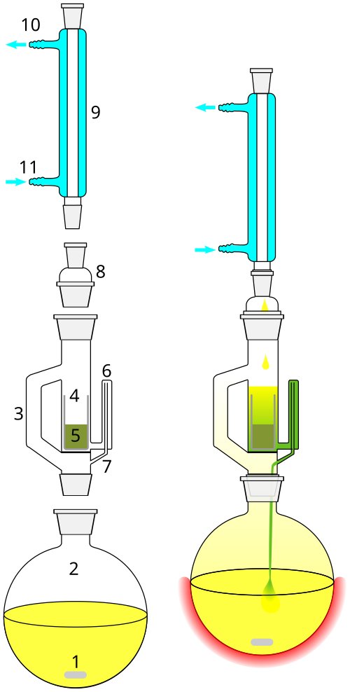

用萃取方法处理固体混合物时，主要根据混合物中各组分在所选溶剂中的溶解度。从液体混合物中萃取物质的情况比较复杂，必须考虑被萃取物在两种不相溶的溶剂内的分配及其分配系数。分配系数是在一定条件下(温度等)被提取物在两液相内达到完全平衡后的浓度关系，其大小约等于该物质在两溶剂内的溶解度之比。在一定温度下，若该物质的分子在两溶液中不发生缔合、溶剂化、溶质的电离等作用时，则此物质在两液层内浓度之比是一定值k，而实验上常见分配系数k由于上述现象而有偏差。

琥珀酸在水(A)和乙醚(B)间的分配系数接近一定值，见表3.9。

**表3.9 25℃琥珀酸在水(A)和乙醚(B)中的分配**

| $c_A$ | $c_B$ | $c_A/c_B$ |
| --- | --- | --- |
| 0.370 | 0.0488 | 7.58 |
| 0.547 | 0.0736 | 7.43 |
| 0.749 | 0.101 | 7.49 |

### (二)萃取溶剂的选择

1.选择合适萃取溶剂的原则

一般从水中萃取有机物，要求**溶剂在水中溶解度很小或几乎不溶**；被萃取物在溶剂中要比在水中溶解度大；对杂质溶解度要小；溶剂与水和被萃取物都不反应；萃取后溶剂应易于用简单蒸馏回收。此外，价格便宜、操作方便、毒性小、溶剂沸点不宜过高、化学稳定性好、密度适当也是应考虑的条件。一般地讲，难溶于水的物质用**石油醚**提取；较易溶于水的物质，用**乙醚或甲苯**萃取；易溶于水的物质则用**乙酸乙酯**萃取效果较好。

2.经常使用的溶剂

乙醚、氯仿、石油醚、二氯甲烷、正丁醇、乙酸乙酯等，其中乙醚效果较好。使用乙醚的最大缺点是容易着火，在实验室中可以小量使用，但在工业生产中不宜使用。

### (三)操作方法

萃取的主要仪器是**分液漏斗**(图3.27)。使用前须在下部活塞上**涂凡士林**（密封），然后，于漏斗中放入水摇荡，检查两个塞子处是否漏水。确实不漏时再使用。

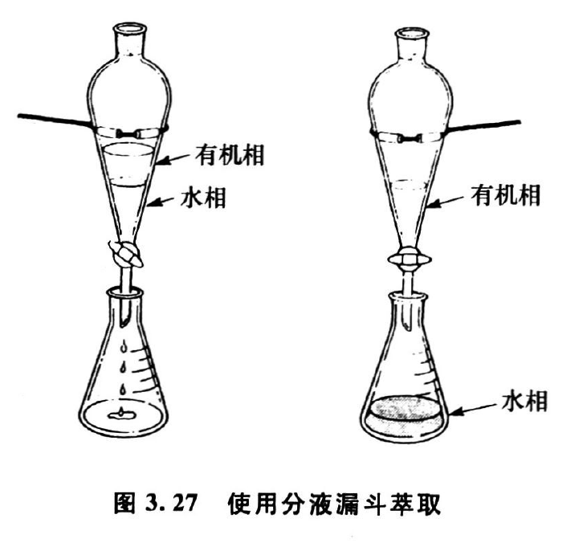

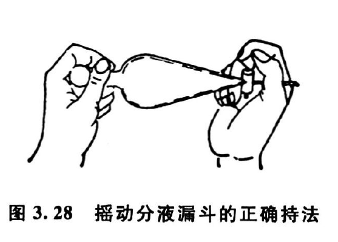

将水溶液倒入分液漏斗中，加入溶剂，塞紧塞子，右手握住漏斗口颈，食指压紧漏斗塞，左手握在漏斗活塞处，拇指压紧活塞，把漏斗放平摇荡，见图3.28，然后，**把漏斗上口向下倾斜**，下部支管指向斜上方，但要注意不要指向其他实验者。左手仍握在活塞支管处，食拇两指**开动活塞放气**(图3.29)，经几次摇荡、放气后，把漏斗架在铁圈上，并把上口塞子上的小槽对准漏斗口颈上的通气孔。待液体分层后，将两层液体分开。**下层液体由下部支管放出，上层液体应由上口倒出**。应注意哪一层为有机溶液，将它存放在干燥的锥形瓶中，水溶液再倒回分液漏斗中，留待再一次萃取。如分不清哪一层是有机溶液，可取少量任何一层液体，于其中加水试，如加水后分层，即为有机相；不分层，说明是水相。

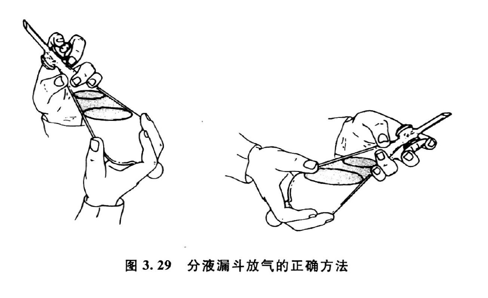

用乙醚萃取时，应特别注意周围不要有明火。摇荡时，用力要小，时间短，**应多摇多放气**，否则，漏斗中蒸气压力过大，液体会冲出造成事故。

用分液漏斗进行萃取，应选择**比被萃取液大1~ 2倍体积**的分液漏斗。初学者往往忽略估计溶液和溶剂的体积，将分液漏斗中的溶液和溶剂装得很满，振摇时不能使溶剂和溶液分散为小的液滴，被萃取物质不能与两溶液充分接触，影响了该物质在两溶液中的分配，降低了萃取效率。

在萃取某些含有**碱性或表面活性较强的物质**(如蛋白质、长链脂肪酸等)时，易出现经摇振后溶液乳化，不能分层或不能很快分层的现象。原因可能由于两相分界之间存在少量轻质的不溶物；也可能两液相交界处的表面张力小；或由于两液相密度相差太少。碱性溶液(例如氢氧化钠等)能稳定乳状质的絮状物而使分层更困难，这种情况下可采取如下措施：(i)采取长时间静置；(ii)利用“盐析效应”，在水溶液中先加入**一定量电解质(如氯化钠)**，或加饱和食盐水溶液，以提高水相的密度，同时又可以**减少有机物在水相中的溶解度**；(iii)滴加数滴**醇类化合物**，改变表面张力；(iv)**加热**，破坏乳状液(注意防止易燃溶剂着火)；(v)过滤，除去少量轻质固体物(必要时可加入少量吸附剂，滤除絮状固体)。若在萃取含有表面活性剂的溶液时形成乳状溶液，当实验条件允许时，可小心地**改变pH，使之分层**。当遇到某些有机碱或弱酸的盐类，因在水溶液中能发生一定程度解离，很易被有机溶剂萃取出水相，为此，在溶液中要加入**过量的酸或碱**，以达到顺利萃取之目的。

## 3.9 薄层色谱

### (一)原理

薄层色谱(thin-layer chromatography)常用TLC代表。

根据薄层色谱所采用的薄层材料性质的不同，其物理化学原理也有所不同。据此，可分为下面几种： (1)**吸附薄层色谱**：采用硅胶、氧化铝等吸附剂铺成薄层，利用吸附剂表面对不同组分吸附能力的差别达到分离的目的。 (2)分配薄层色谱：由硅胶、纤维素铺成薄层，不同组分在指定的两相中有不同的分配系数。 (3)离子交换薄层色谱：由含有交换活性基团的纤维素铺成薄层。 (4)排阻薄层色谱：利用样品中分子大小不同、受阻情况不同加以分离，也称凝胶薄层。

此外，还有利用氢键能力的强弱而分离的聚酰胺薄层色谱等。

吸附薄层色谱是使用最为广泛的方法。在层析过程中主要发生**物理吸附**。物理吸附具有普遍性、无选择性，吸附过程是可逆的，吸附剂对不同溶质吸附能力差别较大。这一差异的根源主要是由化学结构的差异所引起的。

在含氧吸附剂上，例如**硅胶和氧化铝**，吸附物与吸附剂之间的作用力包括静电力、诱导力和氢键作用力，前两者为范德华力。**被分离物质的极性越大，与极性吸附剂的作用就越强**；非极性被分离物与极性吸附剂相互作用时，使非极性分离物分子产生诱导偶极矩而吸附于吸附剂表面，称之为诱导力。氢键作用力是特殊的范德华引力，具有方向性和饱和性。

其原理概括起来是：由于混合物中的各个组分对吸附剂(固定相)的吸附能力不同，当展开剂(流动相)流经吸附剂时，发生无数次吸附和解吸过程，**吸附力弱的组分随流动相迅速向前移动，吸附力强的组分滞留在后**，由于各组分具有不同的移动速率，最终得以在固定相薄层上分离。这一过程可表示为

$${化合物在固定相} \xrightleftharpoons{K} {化合物在流动相}$$

平衡常数K的大小取决于化合物被吸附能力的强弱。一个化合物愈强烈地被固定相吸附，K值愈低，那么这个化合物沿着流动相移动的距离就愈小。

TLC 除了用于分离外，还可通过与已知结构化合物相比较，来鉴定少量有机混合物的组成；**寻找柱色谱的最佳分离条件以及监测反应进程**。

应用 TLC 进行分离鉴定的方法是：将被分离鉴定的试样用毛细管点在薄层板的一端，样点干后放入盛有少量展开剂的器皿中展开，借助吸附剂的毛细作用，展开剂携带着组分沿着薄层板缓慢上升，各个组分在薄层板上上升的高度依赖于组分在展开剂中的溶解能力和被吸附剂吸附的程度。如果各个组分本身带有颜色，那么待薄层板干燥后就会出现一系列的斑点；如果化合物本身不带颜色，那么可以用显色方法使之显色，如用**荧光板**，可在紫外灯下进行分辨。

一个化合物在薄层板上上升的高度与展开剂上升的高度的比值称为该化合物的比移值$R_f$(图3.30)。其计算公式为

$$R_f = \frac{化合物移动的距离}{展开剂移动的距离}$$

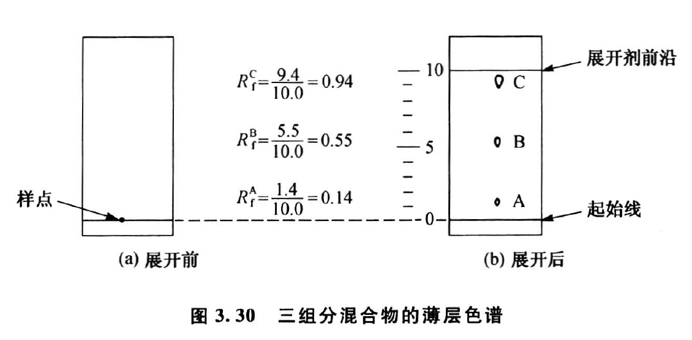

### (二)操作方法

**1.薄层板的制法**

薄层色谱常用的吸附剂是硅胶或氧化铝，常用的粘合剂是煅石膏、羧甲基纤维素钠等。

硅胶是无定形多孔性物质，略具酸性，适用于酸性物质的分离和分析。薄层色谱用的硅胶分为“硅胶 H”——不含粘合剂；“硅胶 G”——含煅石膏粘合剂；“硅胶 HF254”——————含荧光物质，可于波长254nm 紫外光下观察荧光；“硅胶 GF254”————既含煅石膏，又含荧光剂等类型。

与硅胶相似，氧化铝也因含粘合剂或荧光剂而分为氧化铝 G、氧化铝 GF254及氧化铝 HF254。

粘合剂除上述的煅石膏(2CaSO₄•H₂O)外，还可用淀粉、羧甲基纤维素钠。通常又将薄层板按加粘合剂和不加粘合剂分为两种，加粘合剂的薄层板称为硬板，不加粘合剂的称为软板。

**氧化铝的极性比硅胶大**，比较适用于分离**极性较小**的化合物(烃、醚、醛、酮、卤代烃等)。由于极性化合物能被氧化铝较强烈地吸附，分离较差，$R_f$较小；相反，硅胶适用于分离**极性较大**的化合物(羧酸、醇､胺等)，而非极性化合物在硅胶板上吸附较弱，分离较差，$R_f$较大。

薄层板分为“干板”与“湿板”。干板在涂层时不加水，一般用氧化铝作吸附剂时使用。这里主要介绍湿板。湿板的制法有以下几种： (1)涂布法：利用涂布器铺板。 (2)浸法：把两块干净玻璃片背靠背贴紧，浸入吸附剂与溶剂调制的浆液中，取出后分开，晾干。 (3)平铺法：把吸附剂与溶剂调制的浆液倒在玻璃片上，用手轻轻振动至平。

平铺法较为简便，本实验采用此法。取5g硅胶GF254与13 mL 0.5%~ 1%的羧甲基纤维素钠水溶液，在烧杯中调匀，铺在清洁干燥的玻璃片上，大约可铺10 cm × 4cm玻璃片8~ 10块，薄层的厚度约0.25mm。室温晾干后，在110℃烘箱内活化 0.5h，取出放冷后即可使用。

**2.点样**

将样品用低沸点溶剂配成1%~ 5%的溶液，用内径小于1mm 的毛细管点样(图3.31)。点样前，先用铅笔在薄层板上距一端1cm处轻轻划一横线作为起始线，然后用毛细管吸取样品，在起始线上小心点样，斑点直径不超过2mm；如果需要重复点样，**应待前一次点样的溶剂挥发后，方可重复再点**，以防止样点过大，造成拖尾、扩散等现象，影响分离效果。若在同一板上点两个样，样点间距应在1~ 1.5 cm为宜。待样点干燥后，方可进行展开。

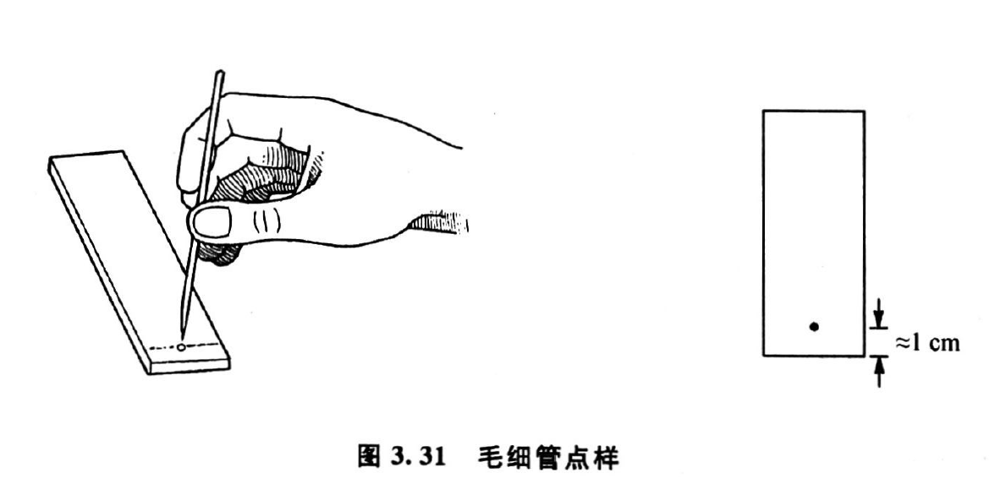

**3.展开**

薄层展开要在**密闭**的器皿中进行(图3.32)，如广口瓶或带有橡皮塞的锥形瓶都可作为展开器。加入展开剂的高度为0.5~ 1.0cm，可在展开器中**放一张滤纸**，以使器皿内的蒸气很快地达到气液平衡，待滤纸被展开剂饱和以后，把带有样点的板(样点一端向下)放入展开器内，并与器皿成一定的角度，同时使展开剂的水平线在样点以下，盖上盖子。当展开剂上升到接近板的顶部时取出，并**立即用铅笔标出展开剂的前沿位置**，待展开剂干燥后，在紫外灯下观察斑点的位置。

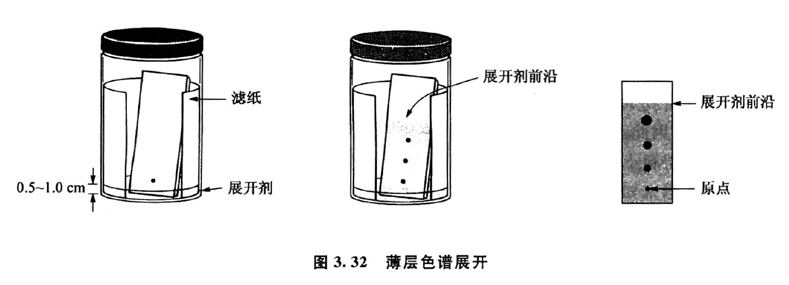

**4.显色**

被分离的样品本身有颜色，薄层展开后，即可直接观察到斑点。若样品无颜色，则需要进行显色。

紫外灯显色硅胶GF254、硅胶 HF254是在硅胶中加入了0.5%的荧光粉，这样的荧光薄层在紫外灯下，薄层本身显荧光，样品斑点成暗点。如果样品本身具有荧光，经层析后可直接在紫外灯下观察斑点位置。

显色剂显色使用一般吸附剂，在样品本身无色的情况下需使用显色剂。

几种通用性的显色剂：

**(1)碘**

• 0.5%碘的氯仿溶液：热溶液喷雾在薄板上，当过量碘挥发后，再喷1%的淀粉溶液，出现蓝色斑点。 • 碘蒸气：将少许碘结晶放入密闭容器中，容器内为碘蒸气饱和，将薄板放入容器后几分钟即显色，大多数化合物呈黄棕色。还可在容器内放一小杯水，增加湿度，提高显色灵敏度。这种方法是基于有机物可与碘形成**分子络合物(烷和卤代烷除外)**而带有颜色。板在空气中放置一段时间，由于碘升华，斑点即消失。

**(2)硫酸** • 浓硫酸与甲醇等体积小心混合后冷却备用； • 15%浓硫酸正丁醇溶液； • 5%浓硫酸乙酸酐溶液； • 5%浓硫酸乙醇溶液； • 浓硫酸与乙酸等体积混合。

使用以上任一硫酸试液喷雾后，空气干燥15min，于110℃加热至显色，大多数化合物炭化呈黑色，胆甾醇及其脂类有特殊颜色。

**(3)磷钼酸**

5%~ 10%磷钼酸乙醇溶液，薄板展开后吹干展开剂，于显色剂中沾湿或喷壶喷匀，热枪吹热至显色清晰。

**5.利用薄层色谱进行化合物的鉴定**

当实验条件严格控制时，每种化合物在选定的固定相和流动相体系中有特定的$R_f$，把不同的化合物$R_f$数据积累起来，可以供鉴定化合物使用。但是，在实际工作中，$R_f$的重复性较差，因此不能孤立地用比较$R_f$来进行鉴定。然而当未知物与已知结构的化合物在同一薄层板上，用几种不同的展开剂展开都有相同的$R_f$时，那么未知物很可能与已知物相同。当未知物的鉴定被限定到只是几个已知物中的一个时，利用TLC就可以确定。为了比较未知物与已知物，将它们在同一块薄层板上点样，在适合于分离已知物的展开剂中展开，通过比较$R_f$即可确定未知物，如图3.33(a)所示。进一步的方法，是将未知物与已知物(标准样)在同一薄层板上同一位置点样成“混合点”，两边再分别点上未知样和标准样，展开后通过点型、显色强弱比较是否均具有很好的一致性，这样得出的结论更为可靠。

TLC 也可以用于监测某些化学反应进行的情况，以寻找出该反应的最佳反应时间和达到的最高反应产率。反应进行一段时间[图3.33(b)中所示1h和2h]后，将反应混合物和产物的样点分别点在同一块薄层板上，展开后观察反应混合物斑点体积不断减小和产物斑点体积逐步增加，了解反应进行的情况。

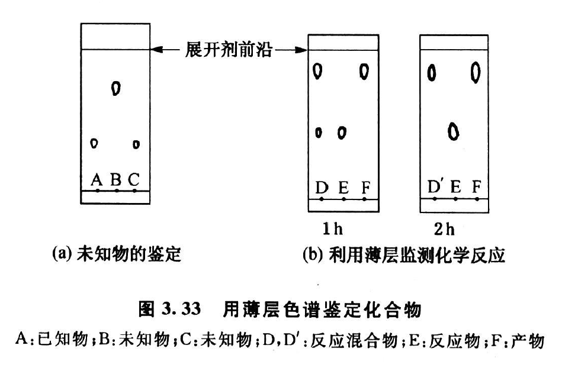

**6.记录**

薄板层析的记录，应该包括薄板种类、展开剂组成情况，并将展开后的薄板情况画出图示：标明点样线(展开起始线)、溶剂展开前沿，通过显色能够观察到的薄板上所有样点情况、样点的图示应该与实际观察到的点的大小和形状一致；因为各类化合物的性质差别，显色强弱与斑点大小并不都能反映含量多少，因此需要特别注意不要遗漏显色较弱的斑点。计算$R_f$值时应以斑点的中心位置量取距离。

### (三)附注

**1.吸附剂和载体的性质与选择**

不论是薄层色谱对吸附剂的要求还是分配色谱对载体的要求，首先必须满足以下条件：

(1)**比表面积大，颗粒均匀，使用中不碎裂**。 (2)在所用的溶剂和展开剂中**不能溶解**，且不与被测样品组分发生化学反应或分解等作用。

薄层色谱对吸附剂的特殊要求是：具有可逆的吸附性，既能吸附样品的组分，又易于解吸，对各组分有不同的吸附性。

分配色谱对载体的特殊要求是：对固定液是惰性的，对样品各组分无吸附性或极弱吸附性。

样品组分的性质如溶解度(水溶性或脂溶性)、酸碱性、极性(分子所带基团性质)等是决定选用吸附剂、载体的首要条件。

实验证明，无论是水溶性的糖、氨基酸，还是脂溶性的生物碱、甾类化合物、芳香油、萜类，都可在吸附薄层上分离。任何类型化合物首先考虑试用硅胶和氧化铝。如果水溶性的化合物在吸附薄层上分离差，可考虑试用纤维素或硅藻土分配薄层。

硅胶是常用的吸附剂，在硅酸钠的水溶液中加入盐酸得到的胶状沉淀是SiO₂•xH₂O缩水硅胶，由于脱水形成多孔性硅胶。层析用硅胶比表面积约为500m²/g，孔体 积为0.4 mL/g，平均孔径为100nm。其表面具有硅醇结构。

硅胶可与极性或不饱和化合物形成氢键而发生吸附。硅胶的吸附能力与其含水量有关，**含水量大，硅胶中大部分羟基与水分子以氢键结合，减少了对样品组分分子的吸附**。

硅胶略有酸性，在分离碱性物质样品时，往往会发生斑点拖尾或在原点不动。此时可在**制备薄层时加入稀碱溶液使其变性，或用碱性展开剂**。

氧化铝由明矾[KAl(SO₄)₂•12H₂O]及氢氧化钠(或碳酸钠)制备，常残留碱性物质而略带碱性。氧化铝是活性大、吸附力强的极性化合物，通常可用1%的盐酸浸泡后，用蒸馏水洗至氧化铝悬浮液的pH为4时是酸性氧化铝，适用于分离酸性物质，例如羧酸、氨基酸等；中性氧化铝的pH约为7.5，用于分离中性物质；碱性氧化铝的pH为10，用于分离胺或其他碱性化合物。吸附能力取决于吸附剂与分离样品之间的作用力，非极性化合物与氧化铝之间靠诱导力，作用力弱；极性物质与氧化铝的作用力有偶极-偶极作用力(静电力)、氢键作用力、配位作用力及成盐作用力。这些类型作用力以如下次序递降：

**成盐作用力>配位作用力>氢键作用力>偶极-偶极作用力>诱导力**

化合物的极性愈强，与吸附剂的作用力愈大，吸附性也愈强。以上作用力和规律同样存在于硅胶中。当一些化合物使用硅胶与氧化铝薄层效果不好时，可选用硅酸镁、糖、淀粉等极性弱的吸附剂。

所谓“活化吸附剂”，均指将吸附剂在一定温度下烘烤，除去吸附的水。活化温度一般随吸附剂的不同而不同。

**2.展开剂的选择**

除以上因素外，薄层色谱分离成败更重要的是如何选择合适的展开剂。这一问题的解决在很大程度上还要依赖于实验，一些原则和规律仅供参考。

选择展开剂时，首先要考虑展开剂的极性以及对被分离化合物的溶解度。在同一种吸附剂薄层上，通常是展开剂的极性大，对化合物的洗脫能力也大，$R_f$也就大。

一般情况下，介电常数大则表示溶剂极性大。单一溶剂极性的递增顺序加下：

**石油醚<正己烷<环己烷<四氯化碳<苯<甲苯<氯仿<二氯甲烷<乙醚<乙酸乙酯<吡啶<异丙醇<丙酮<乙醇<甲醇<水**

通常在各类文献资料中所列各类溶剂极性大小的排列次序，有时会随着不同作者所选用的溶剂纯度的不同(含水及杂质)而导致极性大小的顺序有差异。

使用单一溶剂作为展开剂，溶剂组分简单，分离重现性好。而对于混合溶剂，二元、三元甚至多元展开剂，一般**占比例较大的主要溶剂起溶解和基本分离作用；占比例较小的溶剂起调整、改善分离物的$R_f$和对某些组分的选择作用**。主要溶剂应选择使用不易形成氢键的溶剂，或选择极性比分离物低的溶剂，以避免$R_f$过大。

多元溶剂展开剂首先要求**溶剂互溶**，被分离物应能溶解于其中。极性大的溶剂易洗脱化合物并使其在薄板上移动；极性小的溶剂降低极性大溶剂的洗脫能力，使$R_f$减小；中等极性的溶剂往往起着极性相差较大溶剂的**混溶作用**。有时在展开剂中**加入少量酸、碱，可以使某些极性物质的斑点集中，提高分离度**。当需要在粘度较大的溶剂中展开时，则需在其中加入降低展开剂粘度、加快展开速率的溶剂。在环己烷-丙酮-二乙胺-水(10：5：2：5)的展开剂系统中，水的极性最大，环己烷最小。加入环己烷，是为了降低分离物的$R_f$；丙酮，则起着混溶和降低展开剂粘度的作用；比例最少的乙二胺是为了控制展开剂的pH，使分离的斑点不拖尾，分离清晰。

由实验确定某一被分离物需用混合溶剂为展开剂时，往往是选用一个极性强的溶剂和一个极性弱的溶剂并按不同比例调配。具体操作是：在非极性溶剂中加入少量极性溶剂，极性由弱到强，比例由小到大，以求得到适合的比例。

当样品中含有羰基时，在非极性溶剂中加入少量丙酮；当样品中含有羟基时，于非极性溶剂中加入少量甲醇、乙醇等；当含有羧基酸性样品时，可加入少量的甲酸、乙酸；当含有氨基的碱性样品时，可加入少量六氢吡啶、三乙胺、氨水等。总之，**加入的溶剂应与被测物的官能团相似**。

下表按化合物的酸碱性列出几种常选用的展开剂体系：

| 化合物酸碱性 | 展开剂体系 |
| --- | --- |
| 中性体系 | (1)氯仿-甲醇(100：1)，(10：1)或(2：1) (2)石油醚-乙醚(2：1) (3)石油醚-丙酮(4：1) (4)**石油醚-乙酸乙酯**(3：1) (5)乙酸乙酯-异丙醇(3：1) |
| 酸性体系 | 氯仿-甲醇-乙酸(100：10：1) |
| 碱性体系 | 氯仿-甲醇-浓氨水(100：10：1) |

展开剂的极性大小对混合物的分离有较大的影响。如果展开剂的极性远远大于混合物中各组分的极性，那么展开剂将代替各个组分而被吸附剂吸附，这样各个组分将几乎完全留在流动相里，各个组分则具有较高的$R_f$；反之，如果展开剂的极性大大低于各个组分的极性，那么，各个组分将被吸附于吸附剂上，而不能被展开剂所迁移，即$R_f$为零。一般来说，**溶剂的展开能力与溶剂的极性成比例**。根据列出的常用溶剂的极性次序，有些混合物使用单一的展开剂就可以分开；但更多是需要采用混合展开剂才能加以分离，混合展开剂的极性介于单一溶剂的极性之间。

**3.化学结构差异引起的吸附差异**

(1)饱和烃极性弱，不能与吸附剂形成氢键，所以它的吸附力是最小的。 (2)在饱和烃上引入某些官能团，例如：─NO₂、─CO₂R、─CHO、─OH、─CO₂H、─NH₂等时，常常出现显著的氢键作用力使吸附力增大。 (3)对于简单化合物，如一个烷基和一个官能团组成的有机化合物，吸附能力按如下次序递降：

**─CO₂H > ─OH > ─CO、─COH > ─CO₂R > C=C > R─R'**

(4)对于形成氢键的化合物，能**形成分子内氢键的化合物不易被吸附**，例如：

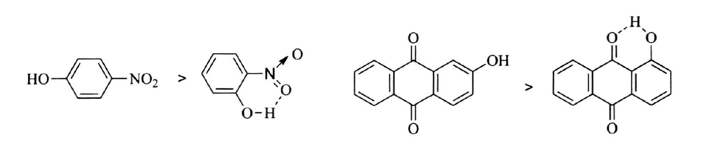

(5)相对分子质量比较大的化合物中引入一个极性基团，比相对分子质量小的化合物中引入一个极性基团对其分子的吸附能力产生的影响要小。 (6)碳链长短对吸附能力的影响。以 CH₃COR 为例，当R链增长时，吸附能力降低(其中也有例外，当R=C₁₄时吸附能力升高)。 (7)双键增加时，吸附能力增大；双键共轭程度增高时，吸附能力加强。芳烃化合物中，双键数目增多，吸附能力加强，例如：

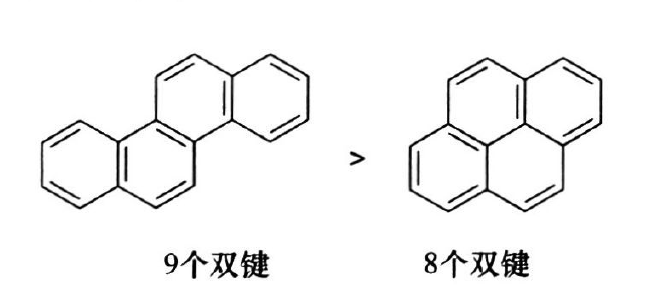

9个双键 8个双键

(8)在氧化铝薄层上线性分子比角形分子的吸附力强，在硅胶上没有观察到这一规律。

以上仅就简单化合物而言。对于复杂化合物，情况比较复杂。分子内含多羟基比含一个羟基的吸附能力强，但如果分子中含多种基团，其吸附情况则要根据实验而定。

上述内容可对一般化合物极性大小与吸附能力的关系得出以下结论：化合物极性愈大，被硅胶和氧化铝吸附愈强。

各类化合物极性顺序大致如下：

**饱和烃<不饱和烃<醚<酯<醛<酮<胺<羟基化合物<羧酸和碱**

在使用中如某些化合物在硅胶和氧化铝薄层上吸附太强，可考虑换用吸附性较弱的硅酸镁或改用分配色谱法。

**4.分配薄层色谱**

分配薄层色谱是根据化合物在两种不互溶(或微溶)的溶剂中的溶解度或分配不同这一性质进行的。在一定温度下，可以近似地把有机物在两溶剂中的溶解度之比，称为“分配系数”。

分配色谱是使混合物中的组分在移动着的溶剂与固定着的溶剂之间进行分配。前者称为**移动相**，后者称为**固定相**。为使固定相溶剂固定下来，需要固体吸附着，这固体称为载体或支持剂，常用**硅藻土和纤维素**。纤维素是由大量的纤维二糖通过β-1，4-苷键连接的，由于有许多羟基，所以具有亲水性。一分子水与纤维素的两个羟基结合，称为“纤维素-H₂O络合物”。这种固定相可以看成是多糖浓溶液，即使使用与水相混溶的溶剂时，仍然形成类似不混溶的两相。

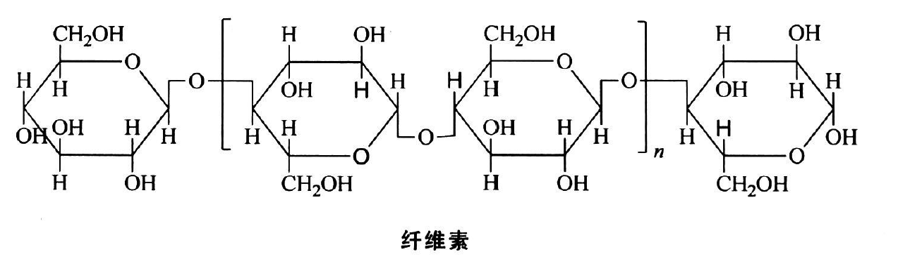

当在有机溶剂中进行层析时，原点上的溶质就在纤维素的水相和有机相间进行分配。有一部分溶质离开原点进入有机相中，并随着它向前移动，当进入无溶质的薄层区时，在两相间又重新进行分配，一部分溶质不断向前移动，同时不断重复分配。**有机溶质在薄层上移动的快慢取决于其在两相间的分配系数**：极性化合物在水中溶解度大些，分配在固相中多些，移动较慢；非极性化合物容易溶解于有机相中，移动较快，因此得以分离。

**5.溶剂的一些性质**

实验室中各类溶剂的应用非常广泛，如：在化学反应中为反应物间保持最大的接触面，促使反应发生；可改变溶剂的用量以调节反应速率，甚至影响反应最终结果；稀溶液能减少单位时间、单位体积内反应物分子相互作用的机会；应用不同溶剂分离和精制产品等。因此，进行化学反应或进行分离操作时，对溶剂的性质要有充分的认识。

迄今为止，选择溶剂主要依据经验规律，一般选择化学性质与物质相似的惰性溶剂，例如，碳氢化合物易溶于碳氢化合物中，羟基化合物易溶于乙醇中，羰基化合物易溶于丙酮中。但是，除此之外的许多因素的影响也不可忽视，如各官能团之间的相互作用、官能团的数目、相对分子质量的大小及分子的形成。溶剂的极性在很大程度上取决于**介电常数**，这一常数**随温度的升高而显著降低**。表3.10列出常用溶剂在20℃时的介电常数。

**表3.10 常用溶剂的介电常数**

| 溶剂  | $\epsilon$ | 溶剂  | $\epsilon$ |
| --- | --- | --- | --- |
| 水   | 81.5 | 二氯乙烷 | 10.4 |
| 甘油  | 56.0 | 二氯甲烷 | 8.90 |
| 二甲亚砜(DMSO) | 47.0 | 醋酸  | 7.10 |
| 乙二醇 | 37.7 | 乙酸乙酯 | 6.02(25℃) |
| 二甲基甲酰胺(DMF) | 36.7 | 氯仿  | 4.70 |
| 乙腈  | 36.2 | 乙醚  | 4.34 |
| 甲醇  | 33.6 | 二硫化碳 | 2.64 |
| 乙醇(无水) | 25.8 | 甲苯  | 2.38 |
| 正丙醇 | 20.1 | 苯   | 2.29 |
| 丙酮  | 20.7(25℃) | 四氯化碳 | 2.24 |
| 异丙醇 | 18.3 | 环己烷 | 2.02 |
| 甲乙酮 | 18.5 | 正己烷 | 1.89 |
| 正丁醇 | 17.8 | 石油醚 | 1.80 |
| 吡啶  | 12.3(25℃) |     |     |

在许多情况下结构因素更重要，如：氯苯的介电常数为11，难溶于水；乙醚的介电常数为4.3，20℃时溶解在水中的质量分数为6.6%，这与醚分子內氧原子和水形成不稳定氢键的程度有关；1，4-二氧六环，由于氧原子突出在环外，更容易与水形成氢键而完全互溶。表3.11列出部分常用溶剂在水中的溶解度。

**表3.11 常用有机溶剂溶解在水中的质量分数$w$**

| 溶剂  | t/°C | w(溶剂/水)/(%) | 溶剂  | t/°C | w(溶剂/水)/(%) |
| --- | --- | --- | --- | --- | --- |
| 正庚烷 | 15.5 | 0.005 | 硝基苯 | 15  | 0.180 |
| 二甲苯 | 20  | 0.011 | 氯仿  | 20  | 0.810 |
| 正己烷 | 15.5 | 0.014 | 二氯乙烷 | 15  | 0.860 |
| 甲苯  | 16  | 0.048 | 二氯甲烷 | 20  | 2.000 |
| 四氯化碳 | 15  | 0.077 | 正丁醇 | 20  | 7.810 |
| 乙酸异戊酯 | 20  | 0.170 | 乙醚  | 15  | 7.830 |
| 苯   | 20  | 0.175 | 乙酸乙酯 | 15  | 8.300 |

有机化合物在水中的溶解度，有一些经验规律，例如：

(1)共价有机化合物中，含有氮、氧、硫等官能团时，由于一般能与水形成氢键，在水中有一定的溶解度。当分子中含1个官能团，碳原子数大于5时，在水中的溶解度很低；当含2个以上的官能团时，特别是含有氨基与羟基时，即使含有5个以上的碳原子，其在水中的溶解度也会较大，例如多羟基类化合物、糖类等。

(2)离子型化合物易溶于水是由于**极性和溶剂化**作用，例如有机酸的碱金属盐，有机碱的盐酸或硫酸盐，以内盐形式存在的氨基酸等。

在溶剂中要通入气态物质时，气体在液体中的溶解度一般随温度的升高而降低，随压力降低而降低。要除去溶于液体中的气体，通常通过加热和置于真空内。气体易溶于极性小的有机溶剂中，而在水中溶解度较小，如CO₂在99%乙醇中的溶解度要较水中大3倍。若以表3.12中一些气体在水中的溶解度为1.0，可列出这些气体在苯与水中的溶解度之比。

**表3.12 某些气体在苯中与水中溶解度之比**

| 气体  | SO2 | CO2 | H2  | N2  | CO  | O2  |
| --- | --- | --- | --- | --- | --- | --- |
| 在苯中与水中溶解度之比 | 2   | 13  | 17  | 33  | 34  | 48  |

氨与氯化氢是反应常用气体，与表3.12所列气体不同，在水中的溶解度大于极性小的有机溶剂(表3.13)。

**表3.13 20℃时氨与氯化氢溶解在一些溶剂中的质量分数$w$**

| 气体  | w/(%) 甲醇 | w/(%) 乙醇 | w/(%) 乙醚 | w/(%) 苯 | w/(%) 四氯化碳 |
| --- | --- | --- | --- | --- | --- |
| NH3 | 19.2 | 10.7 | 1.0 | 1.0 |     |
| HCl | 47.0 | 41.0 | 24.9 | 1.7 | 0.6 |

## 3.10 柱色谱

常用的柱色谱有吸附柱色谱和分配柱色谱两类，前者常用氧化铝和硅胶作固定相，后者以硅胶、纤维素等为支持剂，以其吸收较大量的液体作为固定相，这里支持剂本身不起分离作用。

### (一)原理

柱色谱**分为“干柱”色谱和“湿柱”色谱**两种。干柱色谱可与薄层色谱类比，薄层色谱的分离条件，也可以套用到干柱色谱上来。它既有薄层色谱快速的特点，又具有柱层析分离量大之优点。

干柱色谱是将一空柱用吸附剂填满，将要分离的混合物放在柱顶，使溶剂借毛细作用和地心引力向下移动而将色谱展开。展开完毕，将吸附剂从柱内移出，将已分离的各组分层带用适当溶剂分离出来，分别处理。此法具有耗溶剂少、分离时间短等优点。

湿柱色谱是靠洗脱剂把要分离的各个组分逐个洗脱下来，也称为洗脱色谱。这里主要介绍湿柱色谱。柱色谱(这里指吸附色谱)的原理类似于薄层色谱，欲分离的混合物中的各组分分配在吸附剂和洗脱剂之间，化合物被吸附剂吸附愈强，该化合物溶解在洗脱剂中则愈少，沿洗脱剂移动的距离则愈小。

色谱柱填充的吸附剂的量远远大于薄层板，且柱的大小可以依欲分离的物质的量的多少而选择，因而柱色谱可用于分离比较大量(克数量级)的物质，而薄层色谱分离的量比较小，一般在毫克数量级。图3.34为实验室中常用的色谱柱。

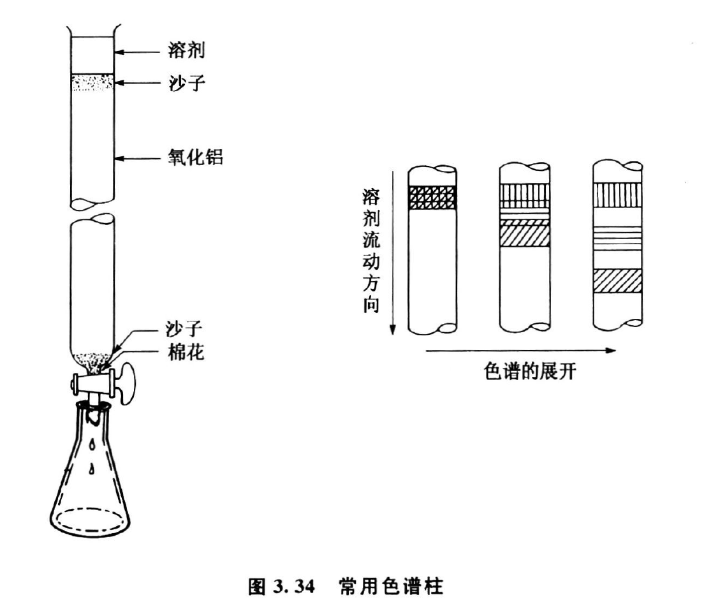

**1.吸附剂**

常用**硅胶和氧化铝**。吸附剂一般经纯化和活性处理，颗粒均匀，吸附剂颗粒越小，表面积越大，吸附能力越高，但溶剂流速越慢。

供柱色谱用的氧化铝有酸性、中性和碱性三种。酸性氧化铝用1%盐酸浸泡后用蒸馏水洗至氧化铝悬浮液的pH为4，用于分离酸性物质；中性氧化铝的pH约为7.5，用于分离中性物质；碱性氧化铝的pH为10，用于分离胺或其他碱性化合物。吸附剂的活化一般是用加热的办法，氧化铝随着表面含水量的不同而分成5个活性等级。

I级氧化铝活性最高，并且很容易失去活性，加入水可以制备其他等级的氧化铝，其活性递降。Ⅰ级氧化铝常用于分离非极性有机化合物，其他等级的氧化铝用于分离极性稍高的有机化合物。硅胶一般用于分离极性的有机化合物。

对酸碱敏感的化合物，常常可以在酸性或碱性吸附剂上发生分解及催化化学反应，例如酯的水解、烯烃的异构化、醛酮的缩合反应等。因此，对于这些化合物的分离，可以在中性的吸附剂上进行色谱分离。

**2.溶质的结构和吸附能力**

化合物的吸附性和它们的极性成正比，化合物分子含有极性较大的基团时吸附性也较强。吸附剂对各种化合物的吸附性一般按以下次序递减:

**酸、碱>醇、胺、硫醇>酯、醛、酮>芳香族化合物>卤化物、醚>烯>饱和烃**

**3.溶剂**

一般根据被分离物中各种成分的极性、溶解度和吸附剂活性等来考虑。先将要分离样品溶于一定体积的溶剂中，**选用的溶剂极性应低，体积要小**。色层的展开**首先使用极性最小的溶剂**，使最容易脱附的组分分离。然后加入不同比例的极性溶剂配成洗脱溶剂，将极性较大的化合物自色谱柱中洗脱下来。常用的洗脱剂的极性按如下次序递增:

**己烷和石油醚<环己烷<甲苯<二氯甲烷<氯仿<乙醚<乙酸乙酯<丙酮<丙醇<乙醇<甲醇<水<吡啶<乙酸**

极性溶剂对于洗脱极性化合物是有效的，非极性溶剂对于洗脱非极性化合物是有效的。若欲分离的混合物组成复杂，单一溶剂往往不能达到有效的分离，通常选用混合溶剂。

使用混合溶剂作为洗脱剂时，其极性按如下次序递增:

**氯仿<环己烷-乙酸乙酯(80:20)<二氯甲烷-乙醚(80:20)<二氯甲烷-乙醚(60:40)<环己烷-乙酸乙酯(20:80)<乙醚<乙醚-甲醇(99:1)<乙酸乙酯<四氢呋喃<正丙醇<乙醇<甲醇**

### (二)操作方法

**1.层析柱填装**

色谱柱的大小，取决于分离物的量和吸附剂的性质，一般的规格是柱的直径为其长度的1/10~ 1/4。实验中常用的色谱柱直径在0.5~ 10cm之间。

装柱要求:吸附剂必须**均匀**地填在柱内，没有气泡、没有裂缝，否则将影响洗脱和分离。通常采用糊状填料法，即把柱竖直固定好，关闭下端活塞，底部用少量脱脂棉或玻璃棉轻轻塞紧(也可加入少量洗净干燥的石英沙层)，然后加入溶剂到柱体积的1/4；用一定量的溶剂和吸附剂在锥形瓶内调成**糊状**，打开柱下端的活塞，让溶剂滴入锥形瓶中，把糊状物快速倒入柱中，吸附剂通过溶剂慢慢下沉，进行均匀填料。也可以将溶剂倒入柱中，打开柱下端的活塞，在**不断敲打柱身**的情况下，填加固体吸附剂。柱填好后，**上面再覆盖0.3 cm 厚的沙层**。注意自始至终不要使柱內的液面降到吸附剂高度以下，否则将会出现气泡或裂缝。柱顶部1/4处一般不填充吸附剂，以便使吸附剂上面始终保持一液层。

**2.样品配制**

把试样溶解在尽可能少量的体积的溶剂中，但应该保证样品溶液具有良好的流动性，不宜过稠过粘。溶剂一般选用洗脱剂或极性低于洗脱剂的溶剂。这是较为常用的**湿法上样**的样品。有时样品在洗脱剂或更低极性溶剂中溶解度太小，需要使用极性更强的溶剂溶解，如直接将该样品溶液加到层析柱中，将严重影响分离效果甚至导致分离完全失败。此时可将样品溶液用适量吸附剂吸附分散后挥发除去其中溶剂(常采用旋蒸法去除，溶剂量很少时也可在通风处放置至溶剂挥发)，之后将干燥的吸附剂-样品加入到层析柱中，即此**干法上样**。

**3.上样**

(1)**湿法上样**:在填装均匀并已平衡好的层析柱中，打开下端活塞，使洗脱剂液面慢慢下降至与吸附剂上表面平齐时，将吸取了样品溶液的滴管贴近吸附剂上表面处，将溶液沿玻璃壁轻轻滴入层析柱中。 (2)**干法上样**:与湿法上样不同，上样前洗脱剂液面要高于吸附剂上表面一段，其高度可根据样品量估算，一般是保证样品加入后溶剂面略高于样品；将样品分若干小份轻轻加入至层析柱中，使样品在溶剂中分散均匀，沉降后表面平整。

**4.展开及洗脱**

样品加入后，打开活塞使层析柱中的溶液慢慢下降至与吸附剂上表面平齐，关闭活塞，用少量洗脱剂洗涤柱壁上所沾试液，放出后再重复如上步骤2~ 3次。小心加入洗脱剂至足量，开始展开和洗脱。由于不同极性的组分在柱中移动的快慢不同，因而混合物中的各个组分在柱上分成不同的色谱带(指有颜色的组分)。逐步洗脱，在层析柱底端用锥形瓶等按份接收。

**5.样品接收和检测**

根据层析柱大小和样品量确定每份适宜的接收体积(几毫升至几十毫升)，通过薄层层析检测洗脱进程和分离效果，至全部组分或所需组分洗脱完毕后停止洗脱。若洗脱速率较慢，可以在层析柱顶部适当加压或在层析柱底部适当减压。

**6.层析柱中溶剂的回收**

柱层析结束后，层析柱中的吸附剂中吸附了相当量的溶剂，应将之回收(可采用在吸附柱顶端加入自来水以将有机溶剂置换出，或用双链球加压赶出有机溶剂，前一方法更为彻底)。

【注意事项】 (1)加入石英沙的目的是**使加料时不致把吸附剂冲起，影响分离效果**。也可用无水硫酸钠、玻璃毛代替。 (2)在层析结束前都应当**保证柱中溶剂不能流干**，否则会使柱身干裂且往往无法复原，以致严重影响分离效果甚至导致层析失败。

## 思考题

### **3.1 重结晶**

-   请查阅安息香、二苯乙二酮的溶解性，结合实验结果说明，若样品中含有溶解度相近的组分时能否通过重结晶有效纯化。
    
-   (1)结晶如带有颜色时(产品本身颜色除外)往往需要加活性炭脱色，加入活性炭时应注意哪些问题？过滤时你遇到什么样的困难？如何克服？
    
-   (2)将母液浓缩冷却后，可以得到另一部分结晶。为什么这部分结晶与第一次得到的结晶相比纯度要差？
    
-   (3)为什么重结晶热溶解时，通常要用比饱和溶液多20%~ 30%的溶剂量？
    
-   (4)用有机溶剂重结晶时，采用什么装置？为什么？
    

### **3.3 简单蒸馏**

-   (1)已知1个大气压(0.1 MPa)下，甲醇的沸点是65℃，水的沸点是100℃。试问哪一种液体在25 ℃、65 ℃、100℃有较高的蒸气压？
    
-   (2)在甲苯的蒸馏中，通常最初几毫升蒸出液呈混浊。这一现象的原因是什么？
    
-   (3)试叙述下列因素对简单蒸馏中测得的沸点的影响:
    
    -   温度控制不好，蒸出速率太快。
        
    -   温度计液球上端在蒸馏头侧管下线的水平线以上或以下。
        

### **3.4 分馏**

-   (1)若加热太快，蒸出液每秒钟的滴数超过一般要求量，用分馏方法分离两种液体的能力会显著下降。这是为什么？
    
-   (2)在分馏装置中分馏柱为什么要尽可能垂直？
    
-   (3)在分离两种沸点相近的液体时，为什么装有填充料的分馏柱比不装填料的效率高？
    

### **3.5 减压蒸馏**

-   (1)在减压蒸馏的操作中，必须先抽真空后加热。原因何在？
    
-   (2)当减压蒸完所要的化合物后，应如何停止减压蒸馏？这是为什么？
    

### **3.6 水蒸气蒸馏**

-   (1)为什么一般进行水蒸气蒸馏时，蒸出液由混浊变澄清后再多蒸出 10~ 20mL的透明蒸出液？如果不这样做，有什么影响？
    
-   (2)如果萘与水在99.3℃时可以进行水蒸气蒸馏，计算在蒸出液中萘与水的质量比。并计算要蒸出4.00g萘，最少需要多少水。
    
-   (3)如何判断在水蒸气蒸馏中，蒸出液中的有机组分在水的上层还是下层？
    

### **3.8 萃取**

-   (1)若用下列溶剂(乙醚、氯仿、己烷、甲苯)萃取水溶液，它们将在上层还是下层？
    
-   (2)此三组分混合物分离实验中，各组分的性质是什么？在萃取过程中发生的变化是什么？
    
-   (3)按以下所提供的数据 $p_{水}^0$=717.5mmHg(95.7 kPa)，$p_{苯胺}^0$=42.4 mmHg(5.65 kPa)，你能否根据以下关系式：

    $$
    V/(RT) = m/(Mp)
    $$

    $$
    m_{水}/(M_{水} p_{水}^0) = m_{苯胺}/(M_{苯胺} p_{苯胺}^0)
    $$

    $$
    m_{水}/m_{苯胺} = M_{水} p_{水}^0/(M_{苯胺} p_{苯胺}^0)
    $$

    计算出水蒸气蒸馏中水/苯胺的比值是多少？
    
-   (4)根据苯甲酸在水中的溶解度，假设热过滤在90℃下，请计算1g苯甲酸重结晶需要的水量是多少(按实际用水量比计算值过量30%计)？苯甲酸析晶温度若为20℃，那么重结晶1g苯甲酸在母液中损失多少克？
    
-   (5)据分离参考方案中所标的1~ 4步，请计算分别所用 4 mol/L HCl、0.5 mol/L碳酸钠、6 mol/L 氢氧化钠的体积(mL)。
    

## 思考题答案

注：答案由AI生成，有些答案不一定正确

### **3.1 重结晶**

-   **溶解度相近组分的纯化：** 不能。因为溶解度相近的物质在冷却析晶时行为相似，会一同析出，无法达到有效分离纯化的目的。
    
-   **(1) 活性炭脱色与过滤：** 注意防暴沸，勿过量。困难是活性炭穿透或堵塞滤纸。应用褶皱滤纸热过滤，或加助滤剂克服。
    
-   **(2) 母液结晶纯度：** 因为母液中可溶性杂质的浓度相对较高，浓缩后结晶时，杂质更易一同析出或被包夹，导致纯度差。
    
-   **(3) 溶剂量过量20%~ 30%：** 为防止热过滤时因溶剂挥发或降温导致溶质过早析出，造成产物损失，并保证难溶杂质完全溶解。
    
-   **(4) 有机溶剂重结晶装置：** 采用回流冷凝装置。因为有机溶剂常具挥发性和可燃性，回流可防止溶剂蒸发损失并保证操作安全。
    

### **3.3 简单蒸馏**

-   **(1) 甲醇与水的蒸气压：** 甲醇。因为甲醇沸点更低，更易挥发，所以在任何相同温度下（25℃、65℃、100℃）蒸气压都比水高。
    
-   **(2) 甲苯初馏液混浊：** 因为甲苯中常含有少量水，水与甲苯形成低沸点共沸物先蒸出，冷凝后因不互溶而形成乳浊液。
    
-   **(3) 影响沸点测定的因素：**
    
    -   速率太快：蒸气过热，未达气液平衡，导致测得的沸点偏高。
        
    -   温度计位置：液球过高，沸点偏低；液球过低，接触过热蒸气，沸点偏高。
        

### **3.4 分馏**

-   **(1) 加热太快对分馏的影响：** 加热太快，气液两相来不及在分馏柱中充分进行热交换和平衡，无法建立有效温度梯度，分离效果变差。
    
-   **(2) 分馏柱保持垂直：** 保证上升的蒸气与下降的冷凝液能均匀、充分地接触，进行有效的气液交换，防止液体“走短路”。
    
-   **(3) 填充料的作用：** 填充料提供了巨大的表面积，增加了气液两相的接触，相当于进行了多次连续的蒸馏，分离效率高。
    

### **3.5 减压蒸馏**

-   **(1) 先抽真空后加热：** 防止液体在压力骤降时发生剧烈暴沸，液体可能冲出蒸馏瓶，甚至导致仪器因内外压差剧变而破裂。
    
-   **(2) 停止减压蒸馏的操作：** 应先停止加热，待体系冷却后，再缓慢放入空气，最后关闭真空源。防止倒吸和热的物质遇空气氧化。
    

### **3.6 水蒸气蒸馏**

-   **(1) 澄清后再多蒸馏：** 确保与水共沸的有机物被完全蒸出，以提高产率。若不这样做，会导致部分产物残留而产率偏低。
    
-   **(2) 萘与水的质量比计算：** 略
    
-   **(3) 判断有机物分层：** 比较有机物与水的密度。若有机物密度大于水（>1g/mL），则在下层；若密度小于水，则在上层。
    

### **3.8 萃取**

-   **(1) 常见萃取剂的分层：** 氯仿密度大于水，在下层。乙醚、己烷、甲苯的密度均小于水，它们将在上层。
    
-   **(2) 三组分分离原理：** 利用酸、碱、中性物质的性质差异。酸性或碱性组分通过与碱或酸反应生成可溶于水的盐而被分离。
    
-   **(3) 水/苯胺比值计算：** 将数据代入公式：m(水)/m(苯胺) = (18.02 × 717.5) / (93.13 × 42.4) ≈ 3.27。比值约为3.27。
    
-   **(4) 苯甲酸重结晶计算：** 略
    
-   **(5) 试剂体积计算：** 略